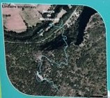
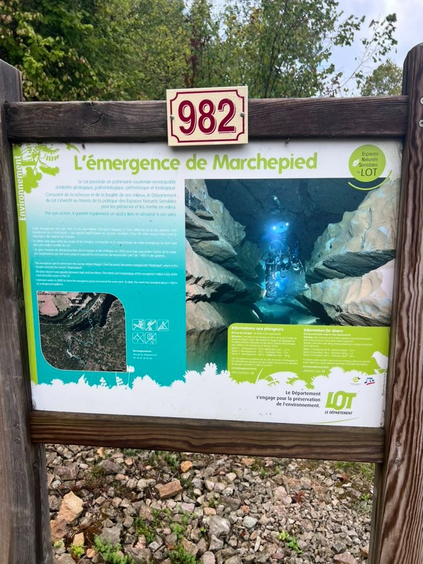

# Details

## Identification

- **Feature type:** Cave

## Cave and exploration data

- **Goes to water:** Yes

## Diving data

- **Water type:** Fresh
- **Tidal:** No

# Maps

- 

# References

- **Facebook:** https://www.facebook.com/marissa0429/posts/pfbid02aJEsSAoSkWFpmY2heJYYH8kBGNmShSrFPQRPr9qBh3xPqYEsodAqF8A9SgoKHcrxl

## Images
- 
- 
