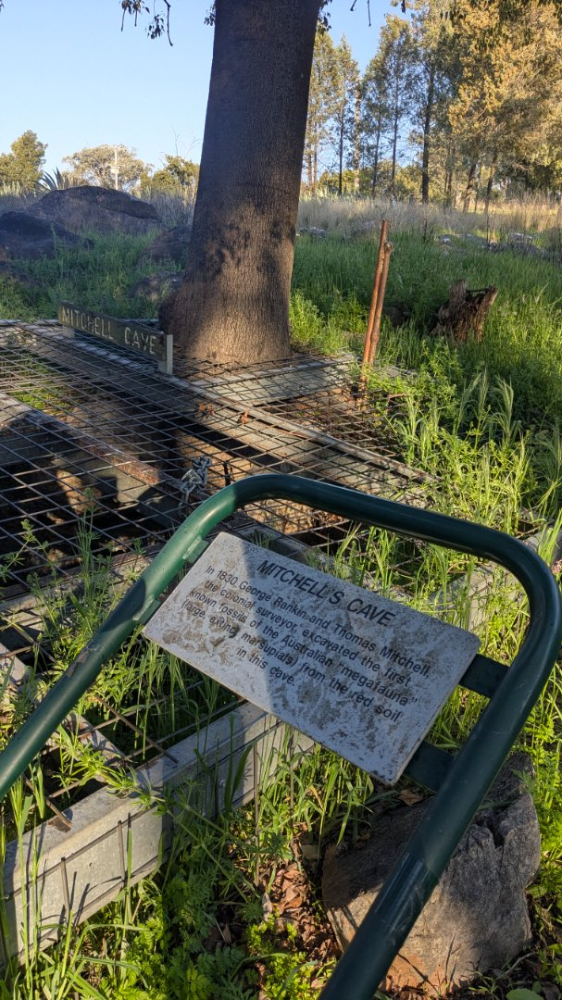
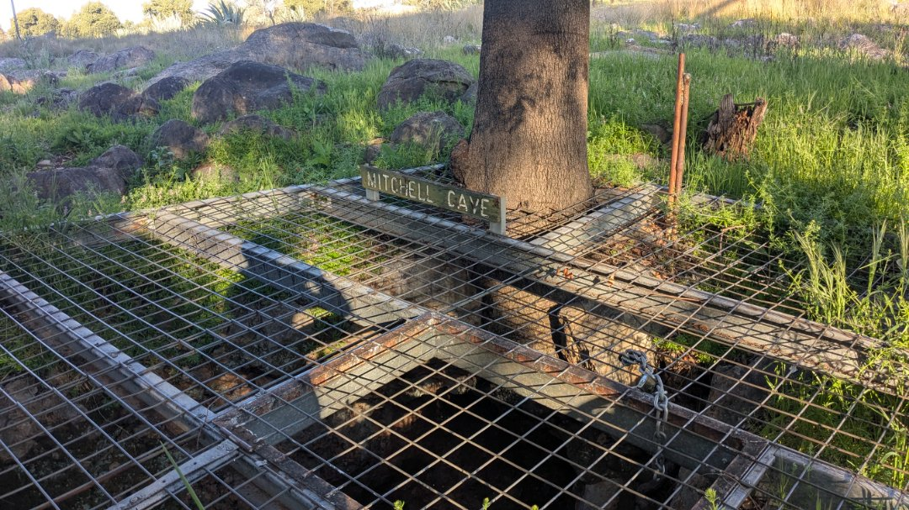
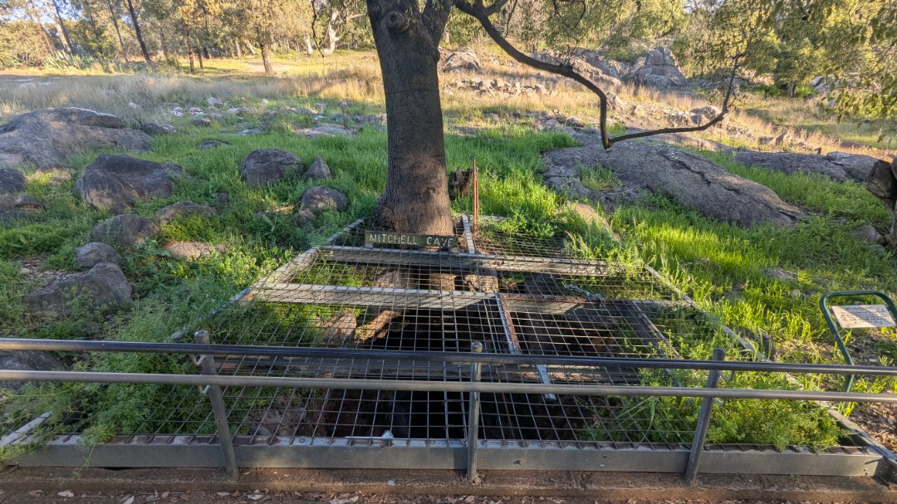

# Details

## Identification

- **Feature type:** Cave

## Cave and exploration data

- **Vertical access:** Yes
- **Tourism potential:** Low

## Amenities

- **hasShowers:** No
- **hasToilets:** No
- **hasPhone:** Yes
- **food:** Bad

# References

## Images
- 
- 
- 
