# About

The first underwater explorations started in 1950’s. In the 70’s and 80’s the divers of the FTSK Delfin dive club successfully explored and charted more than 400 meters of the cave system. They dived regularly this “old part” but in 2002 they found a new passage. The new part was huge, for example they charted a 86 meters long, 15 meters high and 27 meters wide hall. The cave system stretches out to more than 6 kilometres, but there are still plenty to discover in the depth.

# Details

## Identification

- **Feature type:** Cave
- **System name:** Molnár János

## Cave and exploration data

- **Cave rating:** Cave
- **Highest cave rating:** Advanced
- **Vertical access:** No
- **Exploration potential:** Medium
- **Tourism potential:** Low
- **Disabled access potential:** Low
- **Goes to water:** Yes
- **Surveyed length:** 6000 m

## Diving data

- **Water type:** Fresh
- **Tidal:** No
- **Temperature:** 18–27 °C
- **Difficulty:** Hard
- **Entry difficulty:** Easy
- **Entry type:** Shore

## Amenities

- **hasShowers:** Yes
- **hasToilets:** Yes
- **hasPhone:** Yes
- **food:** Outstanding
- **family:** Outstanding
- **parking:** Excellent

# References

- **Facebook:** https://www.facebook.com/fourthelementdive/posts/pfbid02ZnsDp1B5QsprAerkWxvHX9neV8VtCb45QaVa82zfAYN3dXKUZAc2Ct5ooAfkyELUl

Cave system you say? Warm water you say? Who's up for a bit of urban diving?! 🤿
Beneath the streets of central Budapest lies a vast underwater cave system heated by geothermal springs. With access literally hidden behind a curtain (!), 27 °C (80 °F) water in the upper layers, and at least 3.6 miles of passages (with more still unexplored), we reckon this has to be one of the most appealing city breaks out there!
- **CNN Travel:** https://edition.cnn.com/2025/08/18/travel/budapest-diving-molnar-janos-cave

## Images
- 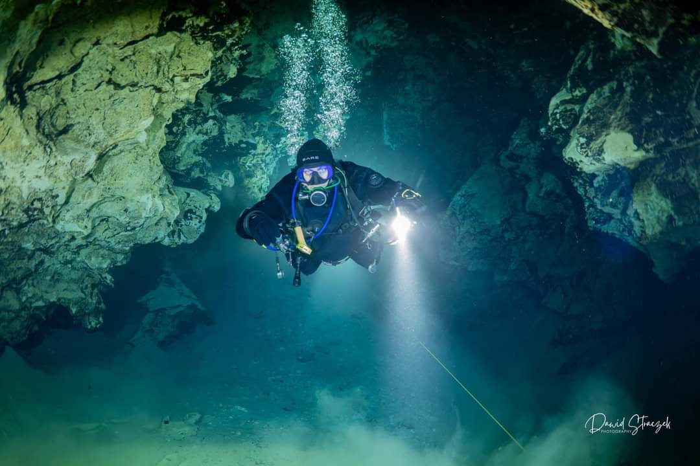
- 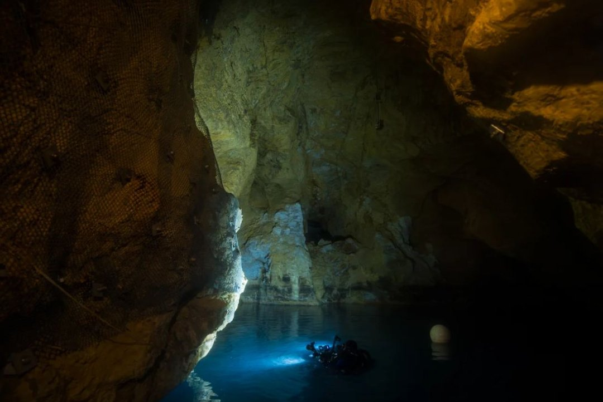
- 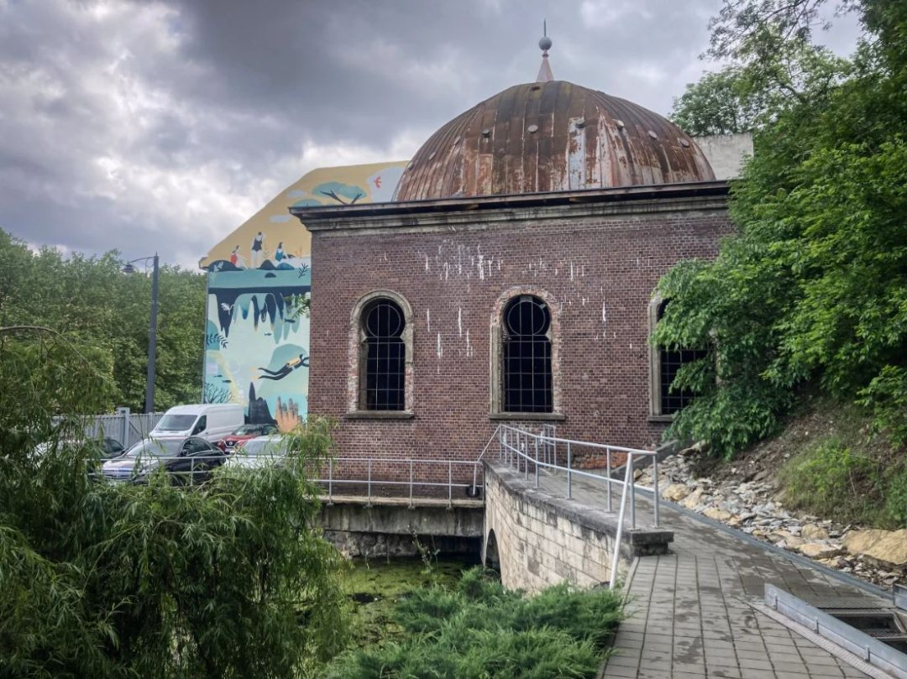
- 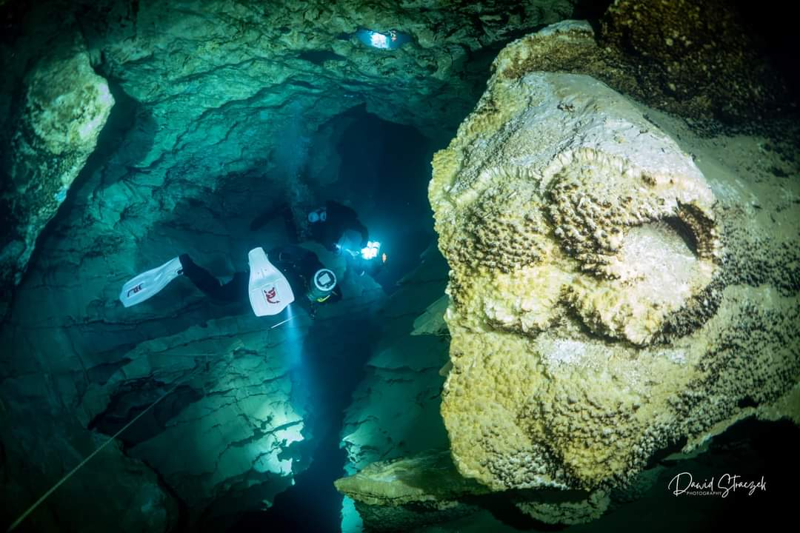
- 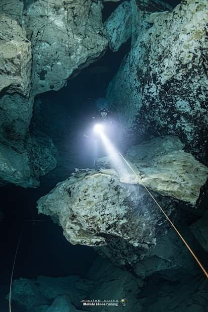
- 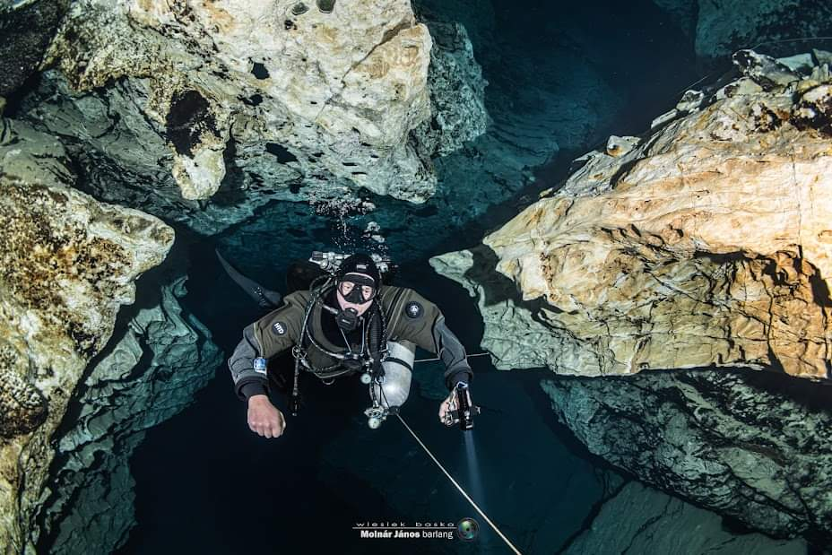
- 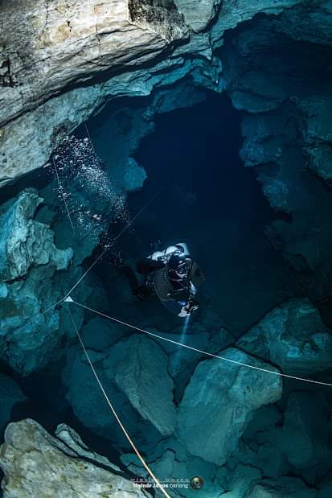
- 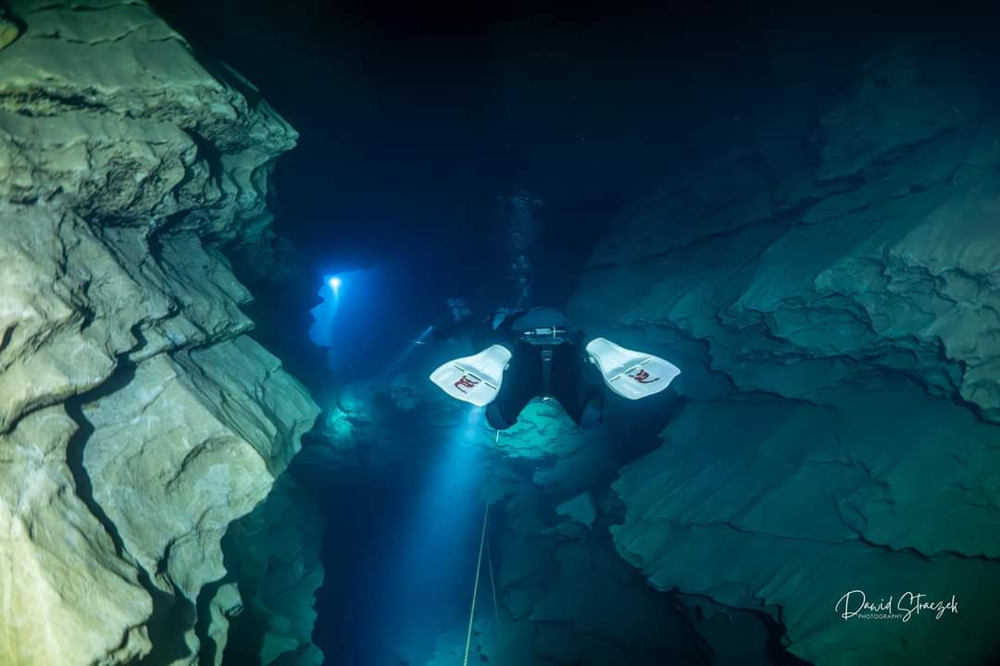
- 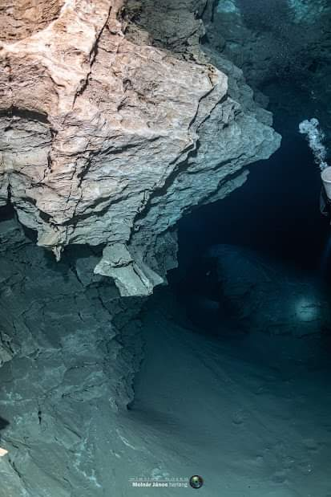
- 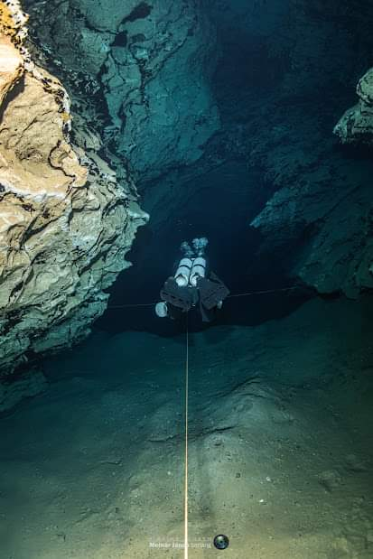
- 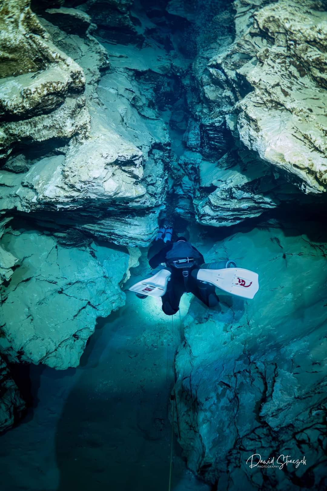
