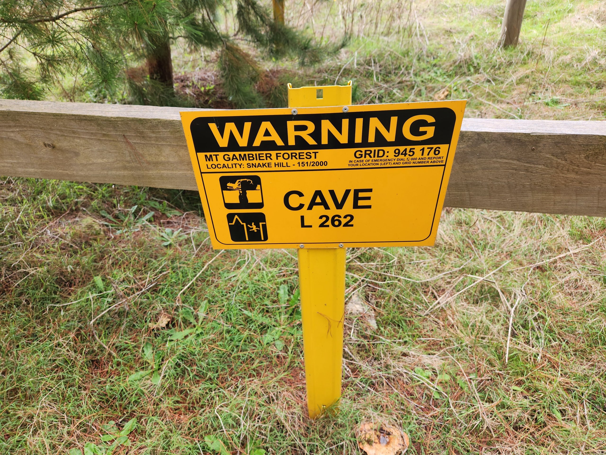

# Details

## Identification

- **Reference:** L0201
- **Source:** Forestry SA

## Cave and exploration data

- **Exploration potential:** High

## Access and warnings

Forestry

# References

- **LSECR:** Page 390
- **Forestry SA:** L0201, Thin Roof: N, Fence: Y. Dimensions: 1m x 2m deep. Features: Decoration & MM Ab = hands/fingers. Remove old  bottles; has new fence

## Images
- 
