# About

Also known as Cocklebiddy 3 Mile Cave, the entrance is a small overhanging doline 20m in diameter. A 20m pitch leads to a loose talus and silt slope which becomes a boulder floored passage after the doline. The passage continues to a small lake at 89m. There are wetas near the entrance of the cave. There was a thylacine carcase found on early trips to the cave. Uphill of the lake leads to further boulder floored chambers with bats. There are 300m of low maze passages beyond the lake, which contains gypsum flowers and needles. The cave breathes in maze section. Beyond the lake underwater, the cave extends into a series of passages and boulder floored chambers with an average depth of 10m. There is a section of silt floor and parts of the cave passages which have a colouration similar to “coffee and cream”. There are three cave passages which have small air chambers. 
## Access 
The cave is close to a vehicle track. It is possible to camp near the cave. A typical trip into the cave would take up to 5 hours. 
## Rigging 
A 20m ladder or SRT is required. Rigging off trees near the entrance is the best option for anchors. 
## Cave Diving 
There are fixed lines in the side passages, these are shown on the map N47-CEG34002, parties will need to use their own reel to reach these fixed lines. It is possible use tripods to lower gear from the high side of the doline to reduce transporting of gear down the steep talus slope. Rigging to a vehicle is the best option for anchoring the tripod from this point.
## Land use 
The cave is on Nuytsland Nature Reserve, and specific permission is required to visit the cave. 
## Mitch's Maze MNemo Survey
[6N47 - Murra-El-Elevyn (Porter, 2024) - MAP with Mitchs Maze MNemo Survey](https://github.com/twosharprocks/Karst-Database/blob/d6f539534154fcd23f60d0a25899bf7ef553f1d8/Assets/4247243be5f8a9005f2fd2dfabb5622e7aa57a4007548c5c6de73a8d00082658.pdf)
[6N47 - Murra-El-Elevyn (Porter, 2024) - MAP with Mitchs Maze MNemo Survey](https://github.com/twosharprocks/Karst-Database/blob/d6f539534154fcd23f60d0a25899bf7ef553f1d8/Assets/4247243be5f8a9005f2fd2dfabb5622e7aa57a4007548c5c6de73a8d00082658.pdf)

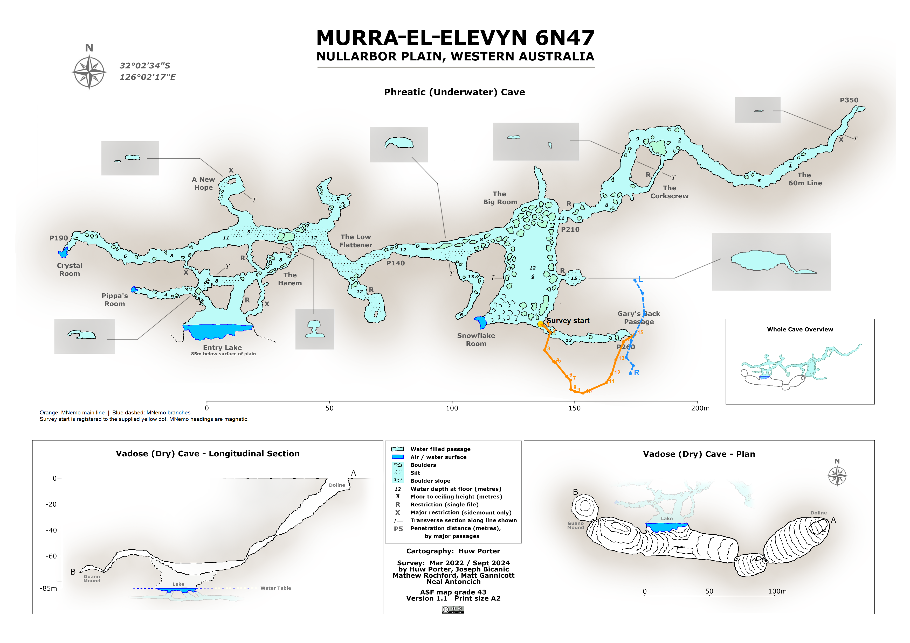

[6N47 - Murra-El-Elevyn - Mitchs Maze MNemo Survey](https://github.com/twosharprocks/Karst-Database/blob/d6f539534154fcd23f60d0a25899bf7ef553f1d8/Assets/2263f2e648728af065c46308c64343bec805320cbbaa21424550770f148b5578.csv)

Caves of the Nullarbor 1967 p6 (N47-CEG30047)
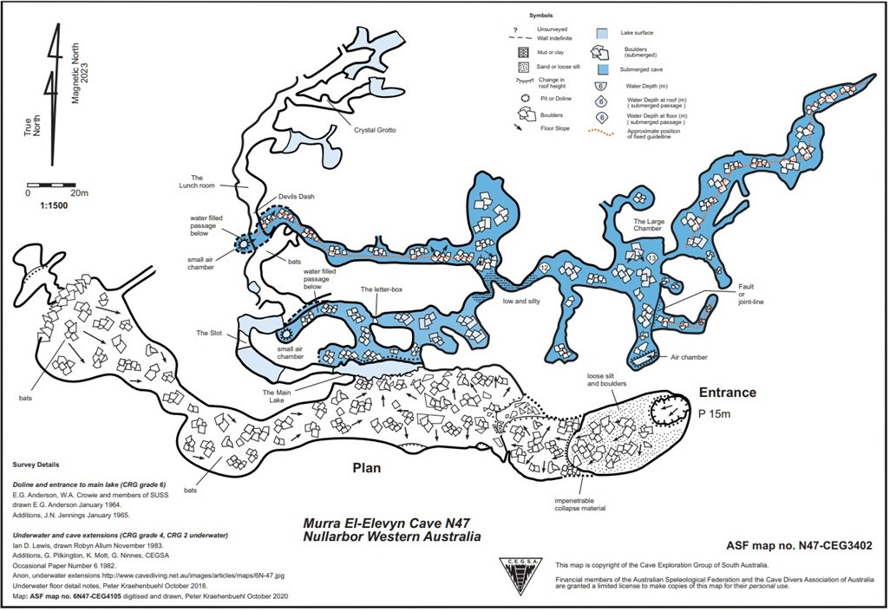

[6N47 - Murra-El-Elevyn (Porter, 2024) (High-Res PDF) - MAP](https://github.com/twosharprocks/Karst-Database/blob/d6f539534154fcd23f60d0a25899bf7ef553f1d8/Regions/Oceania/Australia/6N%20-%20Nullabor%20and%20Roe%20Plains/Maps/6N47%20-%20Murra-El-Elevyn%20%28Porter%2C%202024%29%20%28High-Res%20PDF%29.pdf)
[6N47 - Murra-El-Elevyn (Porter, 2024) (High-Res PDF) - MAP](https://github.com/twosharprocks/Karst-Database/blob/d6f539534154fcd23f60d0a25899bf7ef553f1d8/Regions/Oceania/Australia/6N%20-%20Nullabor%20and%20Roe%20Plains/Maps/6N47%20-%20Murra-El-Elevyn%20%28Porter%2C%202024%29%20%28High-Res%20PDF%29.pdf)

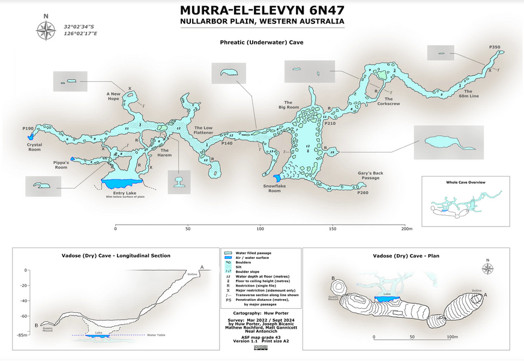

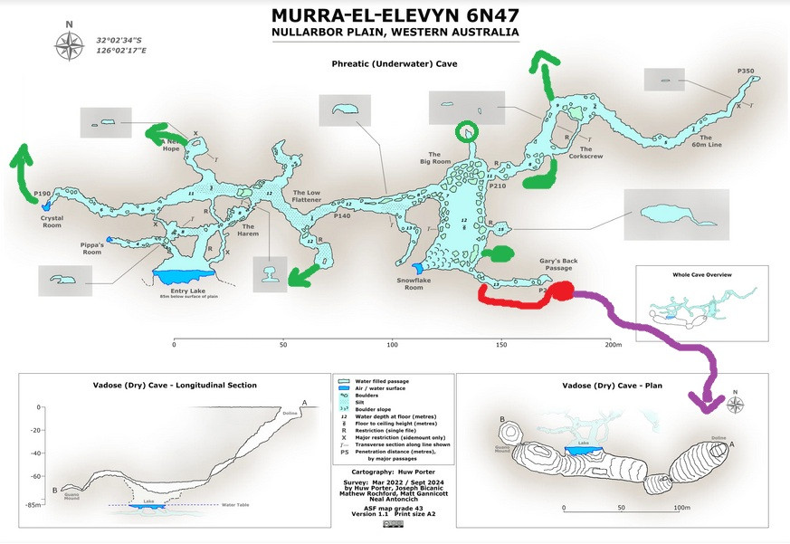
 (Richards)

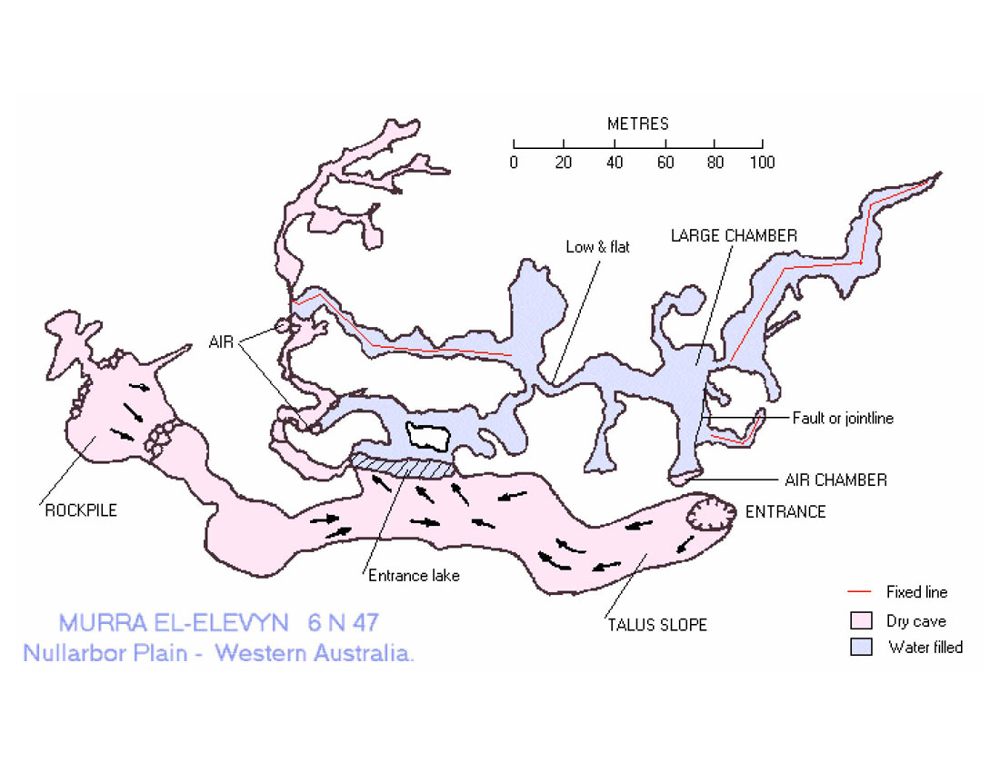

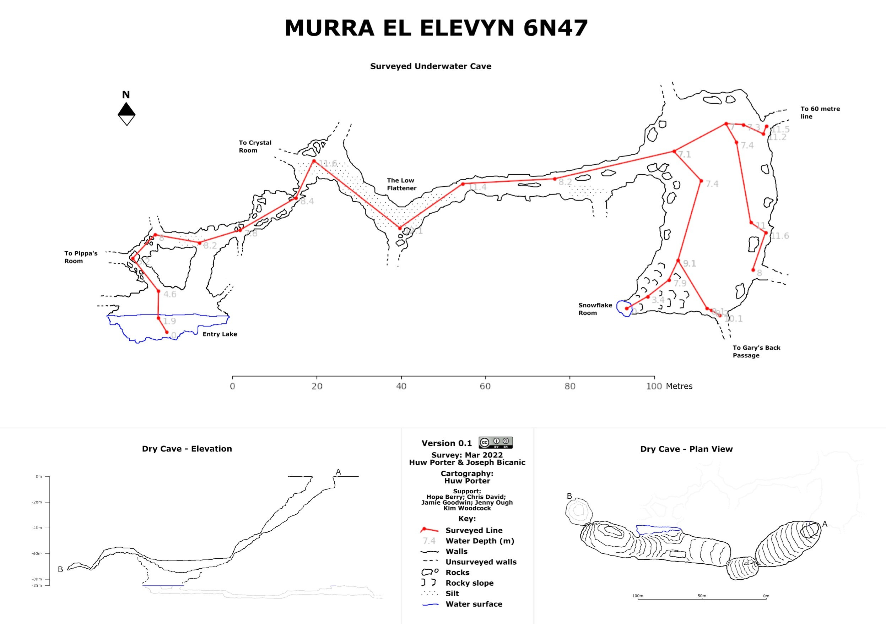

[st1.asflib.net - Joe N. Jennings Slide Box #1011 - Nullarbor - Maps and Sketches](https://st1.asflib.net/MEDIA/ASFJJSlidesCatalogue/Box%201011/JNJ-S-1011-09.html)

# References
[Murra El Elevyn Cave - Google Maps](https://maps.app.goo.gl/k9iPKK1n1RCsXW3H8) 

[Murra El Elevyn (6N47) - cavedivers.com.au](https://www.cavedivers.com.au/index.cfm?action=details&leca=1831&module=BUSINESSDIRECTORY&pageMode=indiv&page_id=1404675&utm_source= "Murra El Elevyn (6N47) - cavedivers.com.au")
- [Source](https://www.cavediving.net.au/index.php/siteinfo/?site=5)

Briefing Docs (Dive Addiction)
- 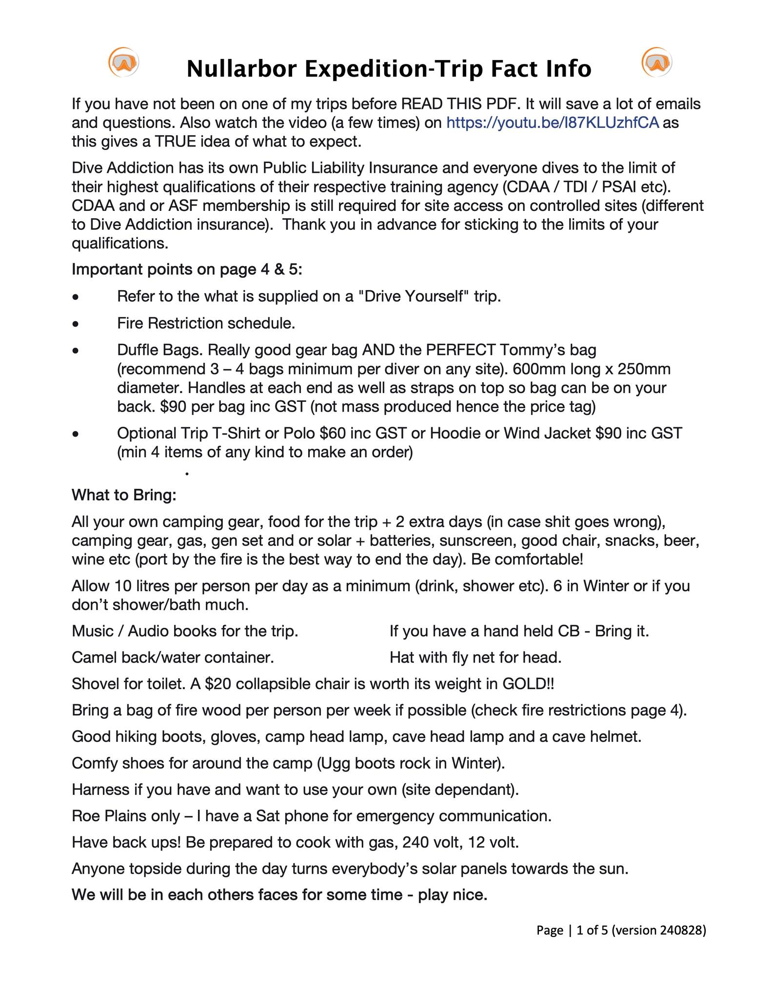
- 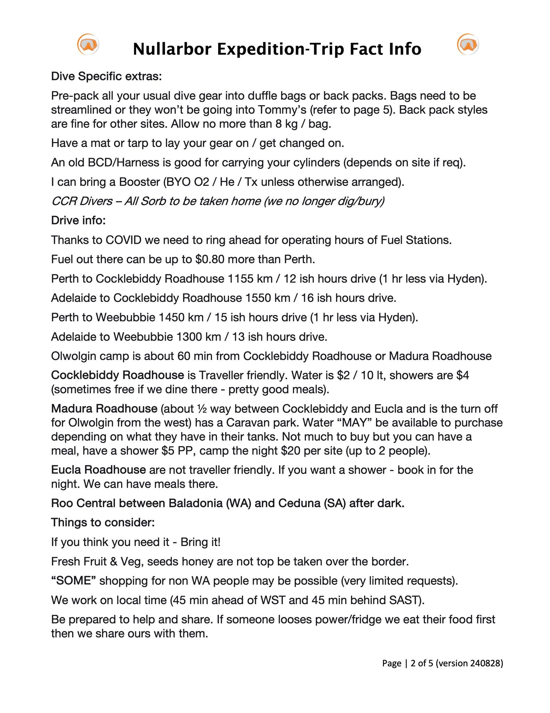
- 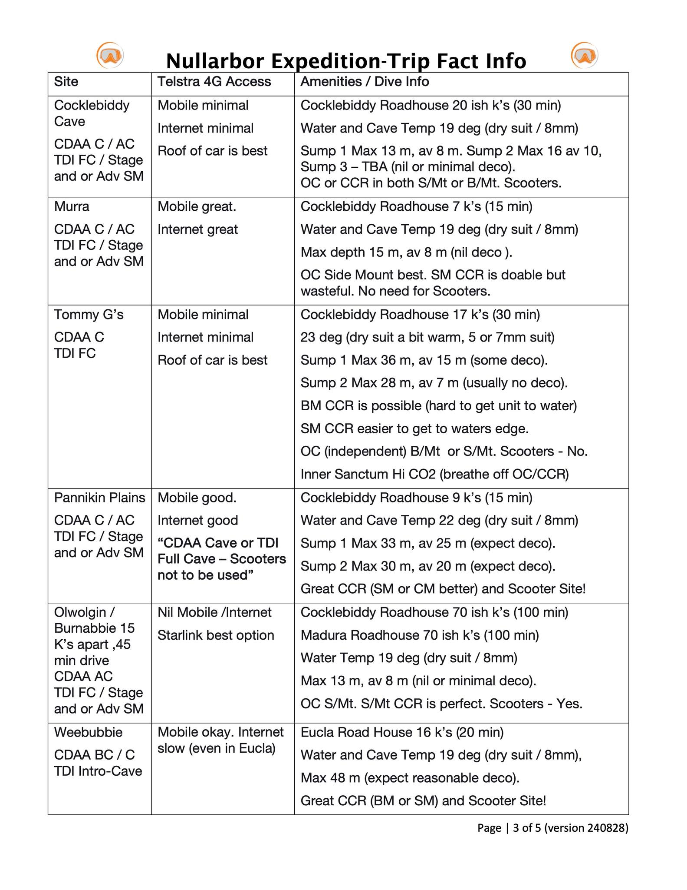
- 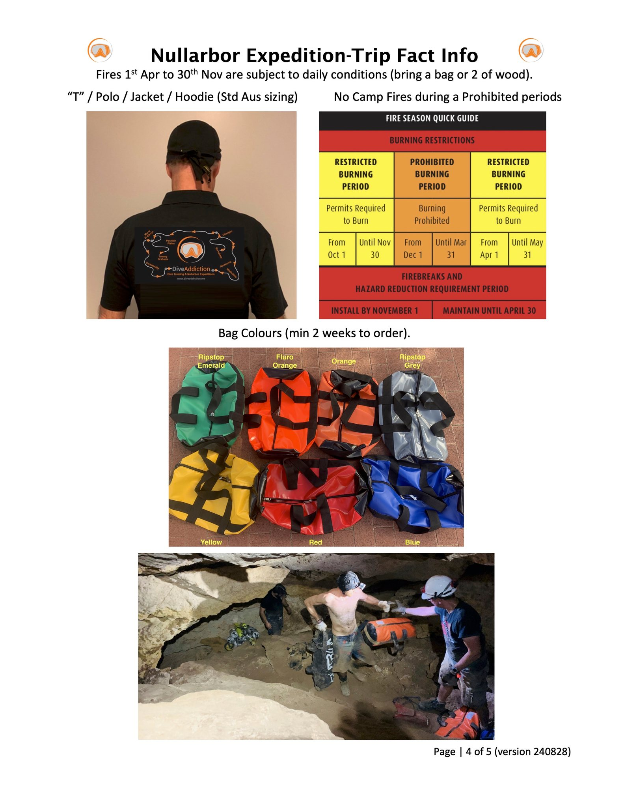
- 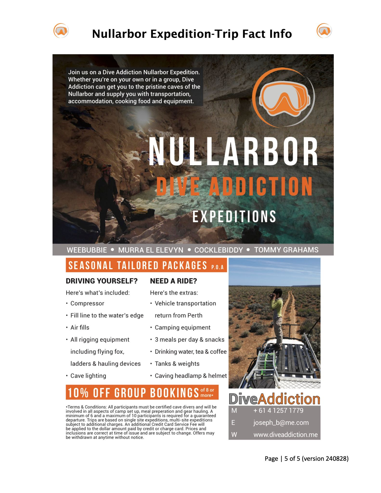
- **https://www.youtube.com/watch?v=yRo_DAsBpeg:** Youtube video showing significant cave ladder required

## Images
- 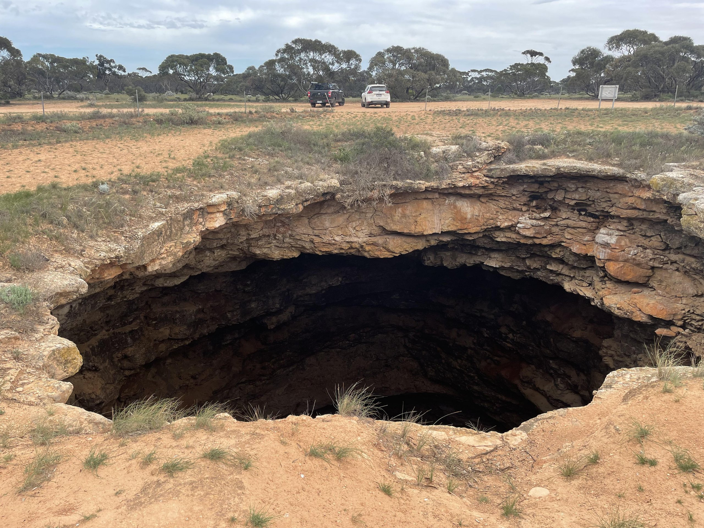
- 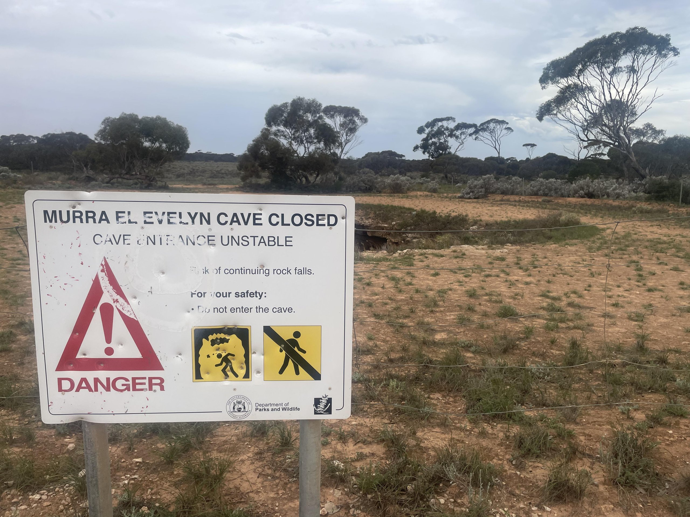
- 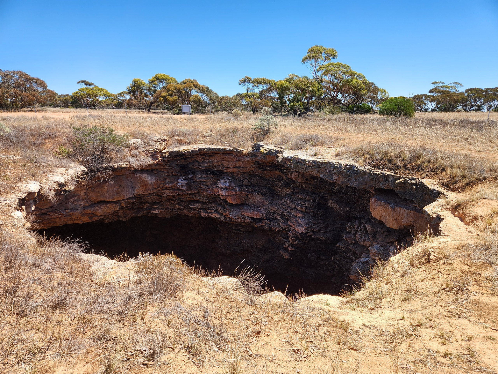
- [MurraElElevyn_HP_V1_1 - 2c2b130a-41c22713](https://github.com/twosharprocks/Karst-Database/blob/d6f539534154fcd23f60d0a25899bf7ef553f1d8/Regions/Oceania/Australia/6N%20-%20Nullabor%20and%20Roe%20Plains/Maps/6N47%20-%20Murra-El-Elevyn%20%28Porter%2C%202024%29%20%28High-Res%20PDF%29.pdf)

[Crystal Room (Pinger) - Google Maps](https://maps.app.goo.gl/YaeE8gHaV8oD5cMk6)
[End of 60m Line - Google Maps](https://maps.app.goo.gl/4UaGXjN3uvzmHu2G8)

