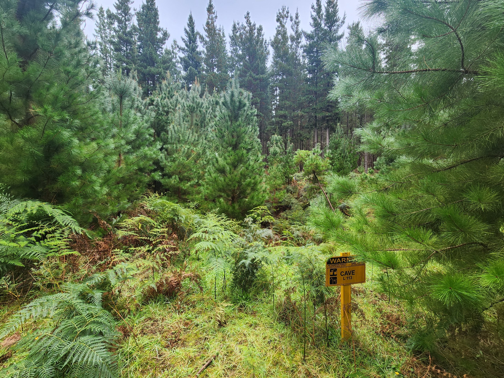
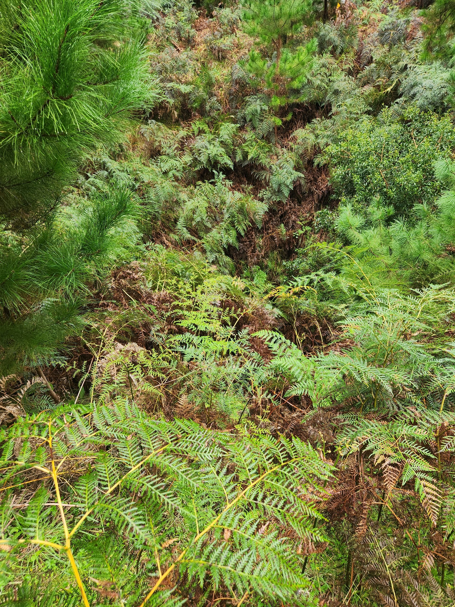
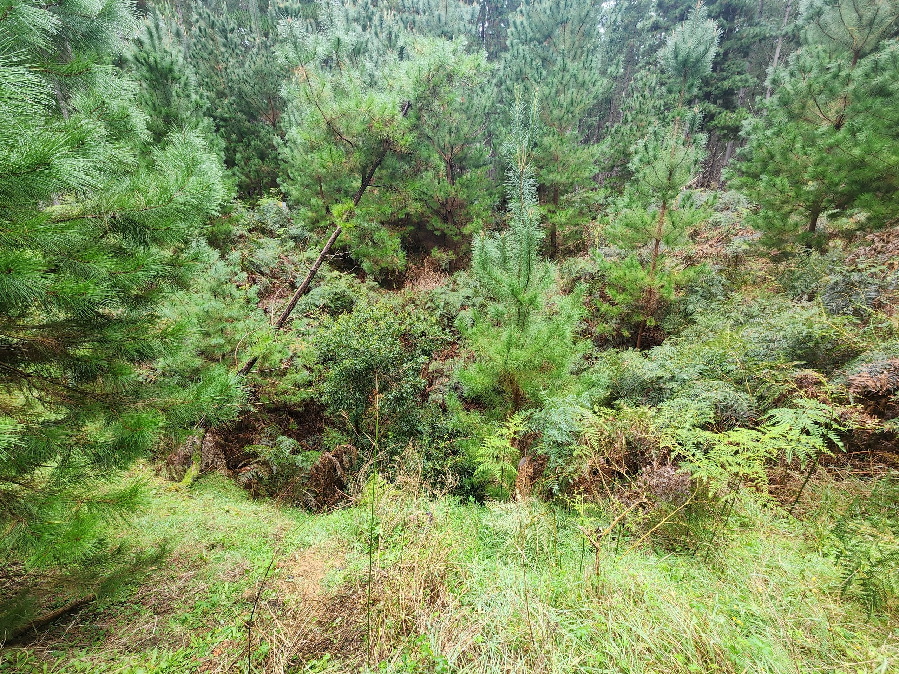
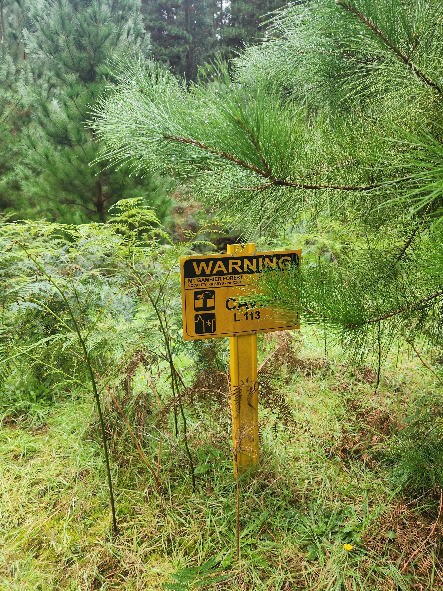
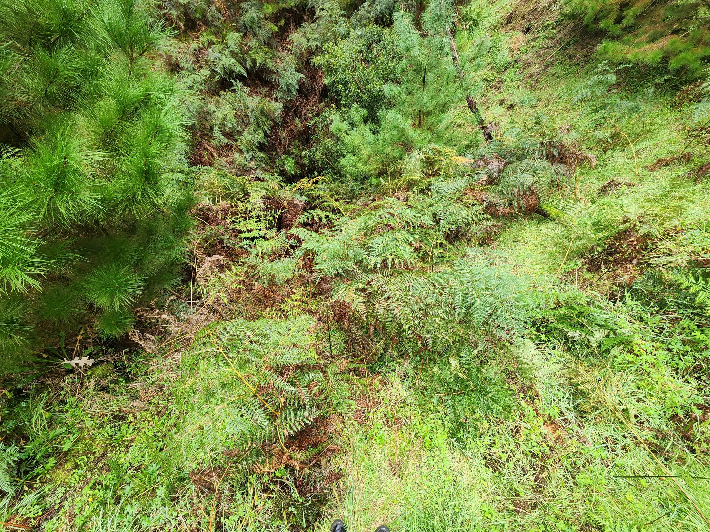

# About

Overgrown deep sinkhole. Steep sides mean ropes are needed to examine closer and VA for entry.

# Details

## Identification

- **Feature type:** Sinkhole
- **Reference:** L0113
- **Source:** Forestry SA

## Cave and exploration data

- **Exploration potential:** High

## Access and warnings

Forestry

# References

- **LSECR:** Page 224
- **Forestry SA:** L0113, Thin Roof: N, Fence: R. Dimensions: very deep!. Features: Hourglass cave; remove wire

## Images
- 
- 
- 
- 
- 
