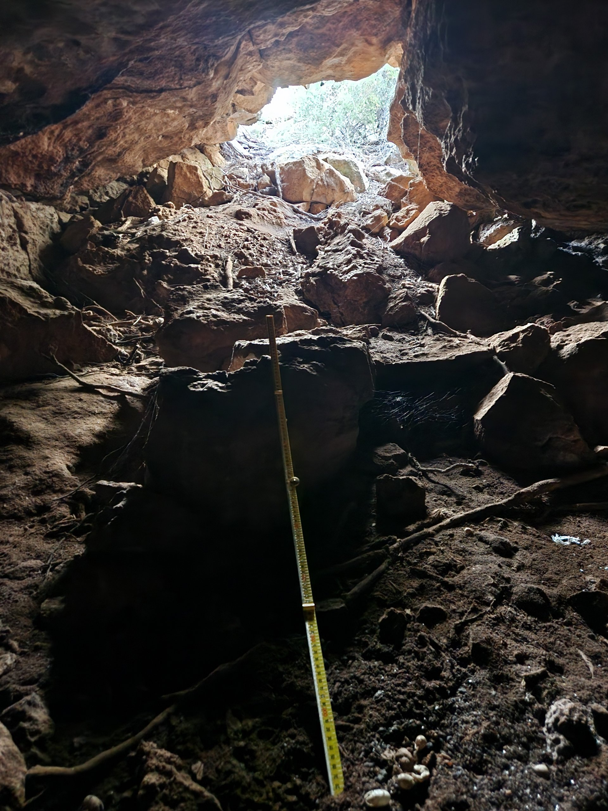
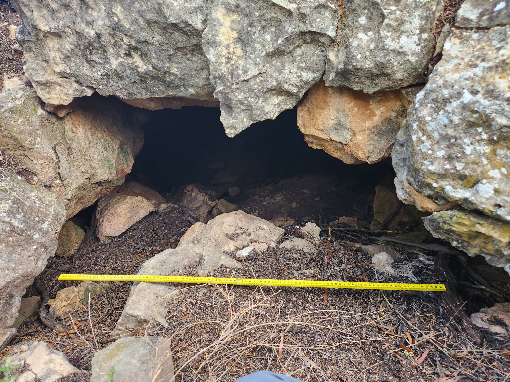
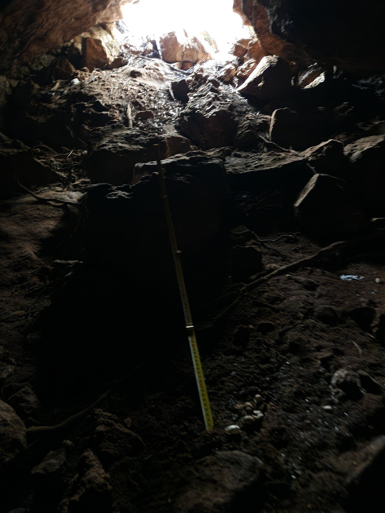
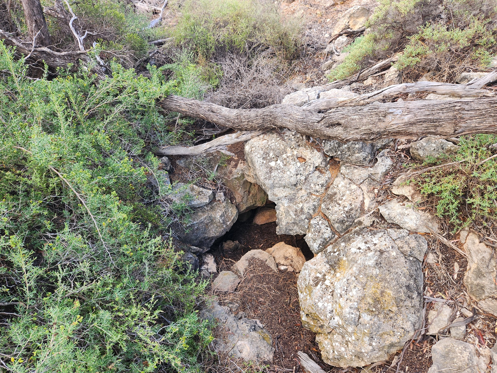
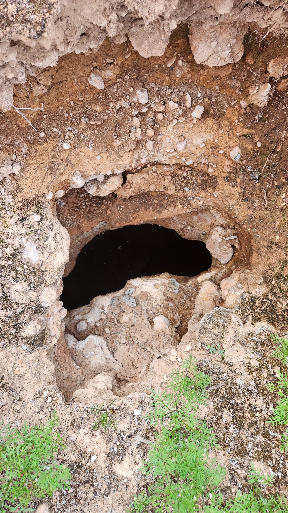
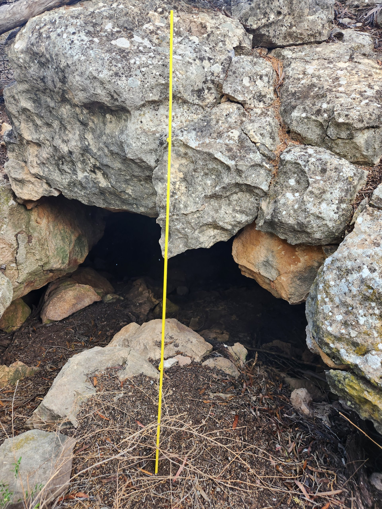

# About

BC 26/11/23: 1m x 70cm entrance into low cave (1.5m in center). 4-5m diameter with low tunnel to the right. Has some potential

# Details

## Identification

- **Feature type:** Cave
- **Reference:** N2774

## Cave and exploration data

- **Exploration potential:** Medium

# References

## Images
- 
- 
- 
- 
- 
- 
