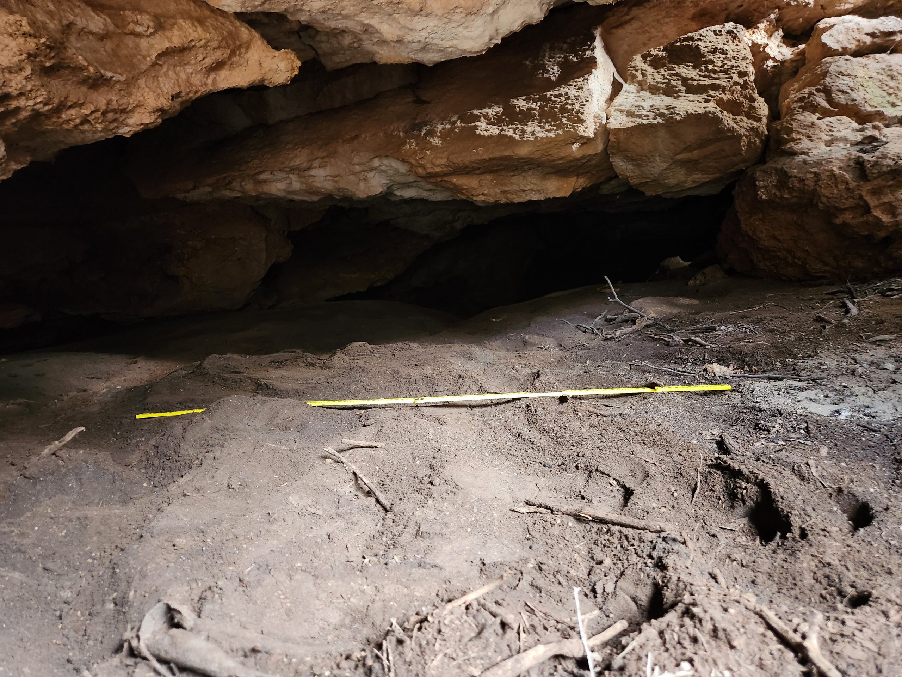
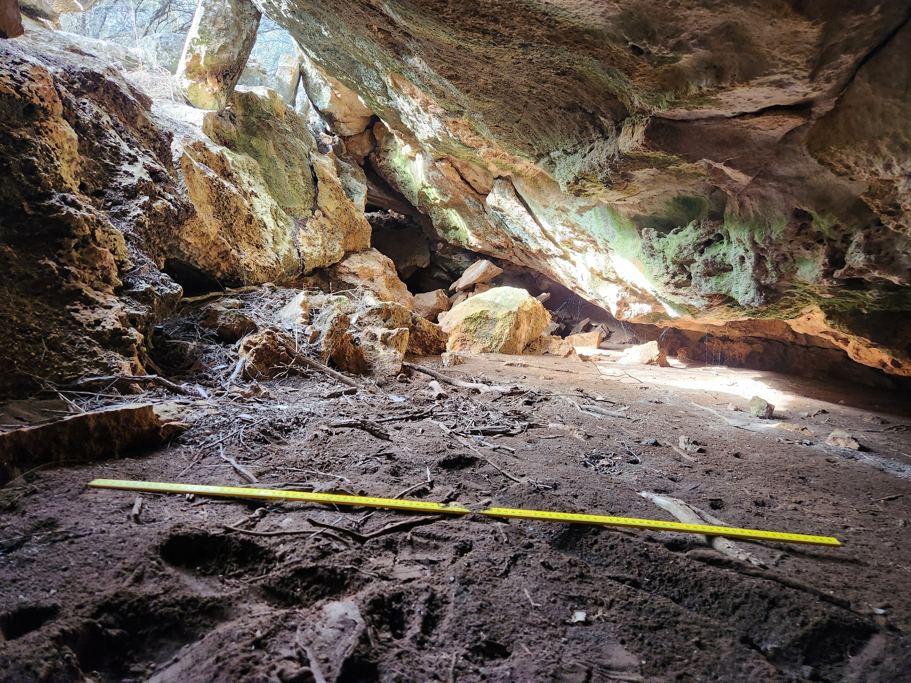
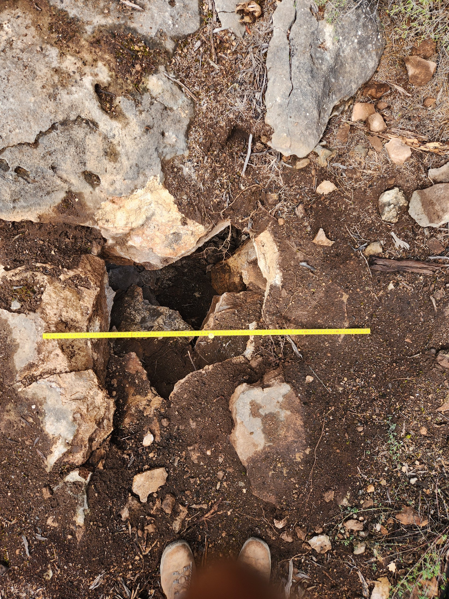
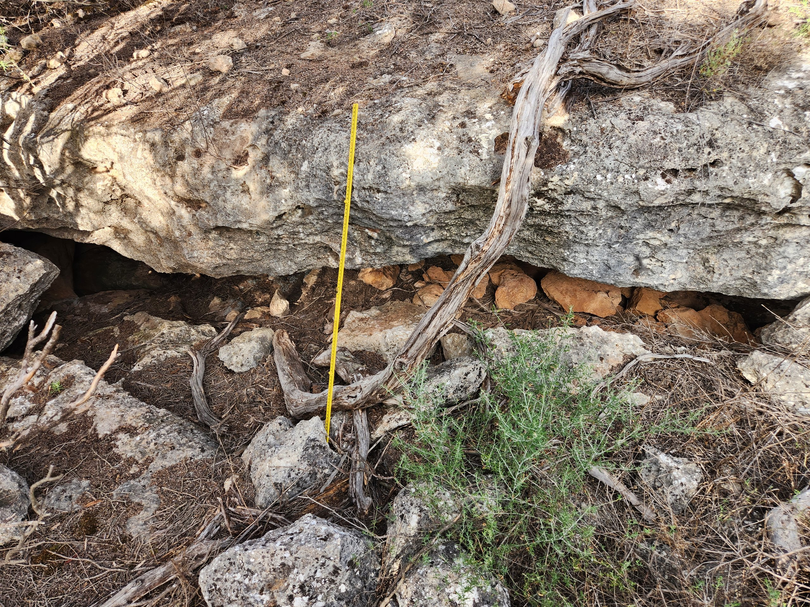
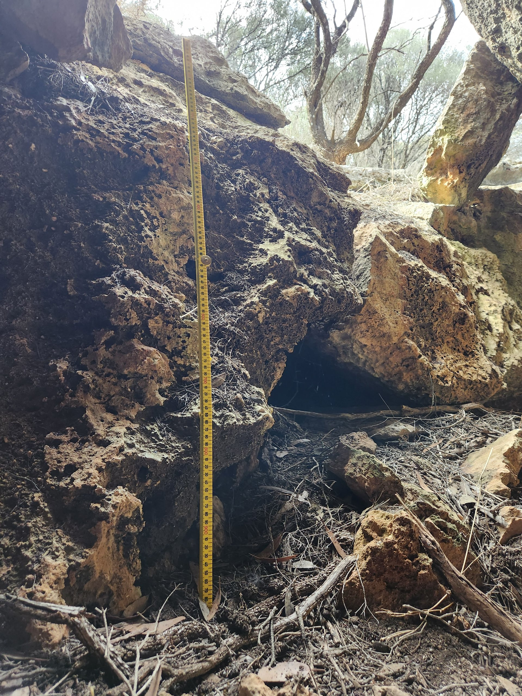
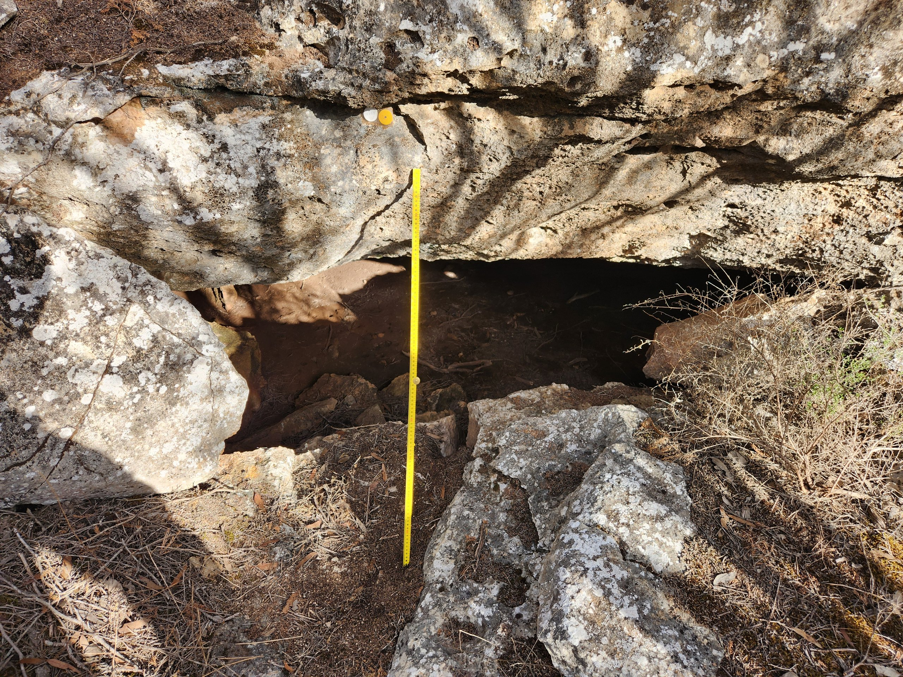
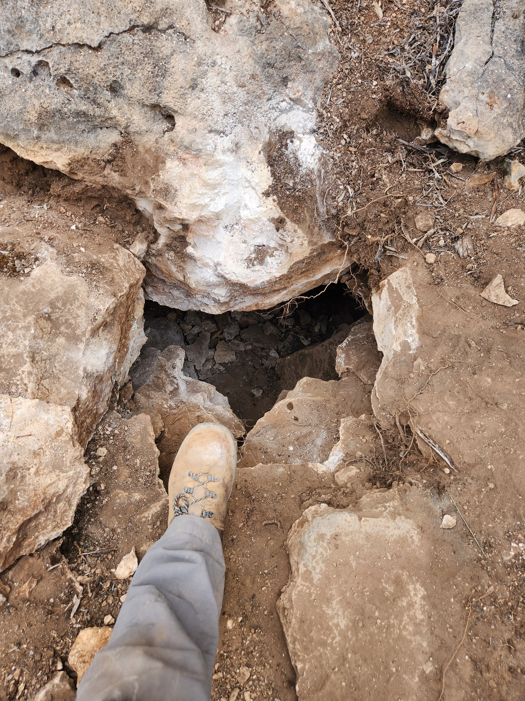
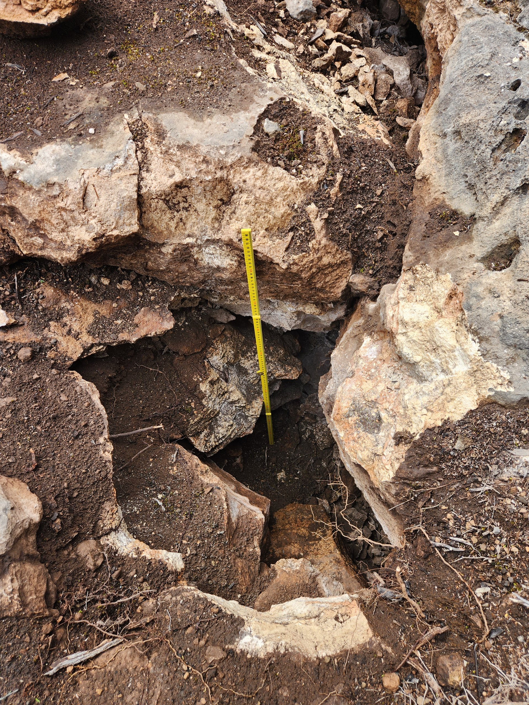
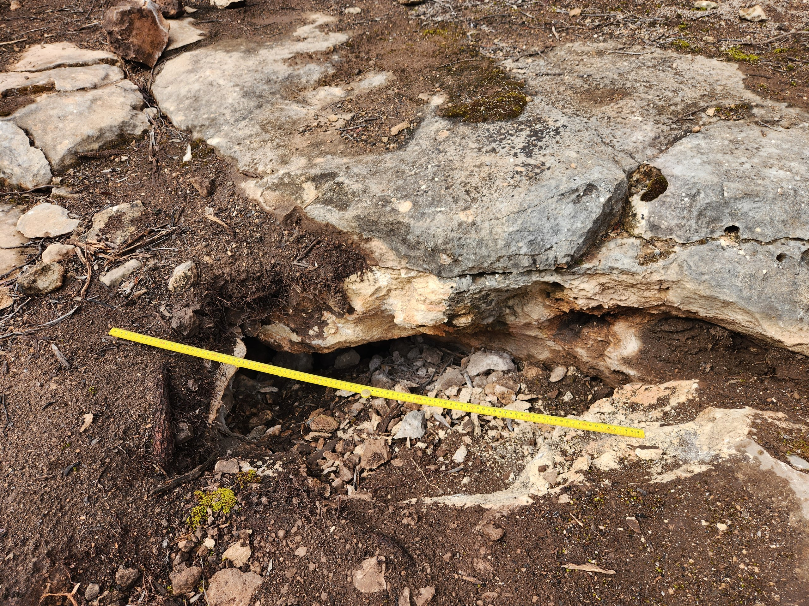

# About

Ryan & brother found

BC 26/11/23: long low multiple entrance to doling. 45deg ceiling in 15-20m wide x 1m high x 2m deep crevice. Definitely worth pushing.

BC 30/11/2023 : Dug out with RK and MK. Descends further into a deeper cave that closes out. More pushing needed

# Details

## Identification

- **Feature type:** Cave
- **Reference:** N2777

## Cave and exploration data

- **Exploration potential:** High

# References

- **From RK:** Visited SF/AR 2019-10-03. Probably good, and with a cavern that Andrea got into. A dirt dig from there.

Visited SF, 2019-10-04, checkout video recorded. Tag confirmed.

Well defined doline feature approx. 20m diameter, 1m deep with exposed karst around approx. Half of it.

Cavern on SE side giving 2-3m vertical drop from bedrock surface (only ~2m horizontal progress) and then a dirt dig. Another potential dig (from scratch) with visible (but uninspiring) voids on the SW side.

Smaller cavern on NW side may also be a potential dirt dig.

## Images
- 
- 
- 
- 
- 
- 
- 
- 
- 
- 
- 
- 
