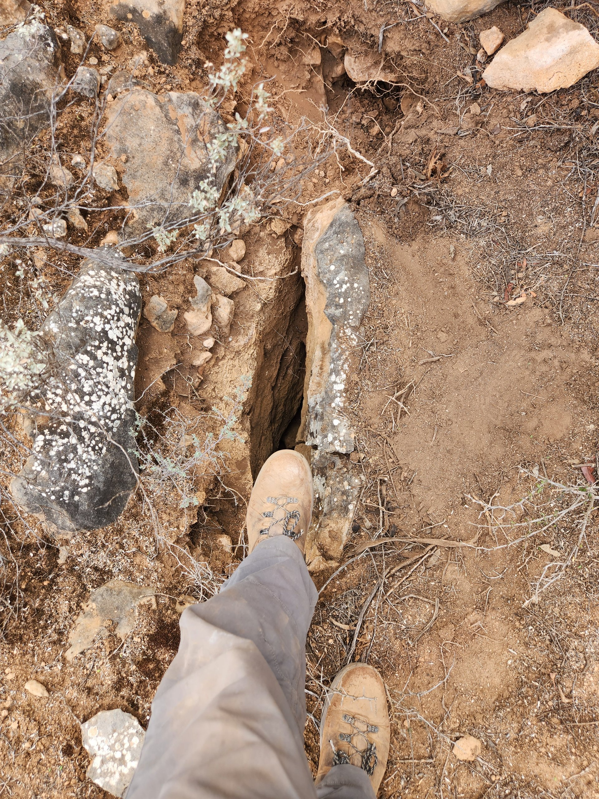
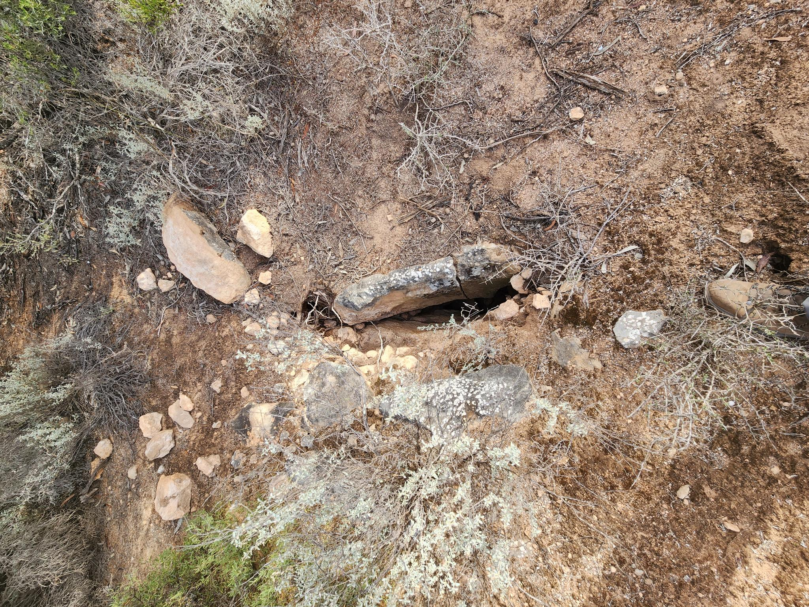

# About

Ryan & brother found.
BC & MW checked - not inspiring.

# Details

## Identification

- **Feature type:** Cave
- **Reference:** N2778

## Cave and exploration data

- **Exploration potential:** High

# References

## Images
- 
- 
