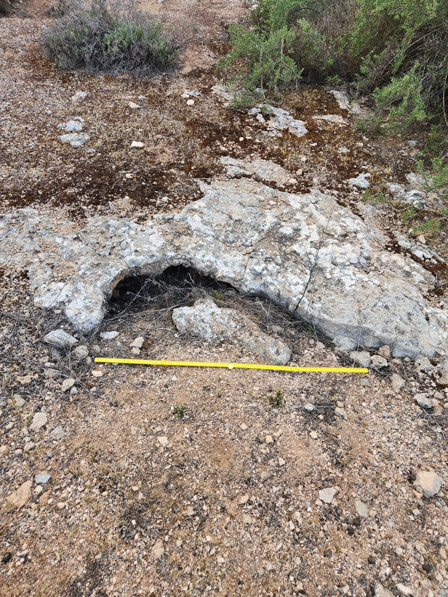
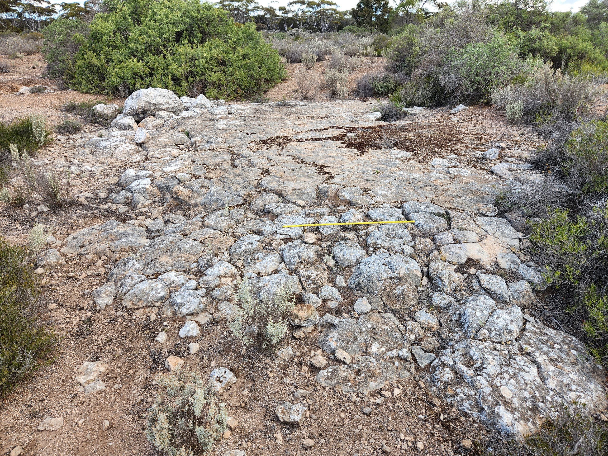
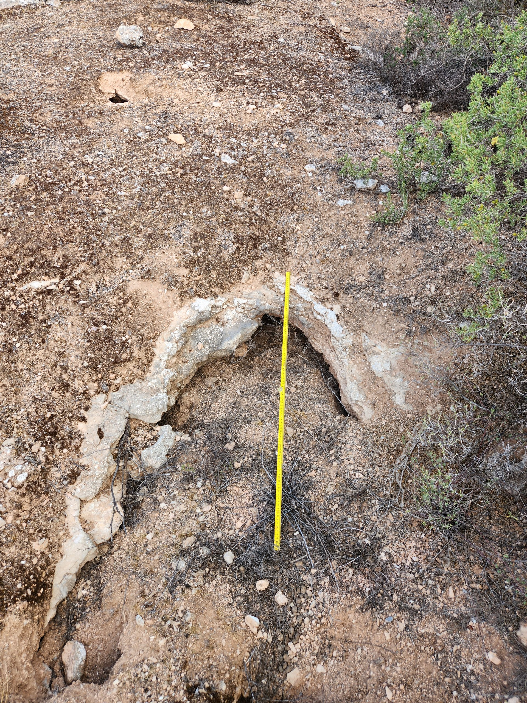
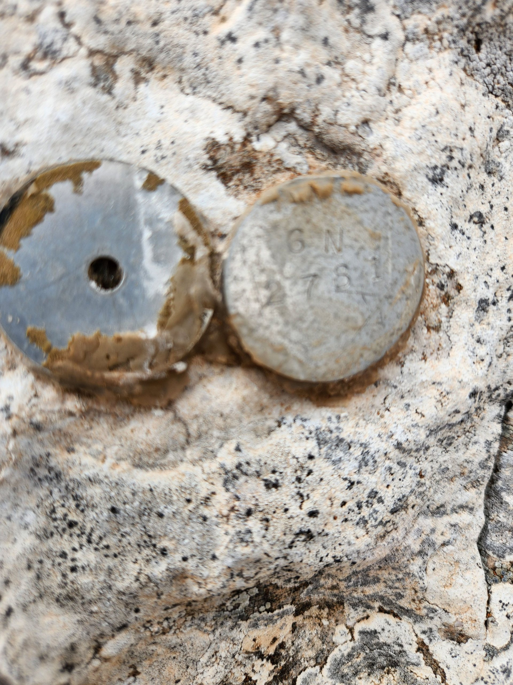
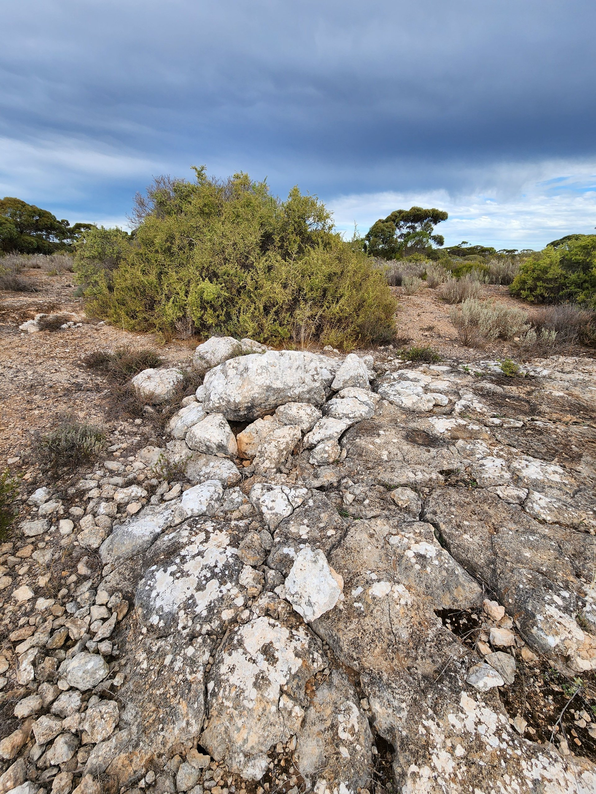

# Details

## Identification

- **Feature type:** RockyOutcrop
- **Reference:** N2781

## Cave and exploration data

- **Vertical access:** No
- **Exploration potential:** Low
- **Tourism potential:** Low
- **Disabled access potential:** Low
- **Goes to water:** No

- **Feature type:** RockyOutcrop

# References

## Images
- 
- 
- 

## Images
- 
- 

# About

BC 26/11/2023: Large rocky outcrops with no immediate entrances. Some small holes that may go somewhere but would require significant digging.
