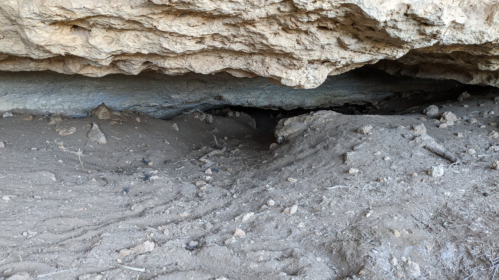
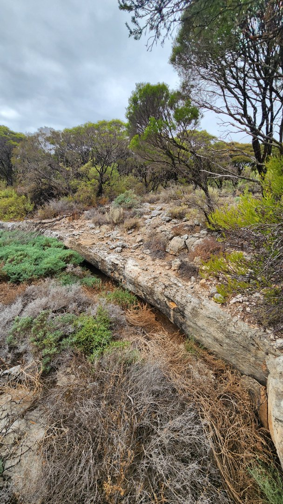
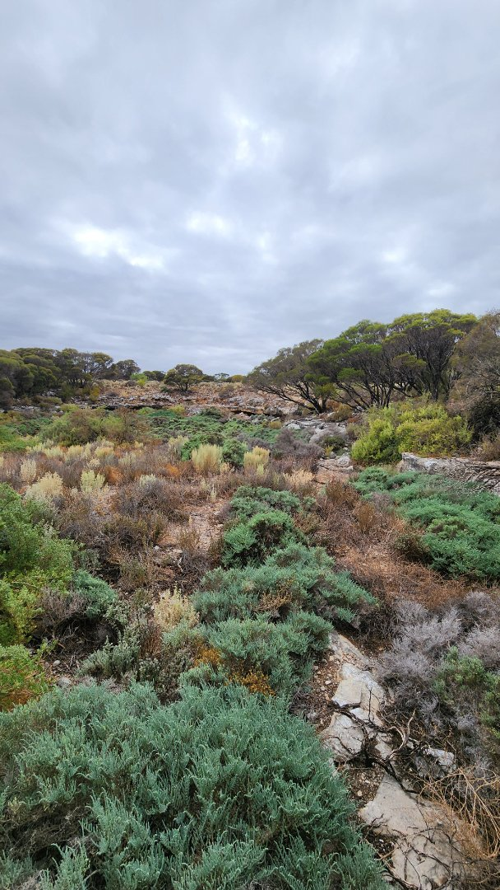

# About

PH dig

# Details

## Identification

- **Feature type:** Cave
- **Reference:** N2782

## Cave and exploration data

- **Vertical access:** No
- **Exploration potential:** Low
- **Tourism potential:** Low
- **Goes to water:** No

# References

- **From RK:** Dug on 7th Oct 2010 by Richard Harris & Paul Hosie
continues - breeze - water?!
Checked again 29March2013 - very difficult and will need dedicated time to dig further. No signs of moisture so low priority at the moment

Checked SF & co, 2019-09-30. Ryan recognised it as "Paul's Dig". Nice big doline with good potential, dig less exciting, needs lots of sandy dirt move.

Tagged 6N2782

## Images
- 
- 
- 
