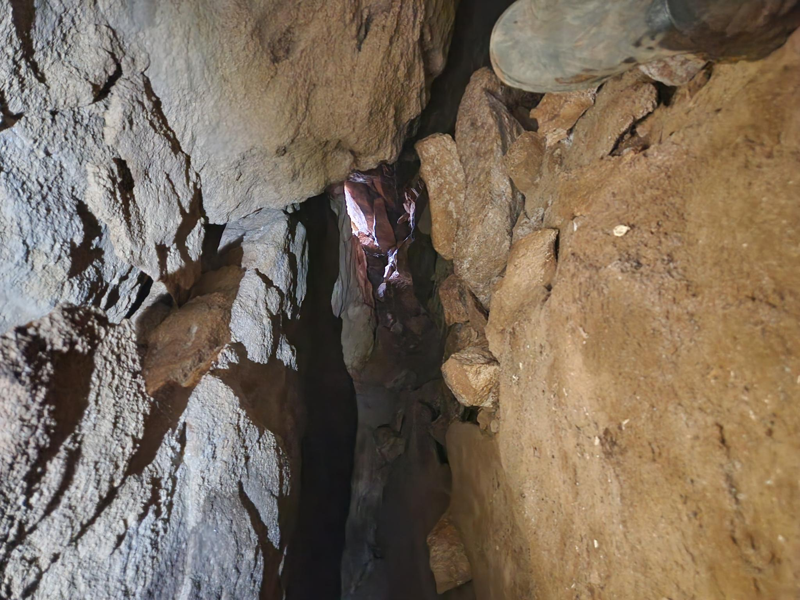
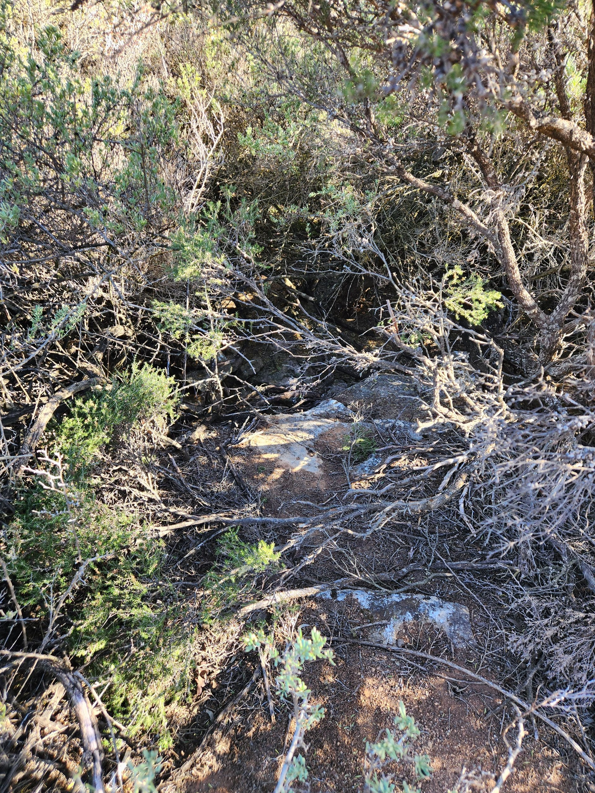
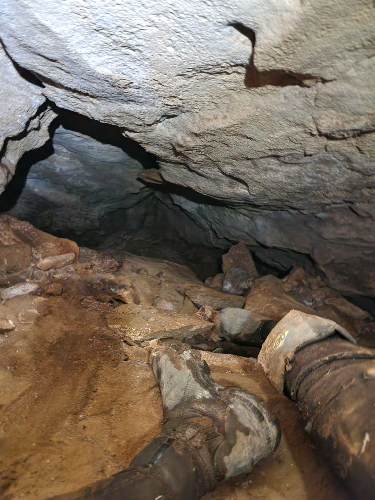
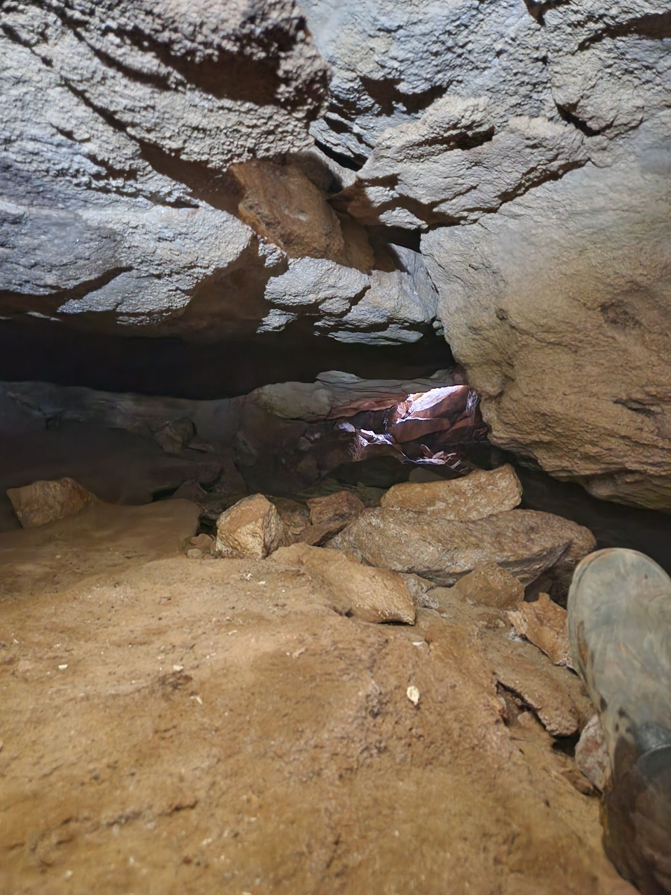
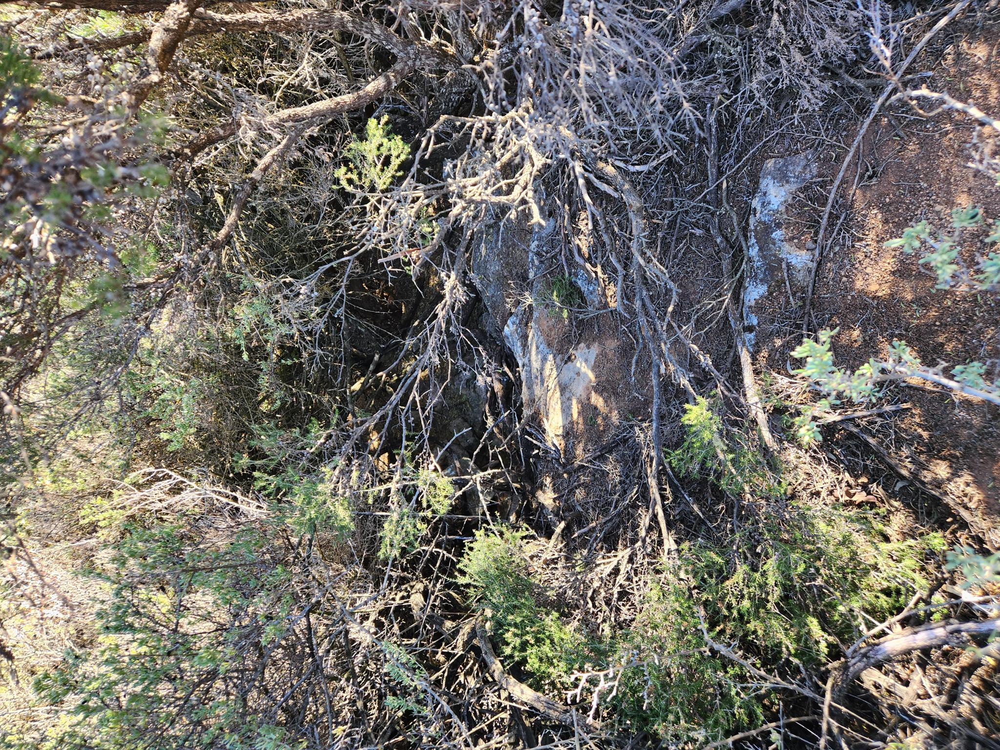
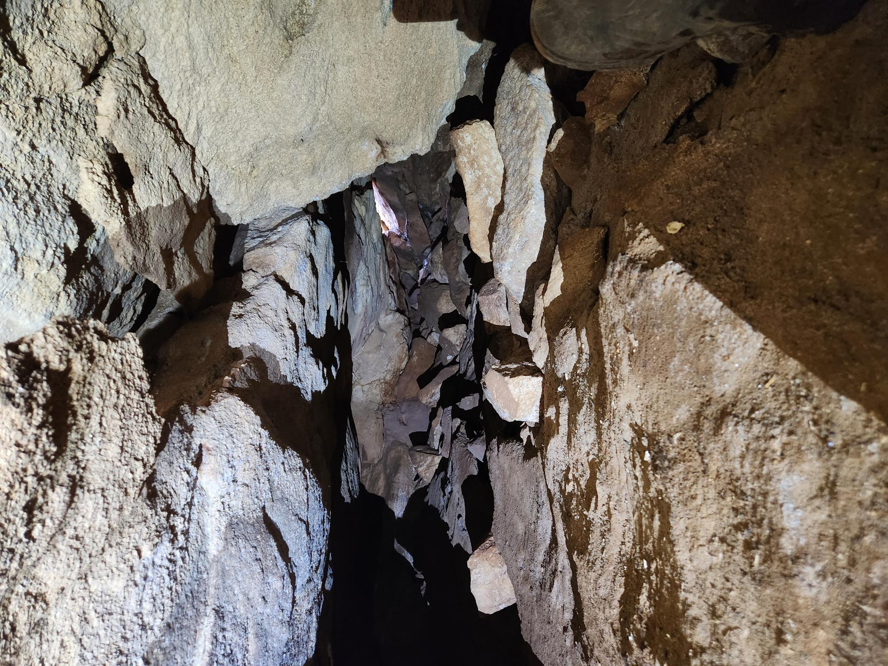
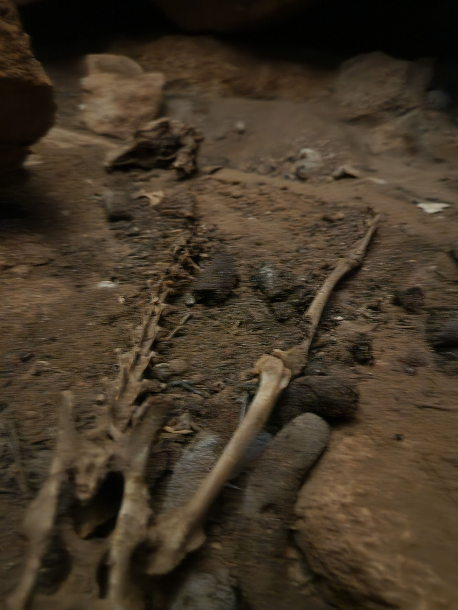

# About

Cave

# Details

## Identification

- **Feature type:** Cave
- **Reference:** N2791

## Cave and exploration data

- **Vertical access:** No
- **Exploration potential:** Low
- **Goes to water:** Yes

# References

## Images
- 
- 
- 
- 
- 
- 
- 
