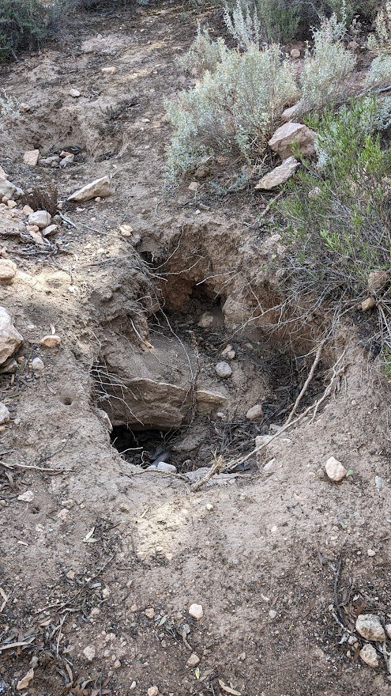
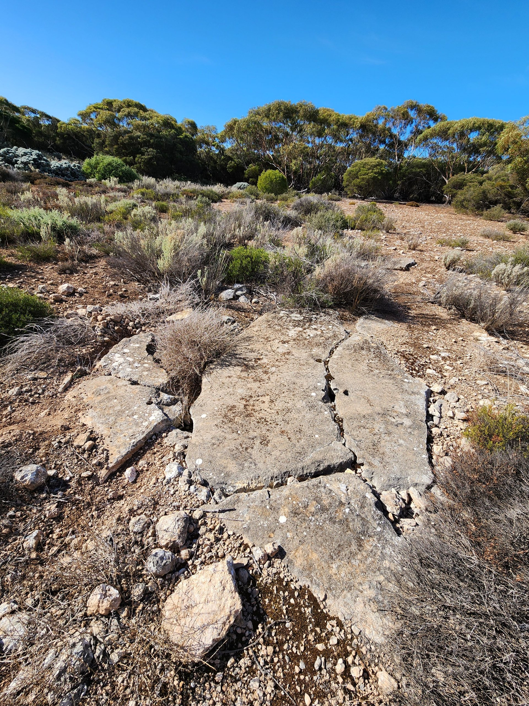
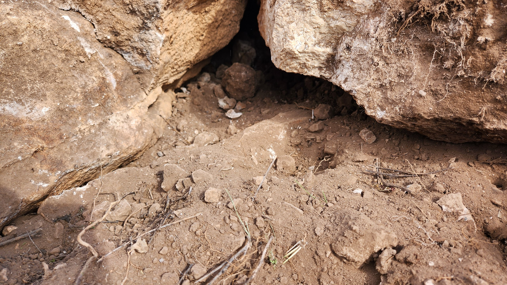
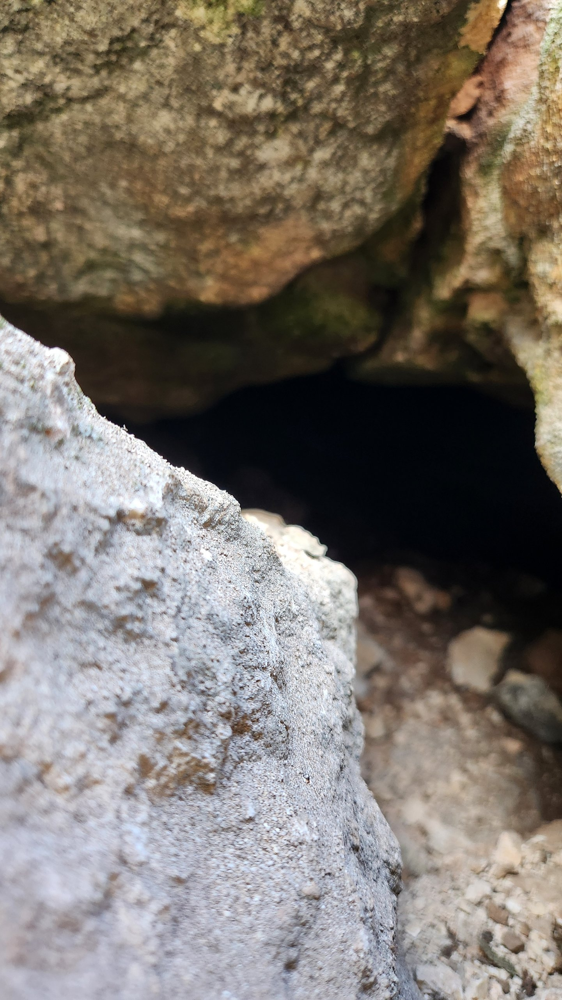
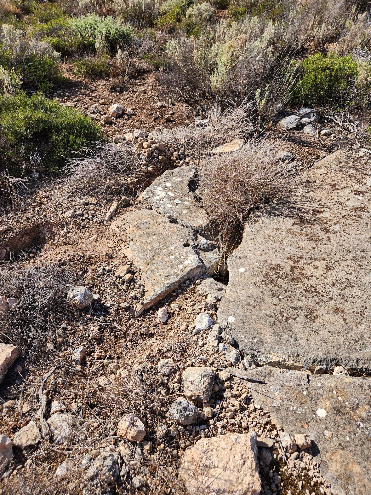
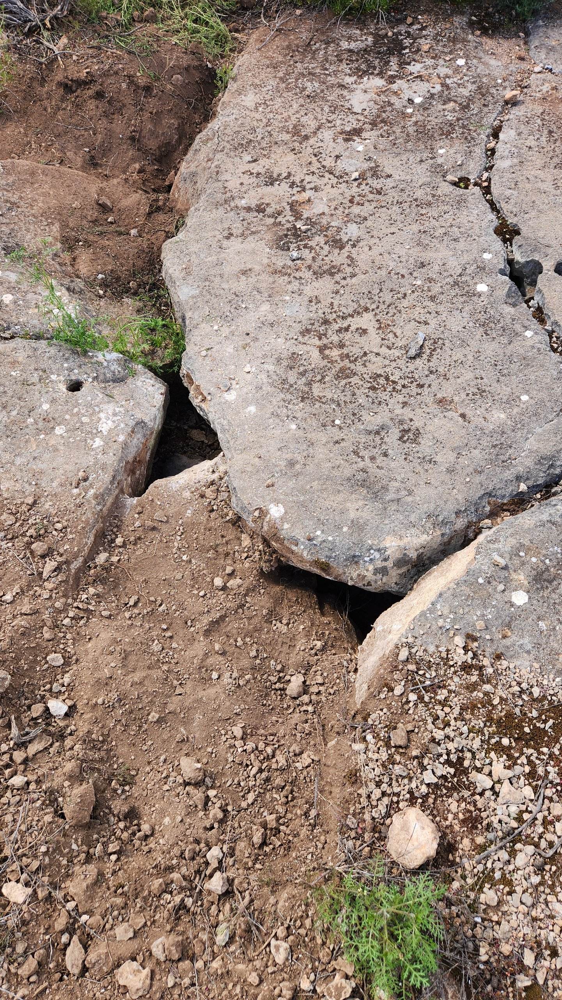

# About

Depression

# Details

## Identification

- **Feature type:** Depression
- **Reference:** N2794

## Cave and exploration data

- **Vertical access:** No
- **Exploration potential:** Low
- **Disabled access potential:** Low
- **Goes to water:** No

# References

- **From RK:** 60mL (EW) x 20mW (NS) x 2m deep degraded depression with several drain points but no cave
was Paul D feature P1309
Joint BRG 056-236

## Images
- 
- 
- 
- 
- 
- 
