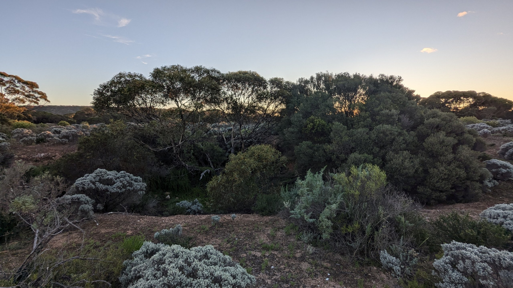
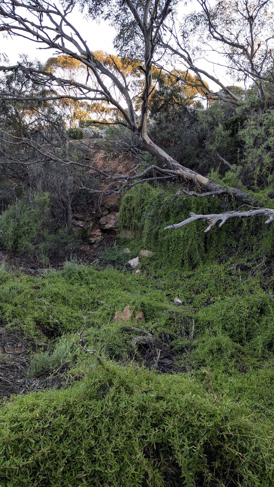

# About

Checked 2024-07 by MW on foot
Small doline with possible solution tubes forming in centre. Possible digs into surrounding walls or directly into centre, but no promise of cave below

# Details

## Identification

- **Feature type:** Depression
- **Reference:** N2795

## Cave and exploration data

- **Vertical access:** No
- **Exploration potential:** Low
- **Goes to water:** No

## Amenities

- **hasShowers:** No
- **hasToilets:** No

# References

## Images
- 
- 
