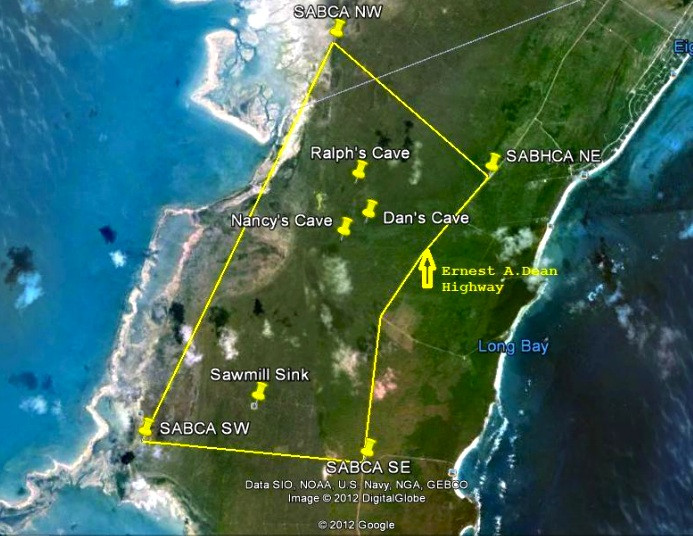
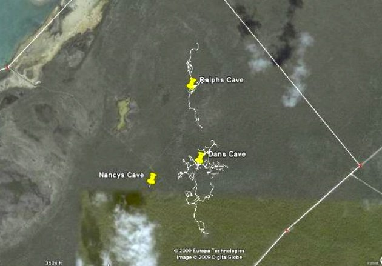

# About

Location estimated from rollingharbour image

# Details

## Identification

- **Feature type:** Cave
- **Source:** rollingharbour.com

# Maps

- 

# References

- **Rolling Harbour:** https://rollingharbour.com/2015/06/01/ralphs-old-bat-abacos-astounding-underground-caves-5/

## Images
- 
- 
