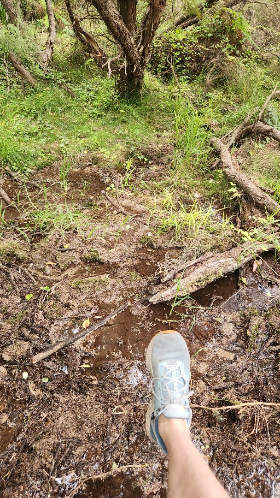
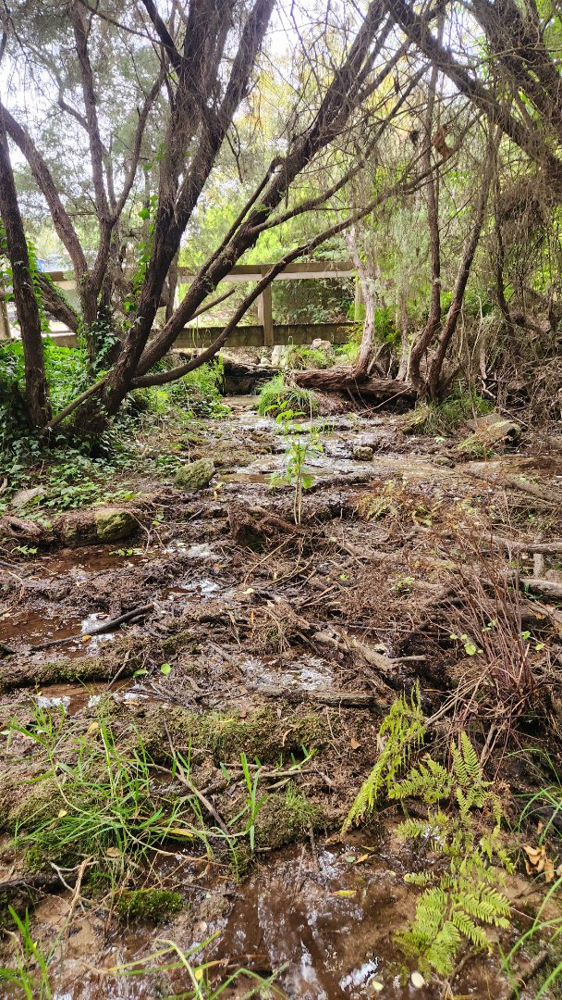

# Details

## Identification

- **Feature type:** SolutionTube
- **Source:** GoogleMaps

## Cave and exploration data

- **Tourism potential:** Medium
- **Disabled access potential:** Medium
- **Goes to water:** Yes

# References

- **GoogleMaps:** https://goo.gl/maps/kbJjvbeDYzrtfUtD9

## Images
- 
- 
