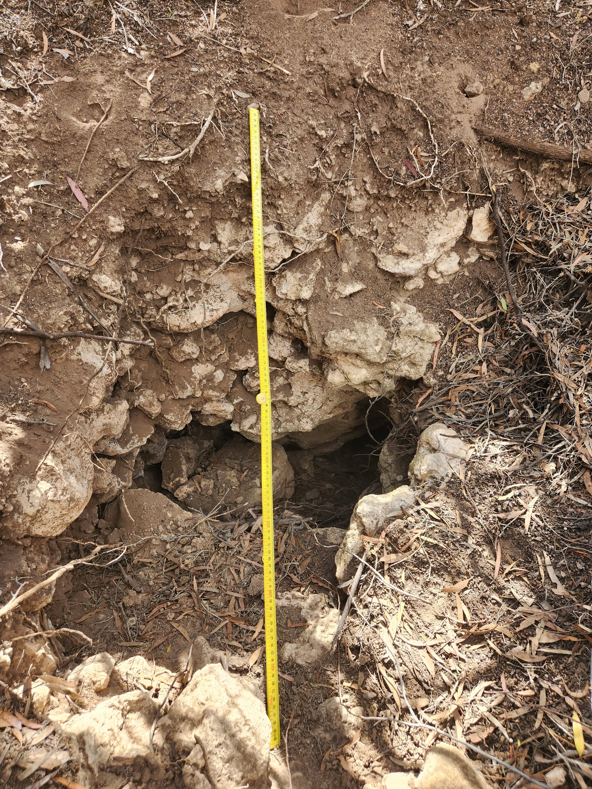
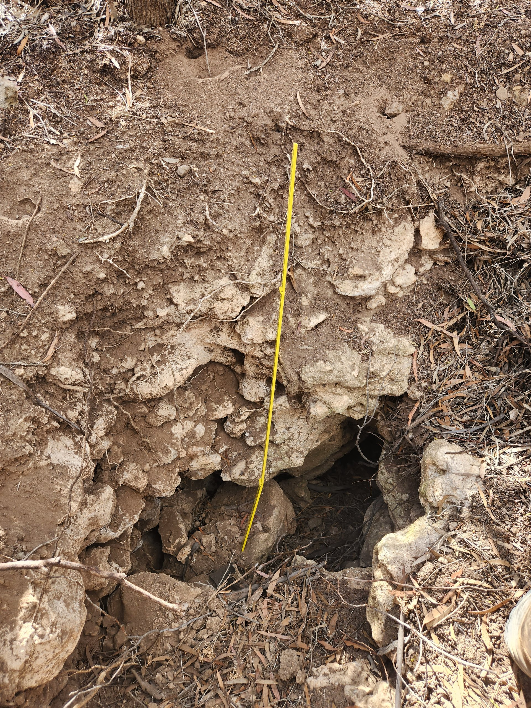
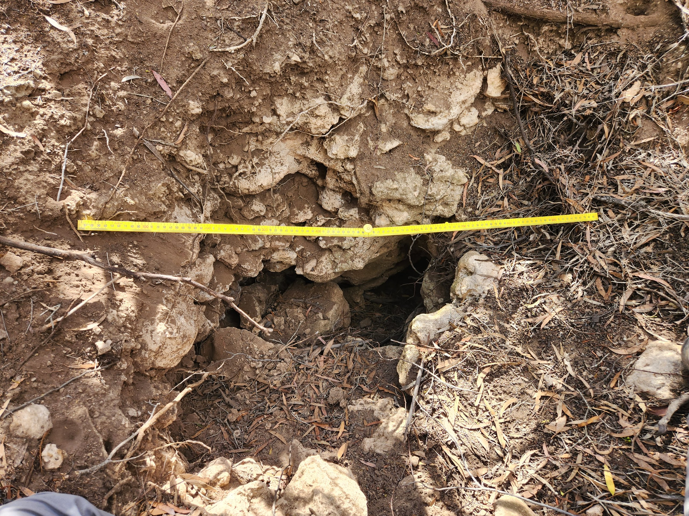

# About

From RK

BC 26/11/2024: Depression has been dug about 1m down. Rock looks loose

# Details

## Identification

- **Feature type:** RockyOutcrop

## Cave and exploration data

- **Exploration potential:** Medium

# References

## Images
- 
- 
- 
