# About

## Overview
Located in the vast expanse of the Nullarbor desert, over 2500 km from Melbourne, Australia, lies a hidden gem known as the Olwolgin Cave. This underwater cave system, named after a nearby bluff on the Roe Plain escarpment, is a fascinating destination for adventurous divers and explorers.

## Getting there
The journey to Olwolgin Cave is an adventure in itself. It begins with meticulous packing for a road trip to the middle of nowhere. The route takes you through major multilane highways, rolling hills, and farmed greenery, before the landscape gives way to the single-lane highway snaking along the southern coastline of the continent.

After two days of travel, you arrive on the Nullarbor proper, where the Southern Ocean crashes against high limestone cliffs. The entrance to Olwolgin Cave is just a hundred meters from the campsite.

## Unique Features
Olwolgin Cave is unique in its structure, combining sculpted fissures and main conduits. The cave has two separate parts, Upstream on the left and Downstream on the right. It hosts numerous interesting features, including rocks covered in black bacteria, hanging roots, and green tannic water. Many of the passages are very tight and silty, requiring side mount configuration to pass.

The water in the cave has very high salinity, similar to [Nurina Cave - 6N46](). The haloclines produce some amazing visual distortions. Unlike the clear-blue water and huge tunnels of the deep caves above the cliff line, Olwolgin features dark-green water. It a has approximately 2,700m of surveyed passage Upstream and 7,200m of passage Downstream.

## Ecosystem
Despite its rugged exterior, Olwolgin Cave is a fragile ecosystem. The cave’s beauty and fragility make it a site of great interest for divers and researchers alike. However, the cave’s delicate environment also necessitates careful exploration to preserve its natural features.

## Conclusion
Olwolgin Cave is a testament to the hidden wonders that lie beneath the surface of our planet. Its unique features and fragile ecosystem make it a fascinating destination for divers and nature enthusiasts. As we continue to explore these subterranean marvels, we gain a deeper appreciation for the intricate and delicate balance of our natural world.

# References

- [6N920 - Olwolgin (DWG, 2022) (A0 size) - MAP](https://github.com/twosharprocks/Karst-Database/blob/d6f539534154fcd23f60d0a25899bf7ef553f1d8/Regions/Oceania/Australia/6N%20-%20Nullabor%20and%20Roe%20Plains/Maps/6N920%20-%20Olwolgin%20%28DWG%2C%202022%29%20%28A0%20size%29.pdf)
- [6N920 - Olwolgin (DWG, 2022) (A0 size - north up)](https://github.com/twosharprocks/Karst-Database/blob/d6f539534154fcd23f60d0a25899bf7ef553f1d8/Regions/Oceania/Australia/6N%20-%20Nullabor%20and%20Roe%20Plains/Maps/6N920%20-%20Olwolgin%20%28DWG%2C%202022%29%20%28A0%20size%20-%20north%20up%29.pdf)

## Images
- 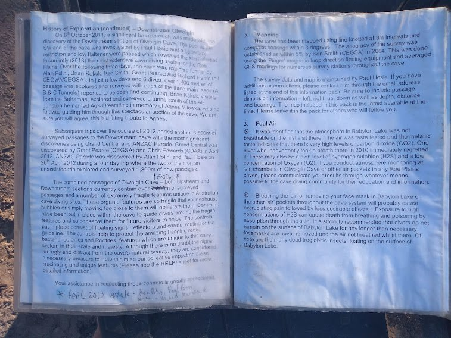
- 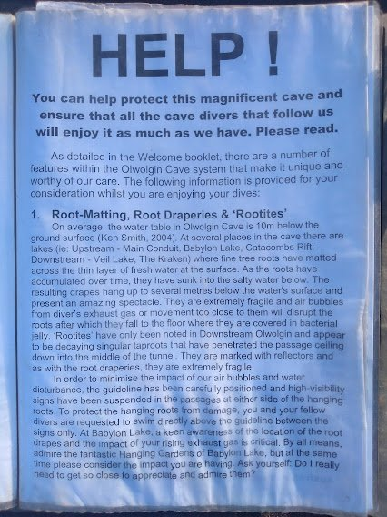
- 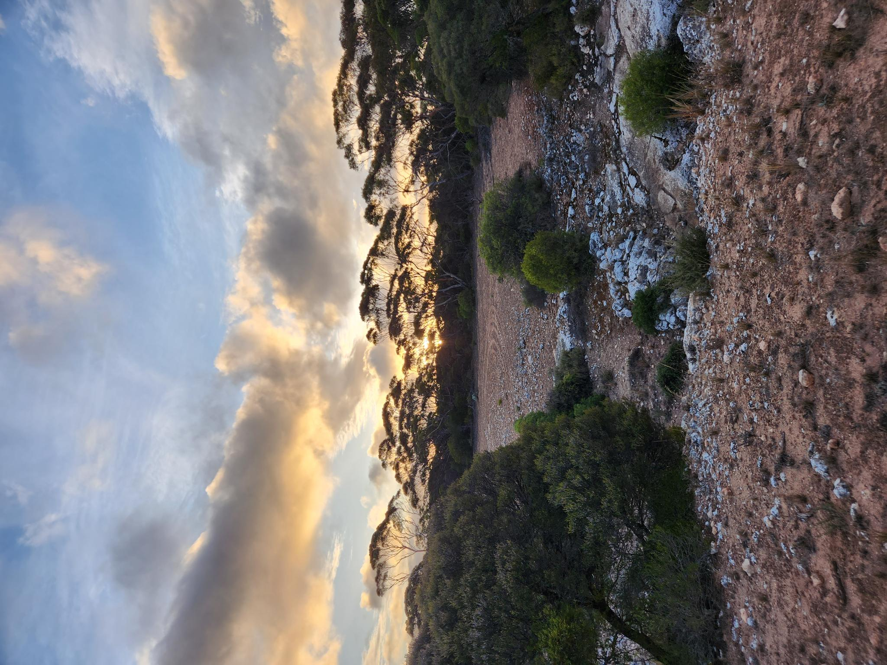
- 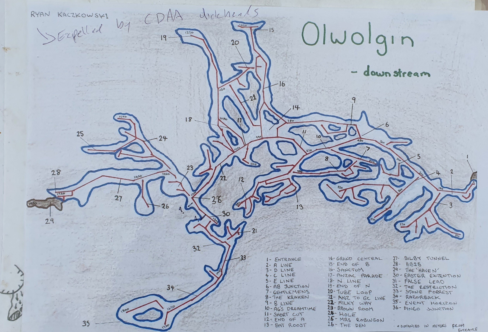
- 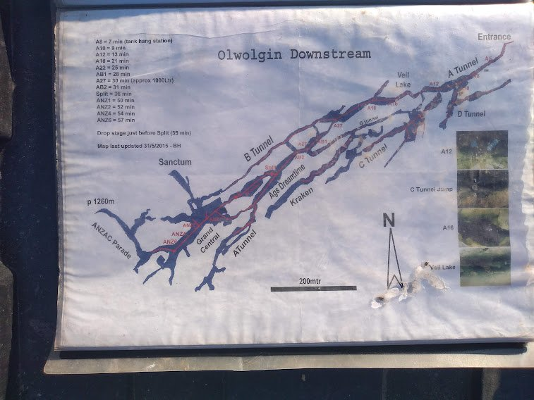
- 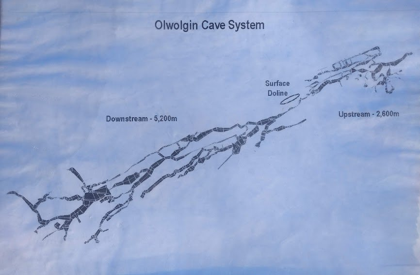
- 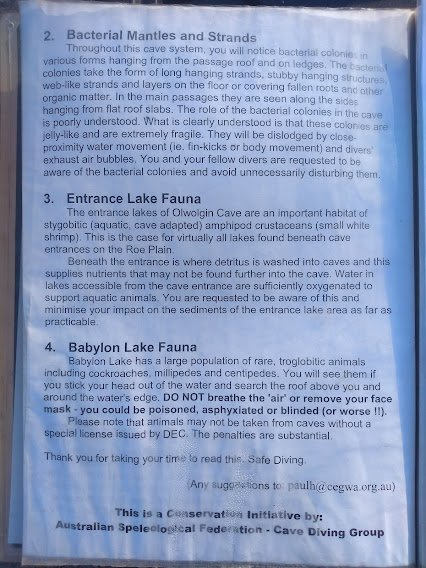
- 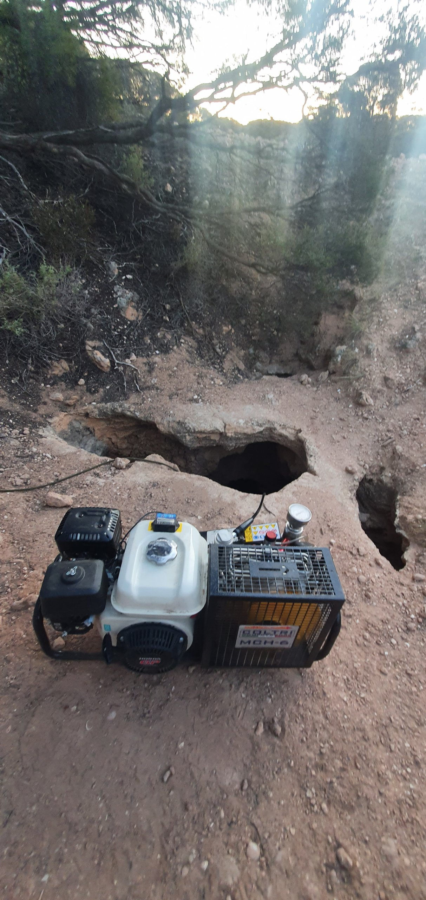
- 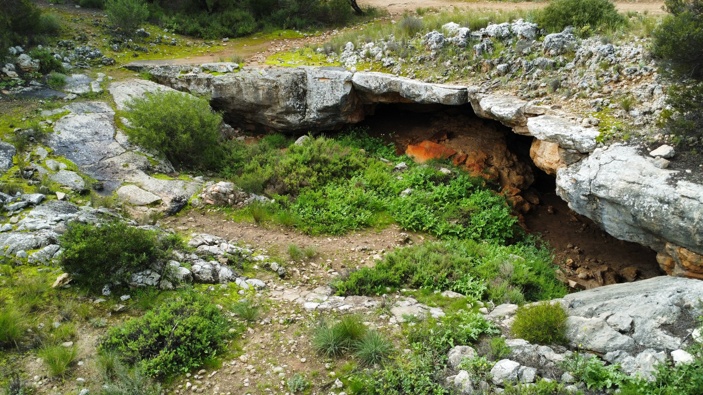
- 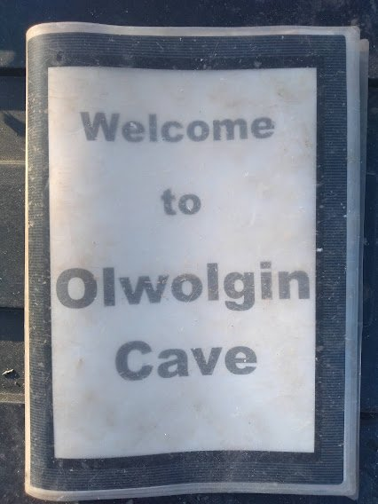
- 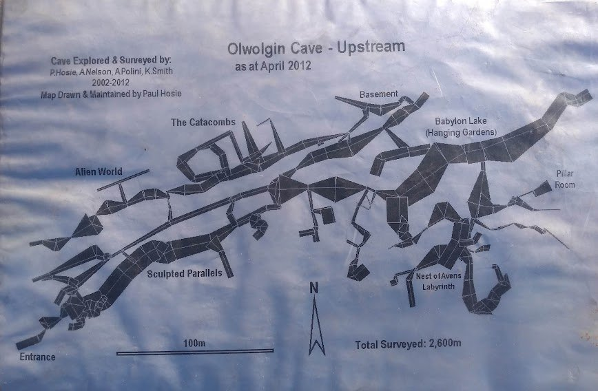
- 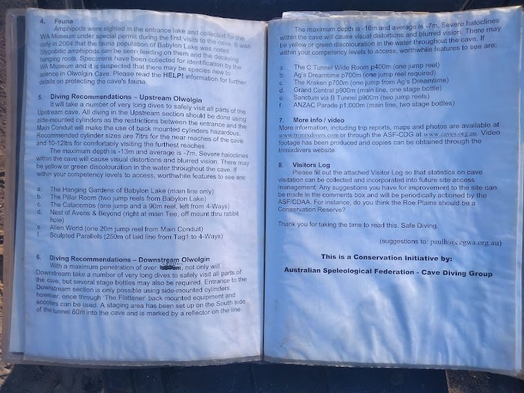
- 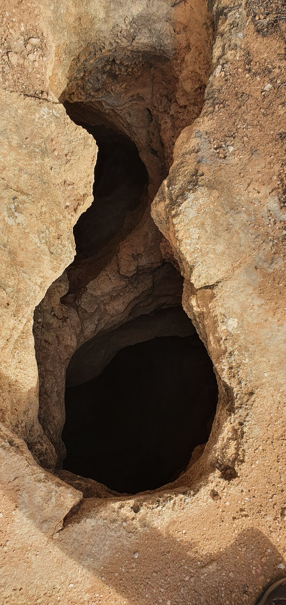
- 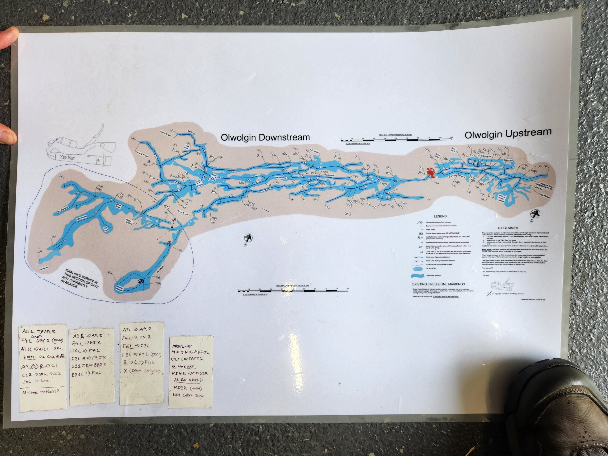
- 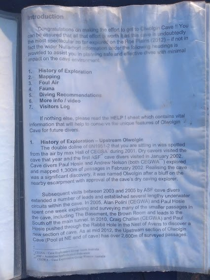
- 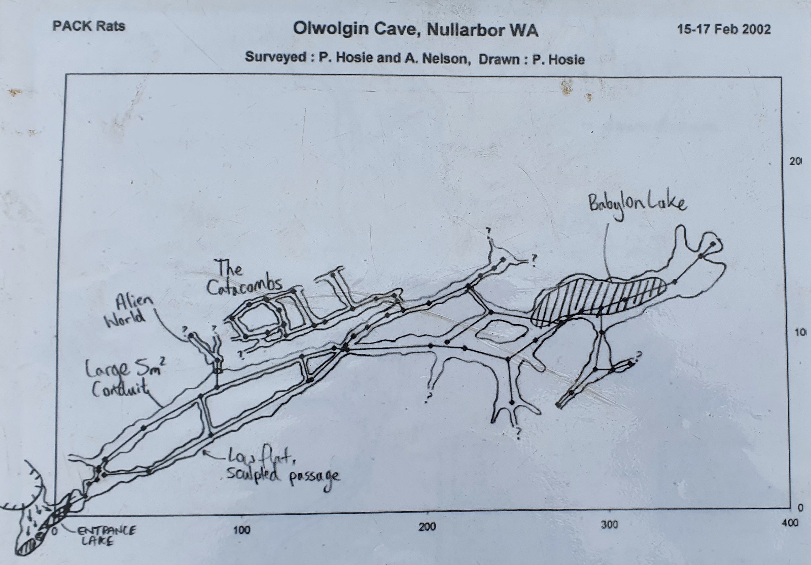
- 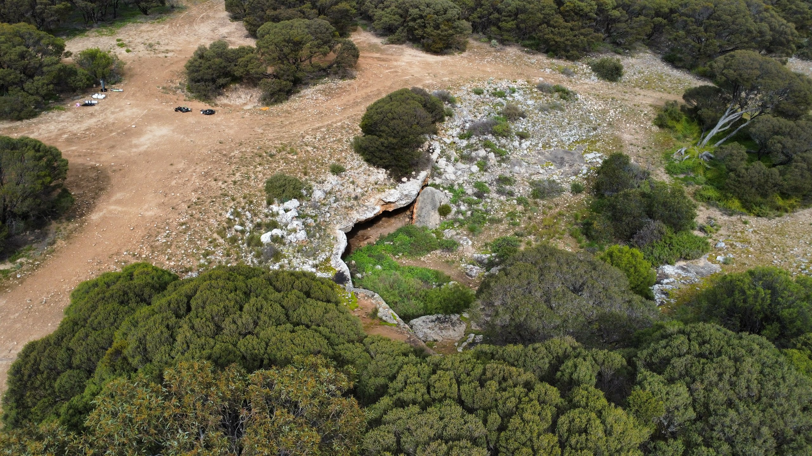
- [054fd253-465a-4d89-a0c8-d12be3a2274d](https://www.youtube.com/watch?v=KImaj-zfgE4)
- [a11b3af4-62e9-4ed9-a0b9-935e530379be](https://www.youtube.com/watch?v=rRAoioCZ8GM)
- [7d39fda1-3d2d-4518-88fc-25b6b4a6f87c](https://www.youtube.com/watch?v=yt7gYYjQurY)
- [0cbde6ea-43f3-4681-8412-440458921e80](https://www.youtube.com/watch?v=MAAOYQfMyCM)

# Details

## Identification

- **Feature type:** Cave

## Cave and exploration data

- **Cave rating:** Advanced
- **Vertical access:** No
- **Exploration potential:** Low
- **Tourism potential:** Low
- **Goes to water:** Yes

## Diving data

- **Water type:** Salt
- **Tidal:** No
- **Temperature:** 16–19 °C

# Maps

- [Olwolgin - All - 11784db8-864d1f22](https://github.com/twosharprocks/Karst-Database/blob/d6f539534154fcd23f60d0a25899bf7ef553f1d8/Assets/09786a282b2ff3b588e2edfd078443e6ba37547984ecff2e8e3e065fb185bb0a.kml)
