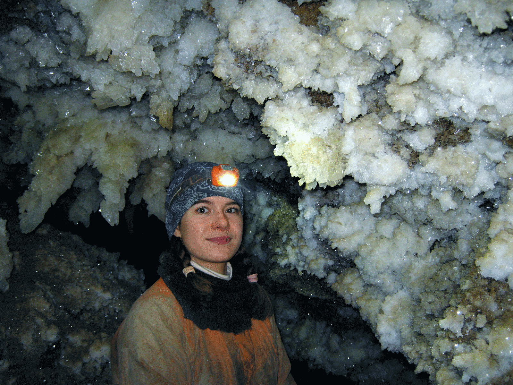
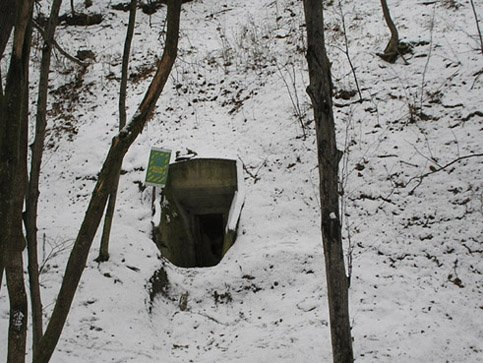
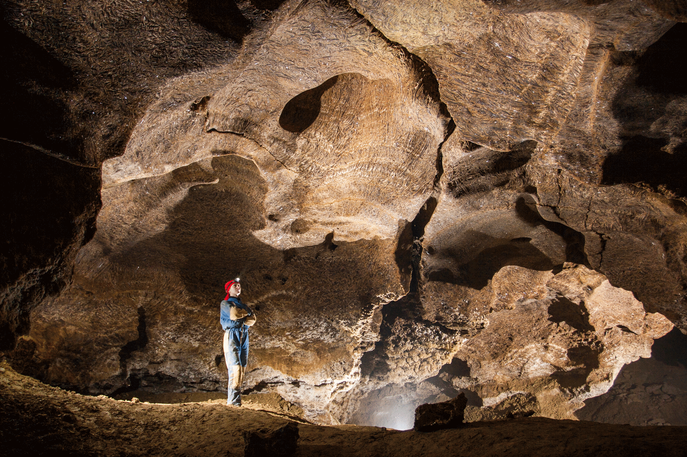
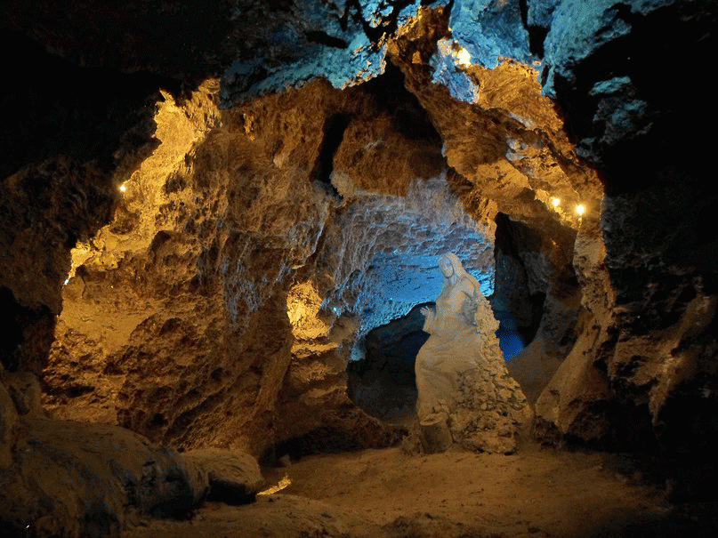
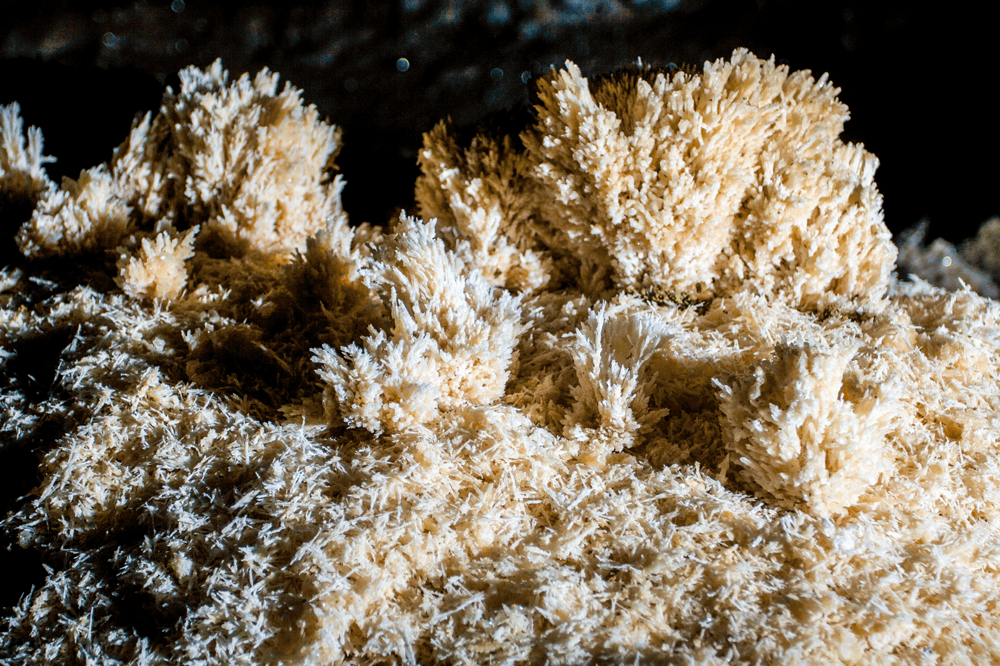
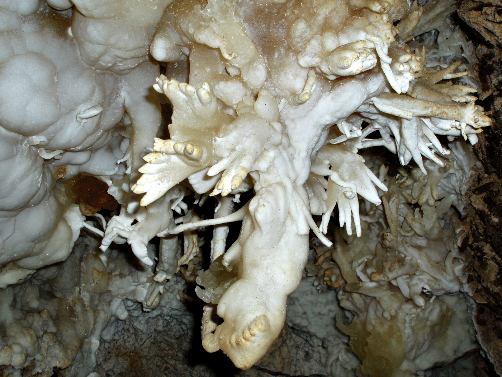
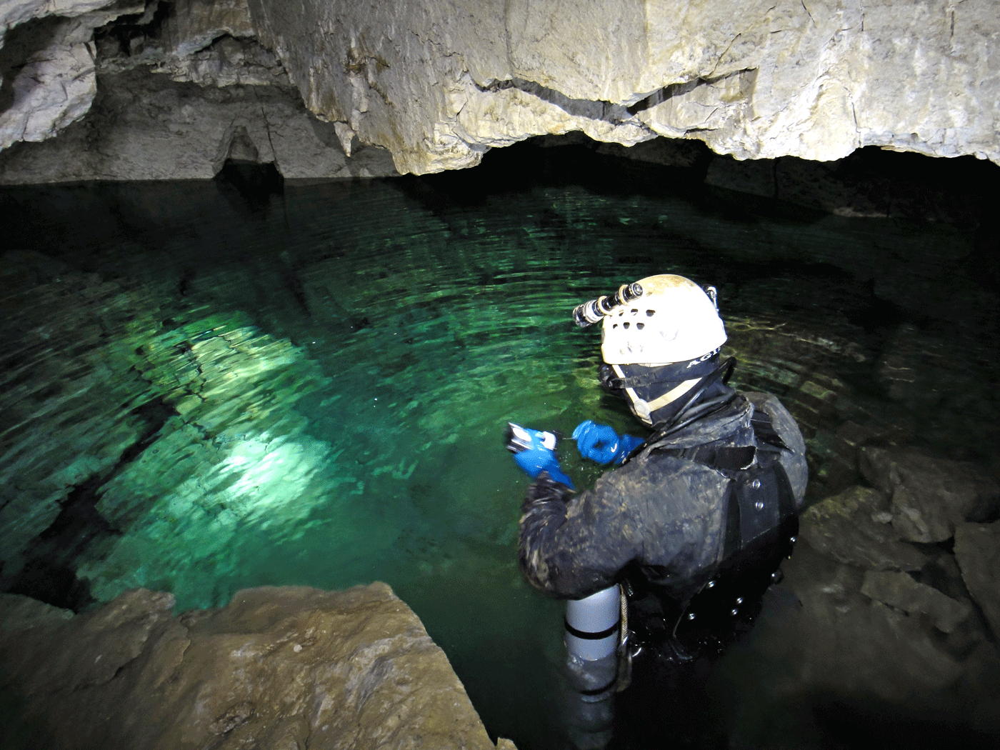
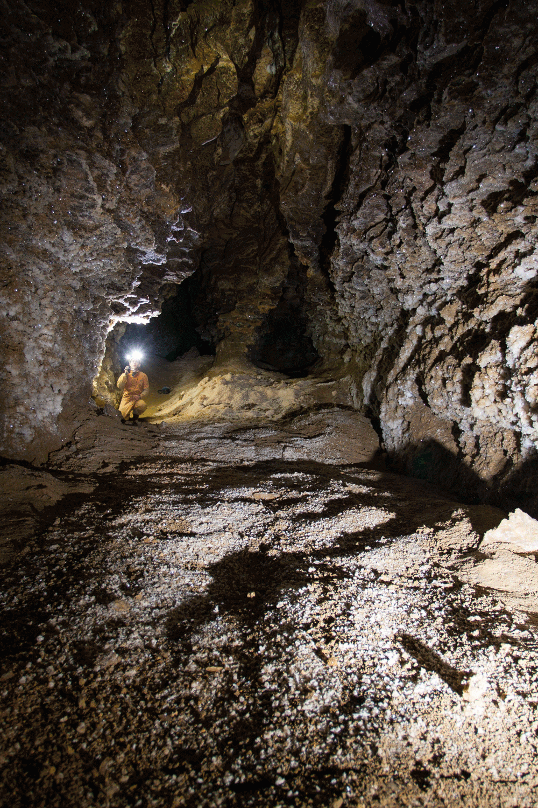
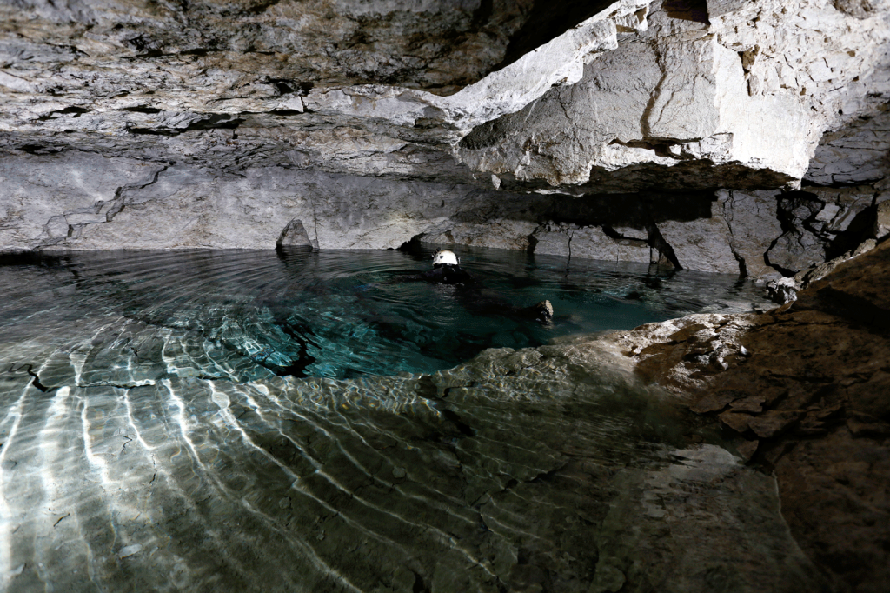
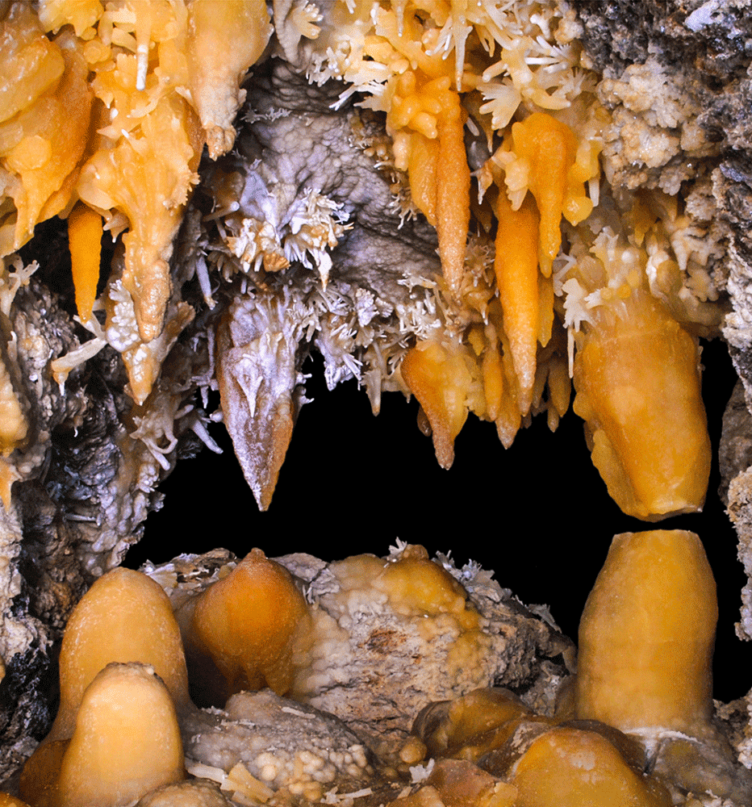

# About

From [Wikipedia](https://en.wikipedia.org/wiki/Optymistychna_Cave)

Optymistychna Cave
Optymistychna (Ukrainian: Оптимістична: meaning "optimistic", also known as Peschtschera Optimistitscheskaya)[2][a] is a gypsum cave located near the Ukrainian village of Korolivka, Chortkiv Raion, Ternopil Oblast.[3] Approximately 264 km (164 mi)[4] of passageways have been mapped within.[1] As a result, it is the longest cave in Europe and the seventh-longest cave in the world,[5] after [Mammoth Cave](), Sistema Sac Actun, [Jewel Cave](), Shuanghedong and Sistema Ox Bel Ha. It is also the longest gypsum cave in the world.[1][6]

History
The cave complex was discovered by the speleologists of the Lviv speleological club "Cyclope" in 1966. It was entirely unknown before then.[7] There have been more than 50 expeditions since then, but exploration has slowed significantly in recent years, and very little surveying is currently being done.[3] The cave is located very close to the Priest's Grotto or Ozerna Cave, the eleventh-longest cave in the world at 130.4 km (81.0 mi), but the two caves have not yet been found to be connected.[1]

In 2008, the cave was recognized as a Natural Wonder of Ukraine.[8]

Geology

Speleothems inside Optymistychna Cave.
The entire cave lies under a 2 km square area in a layer of Neogene period gypsum that is less than 30 metres (98 ft) thick.[7][9] The passages tend to be fairly small, no more than 3 metres (10 ft) wide and 1.5 metres (5 ft) tall for most, although at intersections they can be up to 10 metres (33 ft) tall.[7] They are often choked with mud. They comprise a dense network on several levels, making Optymistychna known as a "maze cave".

Optymistychna's gypsum bed is topped with a limestone layer, which has seeped through into the cave via erosion and formed into calcite speleothems.[7] At other places, the gypsum has formed crystals, often tinted a multitude of colors by mineral salts. In some areas, large gypsum rosettes have formed, colored black by manganese oxide.[7]

# Details

## Identification

- **Feature type:** Cave

## Cave and exploration data

- **Cave rating:** Advanced
- **Highest cave rating:** Advanced
- **Goes to water:** Yes
- **Surveyed length:** 264000 m

## Diving data

- **Water type:** Fresh

# References

## Images
- 
- 
- 
- 
- 
- 
- 
- 
- 
- 
