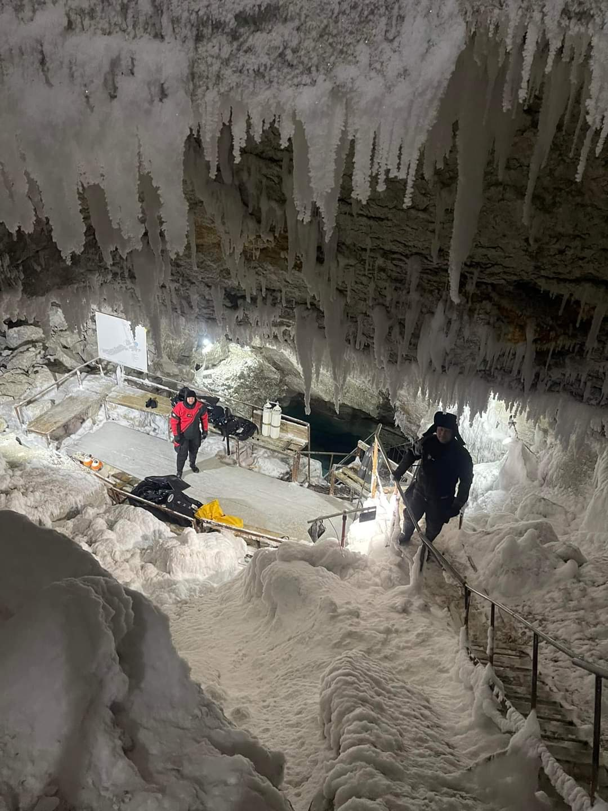
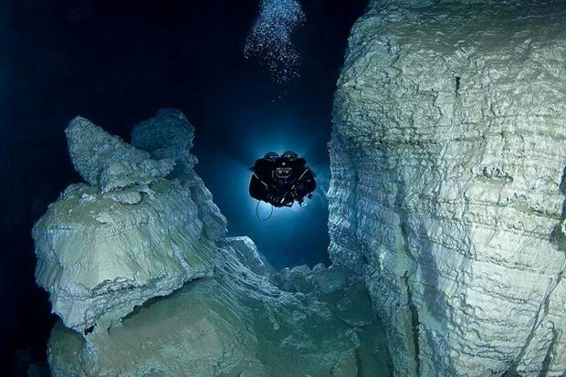
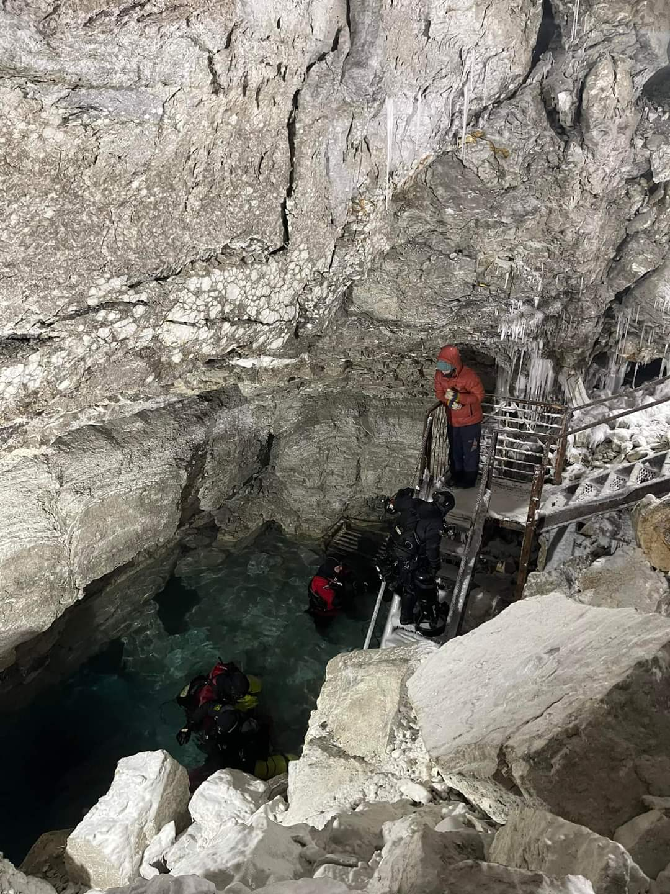
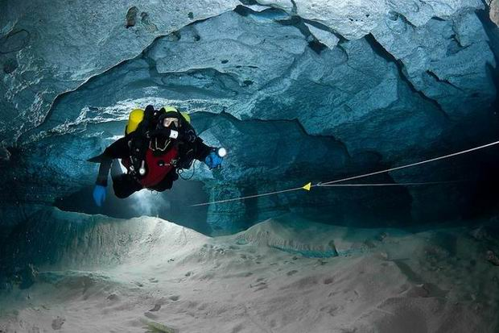
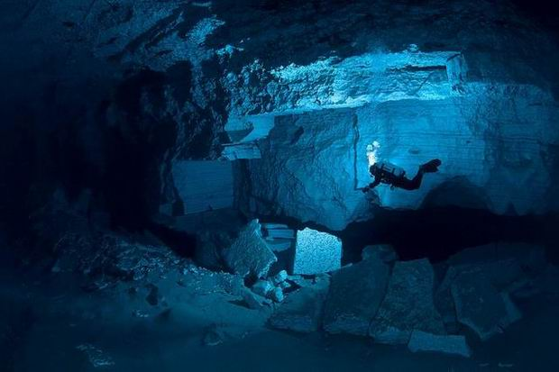
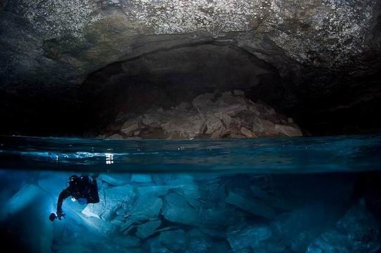
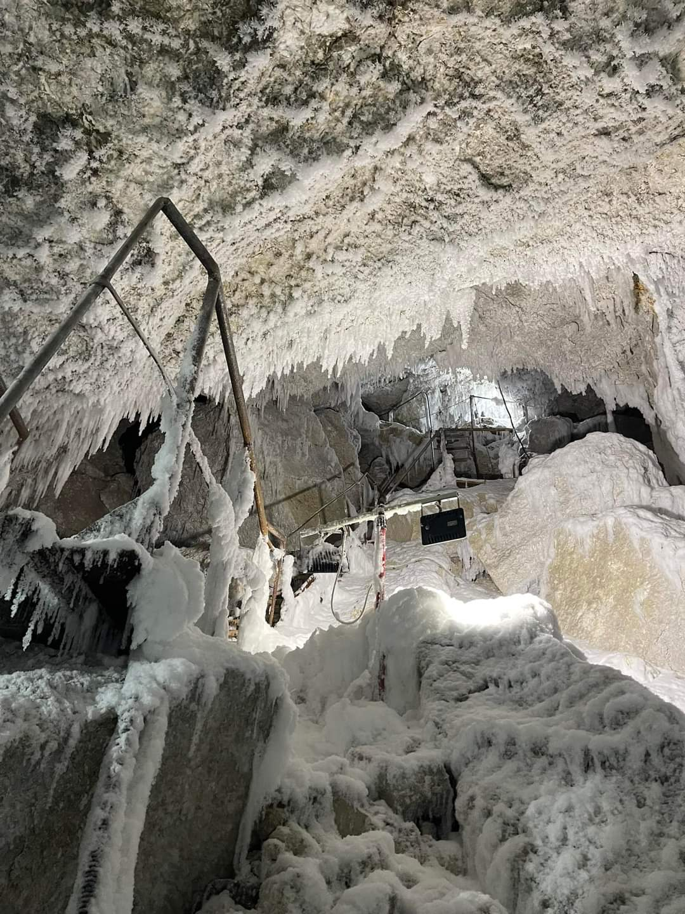
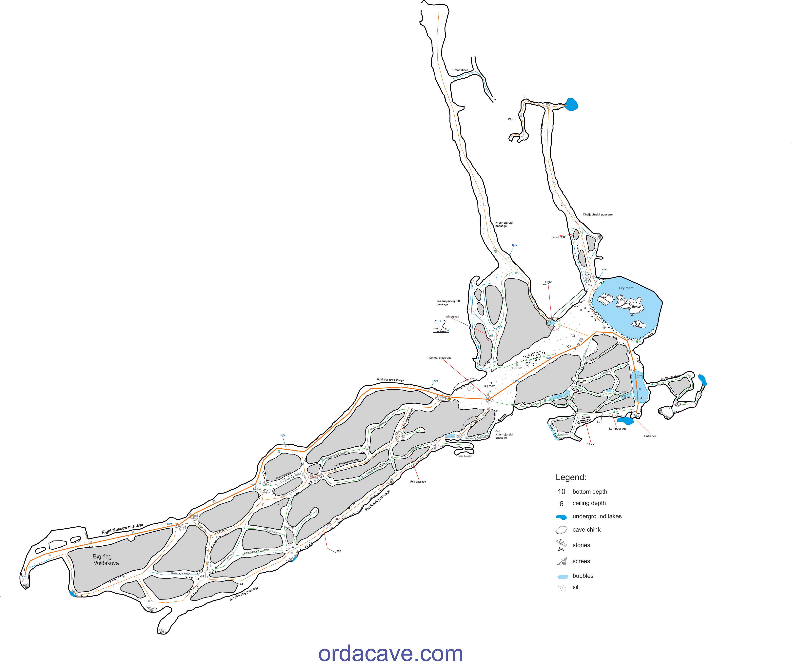
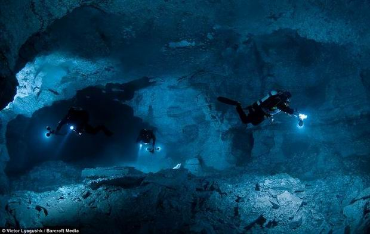

# About

Located near Orda village in Perm region, Ural, Orda Cave is also the biggest underwater gypsum crystal cave in the world and second in Eurasia in terms of volumes of its galleries that stretch up to five kilometers. And what makes it really special is the fact that it is a gypsum cave which means the interior does not resemble typical caves with the presence of stalactites and stalagmites. In the Orda Cave rock formations are arranged in the form of gypsum blocks, creating an unparalleled and unique underwater landscape. The miracle of the Ural, as the cave is also known, is located in Russia, right on the border between Europe and Asia, on the western side of the Ural mountains.

# Details

## Identification

- **Feature type:** Cave
- **System name:** Orda Cave

## Cave and exploration data

- **Cave rating:** Cave
- **Highest cave rating:** Advanced
- **Vertical access:** No
- **Exploration potential:** Low
- **Tourism potential:** Low
- **Goes to water:** Yes
- **Surveyed length:** 5000 m

## Diving data

- **Minimum depth:** 6 m
- **Maximum depth:** 30 m
- **Water type:** Fresh
- **Tidal:** No
- **Temperature:** 3–8 °C
- **Difficulty:** VeryHard
- **Entry difficulty:** Hard
- **Entry type:** Shore

## Access and warnings

https://ordacave.eu/

## Amenities

- **hasShowers:** Yes
- **hasToilets:** Yes
- **hasPhone:** Yes
- **food:** Ok
- **family:** Terrible
- **parking:** Outstanding

# References

## Images
- 
- 
- 
- 
- 
- 
- 
- 
- 
- [104e159d-97dc-4b1d-889b-77d56ff4d5b8](https://www.youtube.com/watch?v=0wvdweguCi4)
- [64d616a1-0cdb-4d48-8ab2-d6136387f1de](https://www.youtube.com/watch?v=0Orkg7cYYME)
