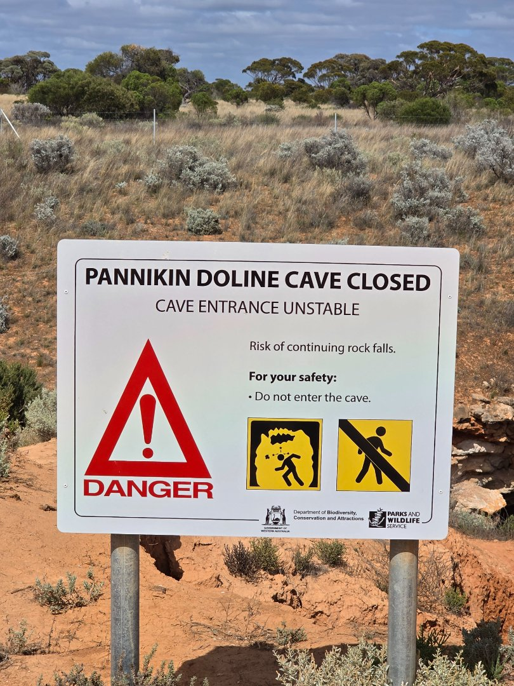
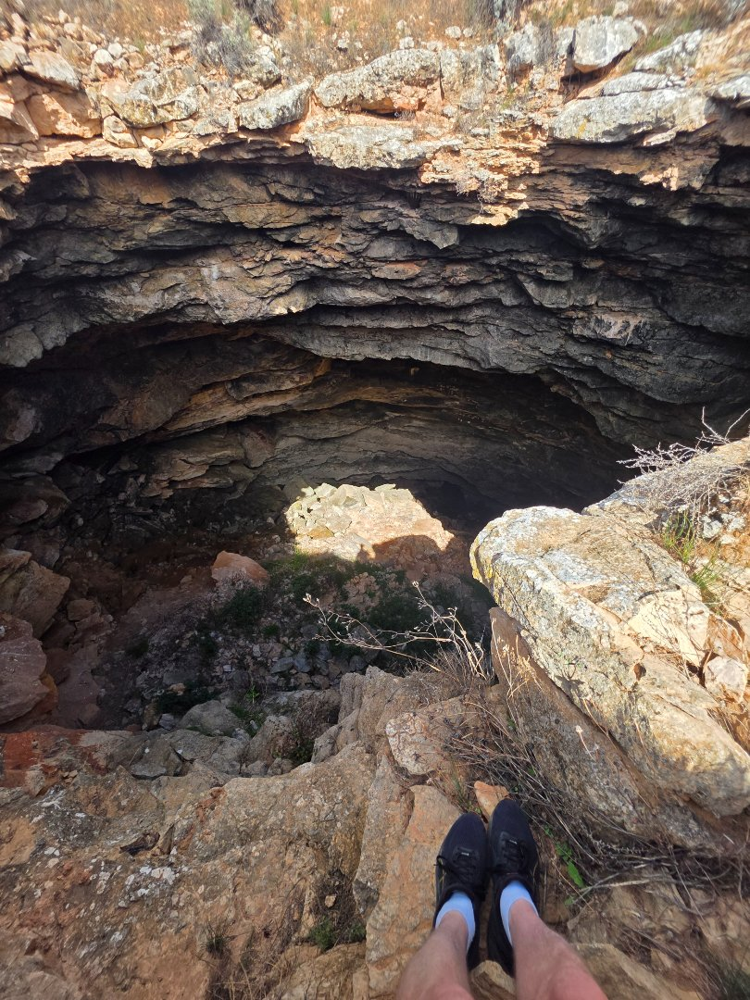
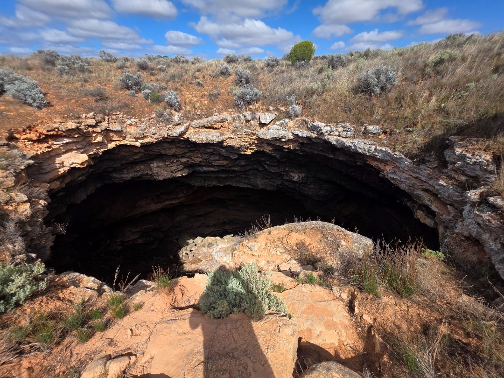
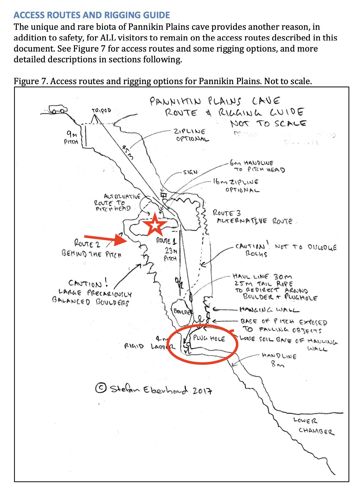
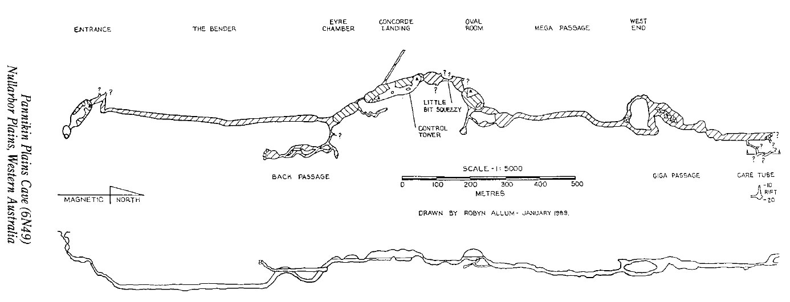

# About

## Images
- 
- 
- 
-  — Stefan Eberhard
- 

# Maps
- [Pannikin Plains - 6N49](https://github.com/twosharprocks/Karst-Database/blob/fea038978a0b2e4618141e26806c62aab33f2a69/Assets/a0906eaeb6c9c3e039d06e4a5eeb8c1b9d1833c1531c3f29623ca816c6661caf.pdf)

# Details

## Identification

- **Feature type:** Cave

## Cave and exploration data

- **Cave rating:** Advanced
- **Vertical access:** Yes
- **Exploration potential:** High
- **Goes to water:** Yes

# Maps

# References
[Pannikin Cave - Google Maps](https://maps.app.goo.gl/KSVMpW6PCV1LJYSy6) 