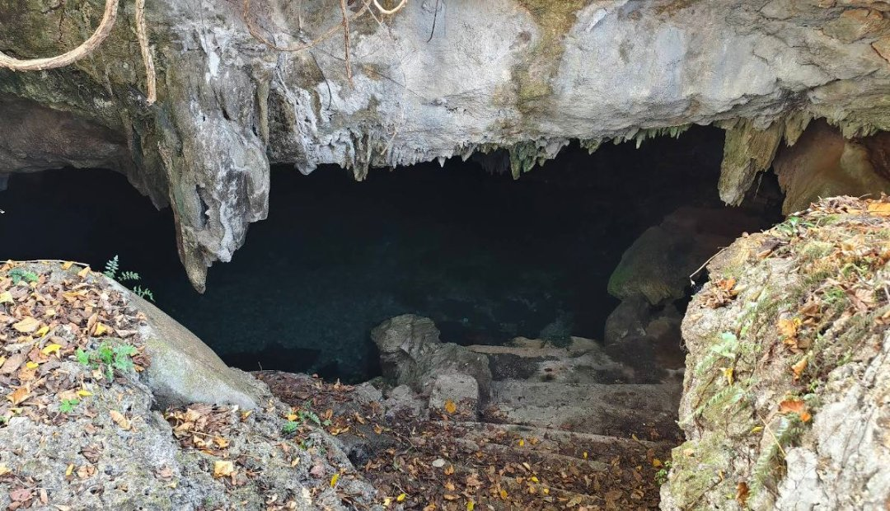
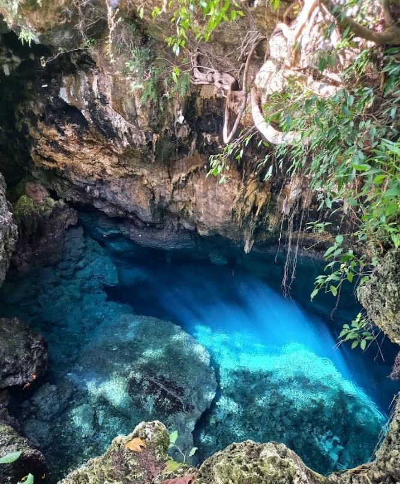
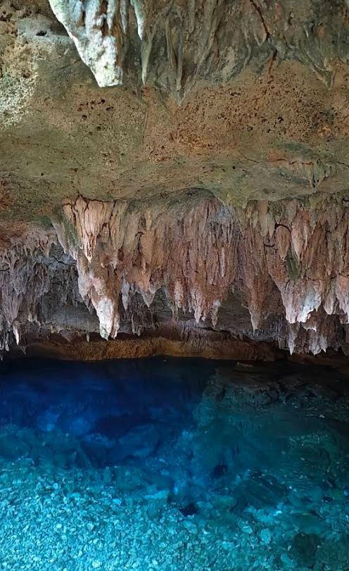

# Details

## Identification

- **Feature type:** Cave
- **System name:** Wisata Goa Lakaedu Boneoge Selatan, Gua Lakaedu

## Cave and exploration data

- **Vertical access:** No
- **Goes to water:** Yes

# References

## Images
- 
- 
- 
