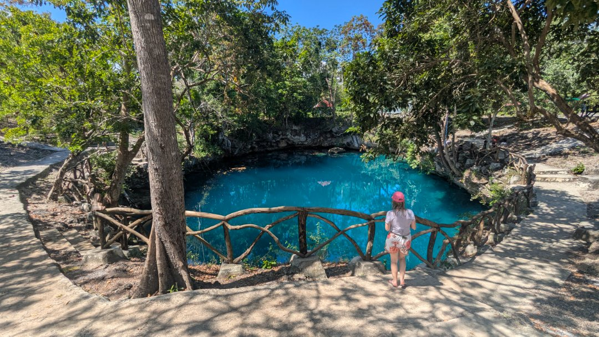

# About

Alam Moko is a vast blue hole close to 30 m in diameter
with direct exposure to daylight, surrounded by cliffs up to
6 m high. One passage develops to the west, but it is too narrow to allow the passage of a diver. The main passage develops to the east. It is in complete darkness, 16.5 m deep and
about 65 m long ending in a collapse of stones.

# References

## Images
- 

## Images
- [241 - 67c09ef9-83ed1117](https://github.com/twosharprocks/Karst-Database/blob/fea038978a0b2e4618141e26806c62aab33f2a69/Assets/4dbb8b5b04ef81a3ca7fad15a9922c39cd912241bb4d7595e3378b7de0041257.pdf)

# Details

## Identification

- **Feature type:** Cave

## Cave and exploration data

- **Cave rating:** Cave
- **Highest cave rating:** Advanced
- **Vertical access:** No
- **Tourism potential:** Medium
- **Disabled access potential:** Low
- **Goes to water:** Yes
- **Surveyed length:** 65 m

## Diving data

- **Maximum depth:** 16.5 m
- **Water type:** Salt

## Amenities

- **hasShowers:** No
- **hasToilets:** Yes
- **hasPhone:** Yes
- **family:** Good
- **parking:** Good
