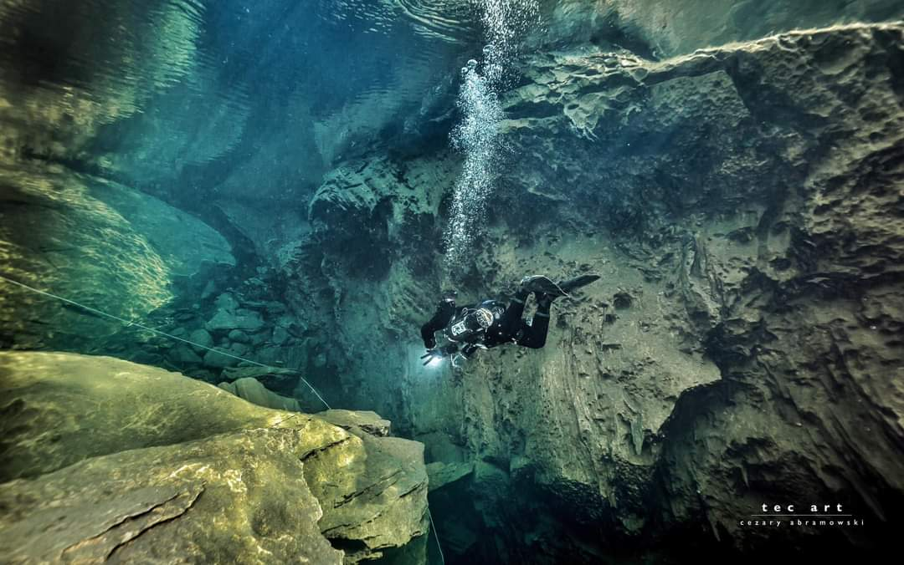
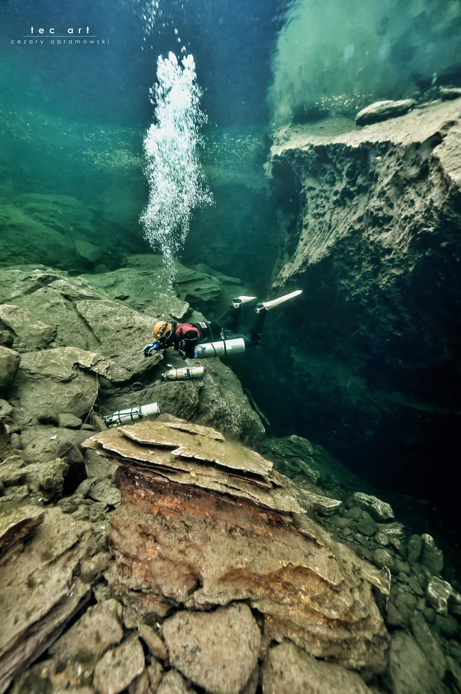

# Details

## Identification

- **Feature type:** Cave

## Cave and exploration data

- **Cave rating:** Advanced
- **Highest cave rating:** Advanced
- **Vertical access:** No
- **Tourism potential:** Medium
- **Goes to water:** Yes

## Diving data

- **Maximum depth:** 135 m
- **Water type:** Fresh
- **Tidal:** No

# References

## Images
- 
- 
- [plura_linemap - 9d3cc010-454886a8](https://github.com/twosharprocks/Karst-Database/blob/a91711b0be35b53a5de563e070ff13f8b90c3afa/Assets/75d2cbda3e4d10a66395e56d031acec1e629ebcb850dae56649a0885e35f0ac9.pdf)
