# About

Checked 23-06-2023 by MW: Clear and easy alternate entrance to Gran Gran system, well worth returning to in the future. Recommend gumboots for streamway.

# Details

## Identification

- **Feature type:** Cave
- **Reference:** L0015
- **System name:** Gran Gran
- **Source:** Forestry SA

## Cave and exploration data

- **Vertical access:** No
- **Exploration potential:** High
- **Tourism potential:** Medium
- **Goes to water:** Yes

# References

- **LSECR:** Page 52
Quarry Cave is entered via a low, rocky horizontal hole at the base of a 6 metre high quarry face next to a sealed highway near Gran Gran Corner, and it leads into a mud-floored chamber terminated by a large rockfall. The height to the ceiling is in the order of 3-4 metres, with a 2 metre high section in the centre of the chamber.
A low passage on the chamber's northern side leads to standing water and connects through to
nearby Gran Gran Cave (5L60).
Wetas have been observed here, and the presence of bats was also mentioned in a brief January 1964 CEGSA report by Bob Sexton, although none were observed by the author during a visit in the early 1980s.

## Images
- 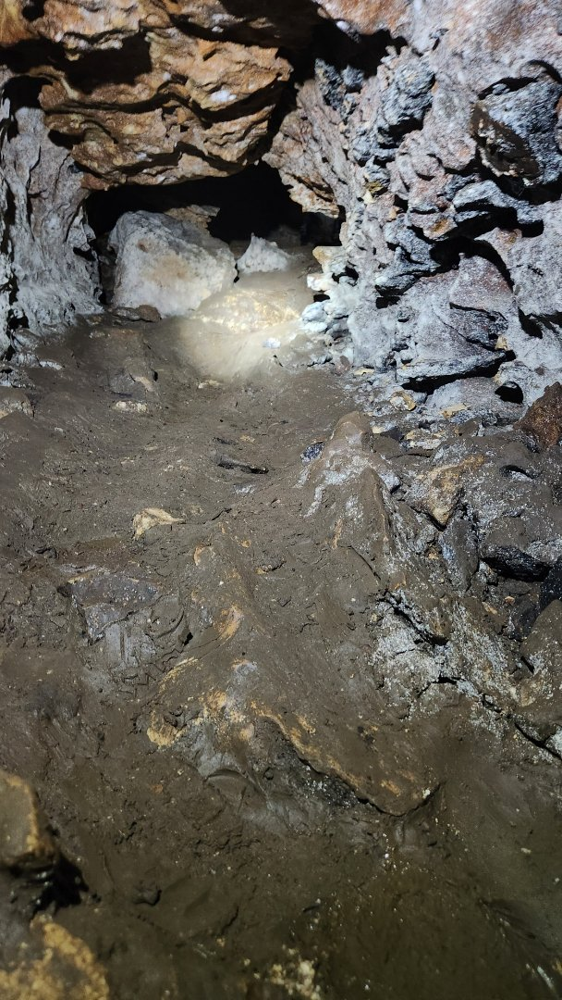
- 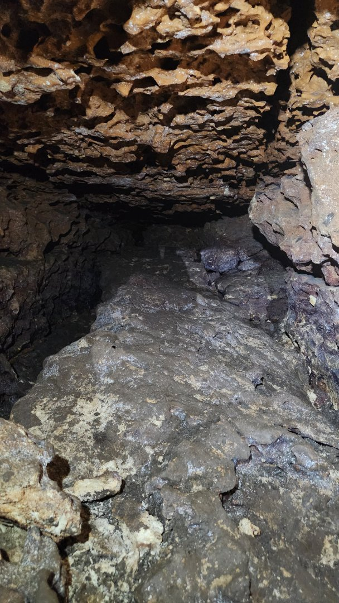
- 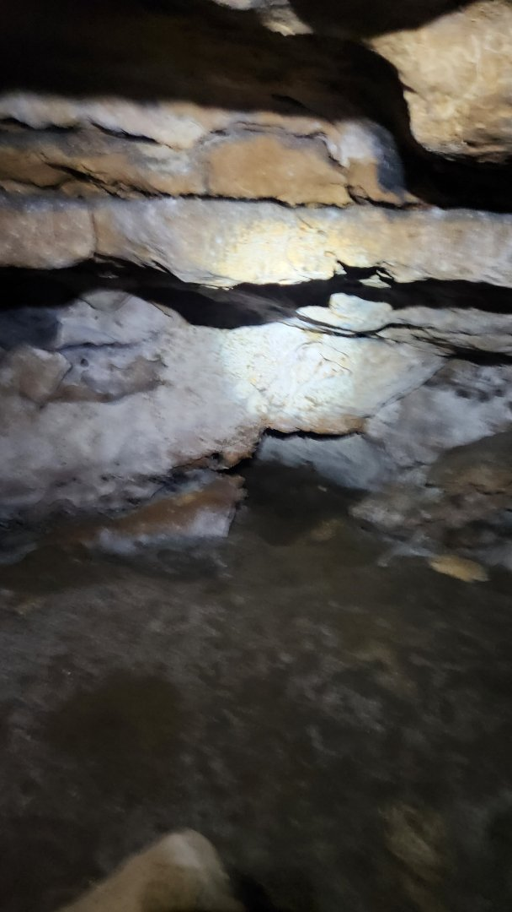
- 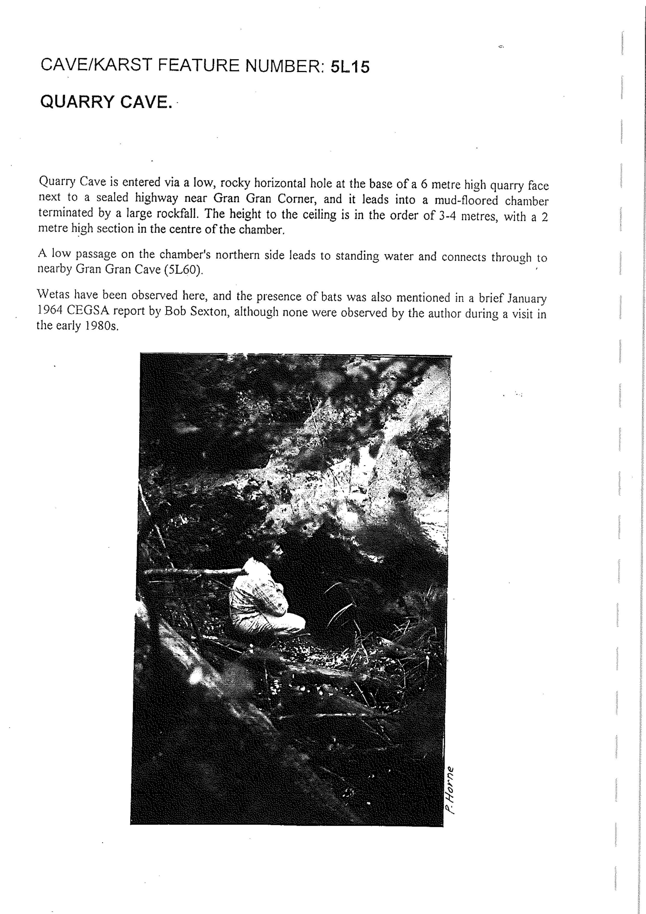
- 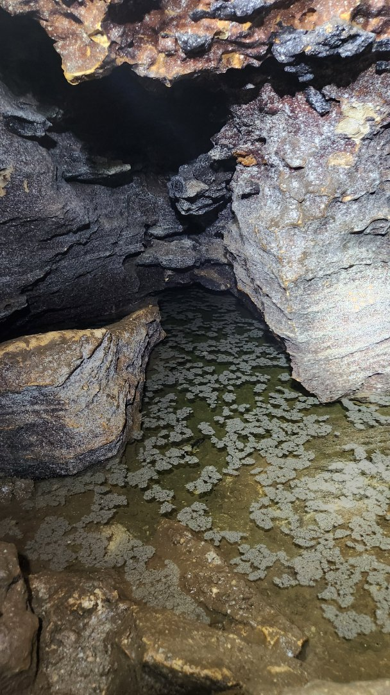
- 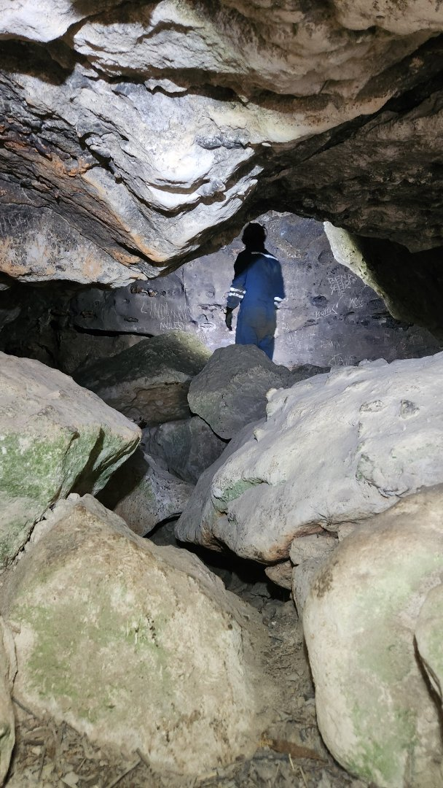
- 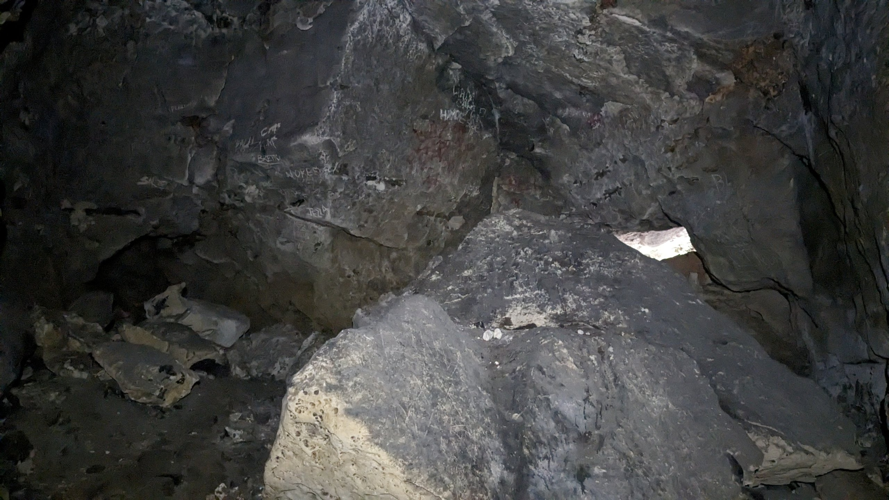
- 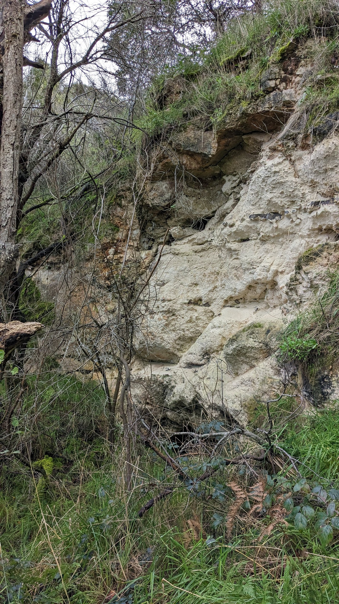
- 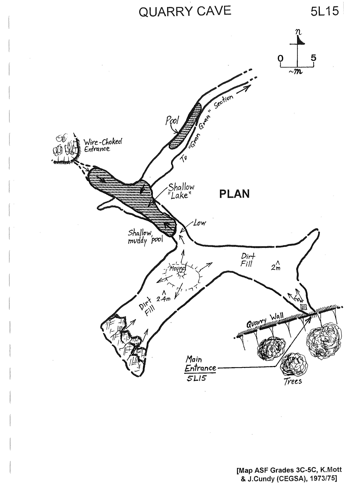
- 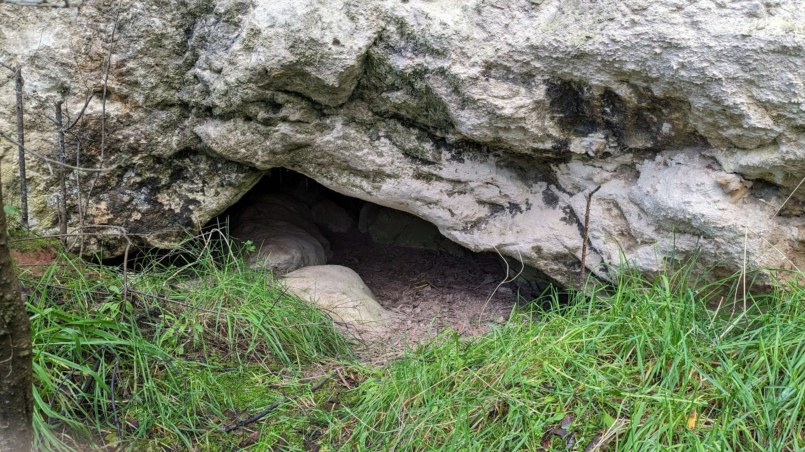
- 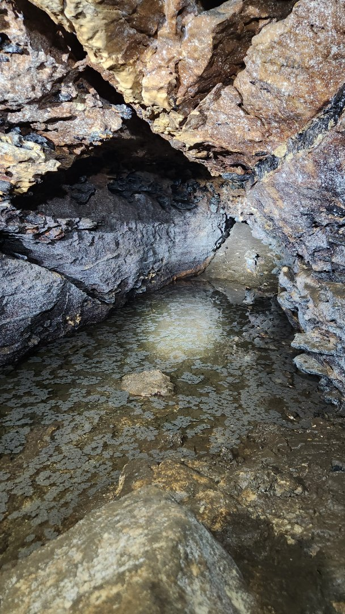
