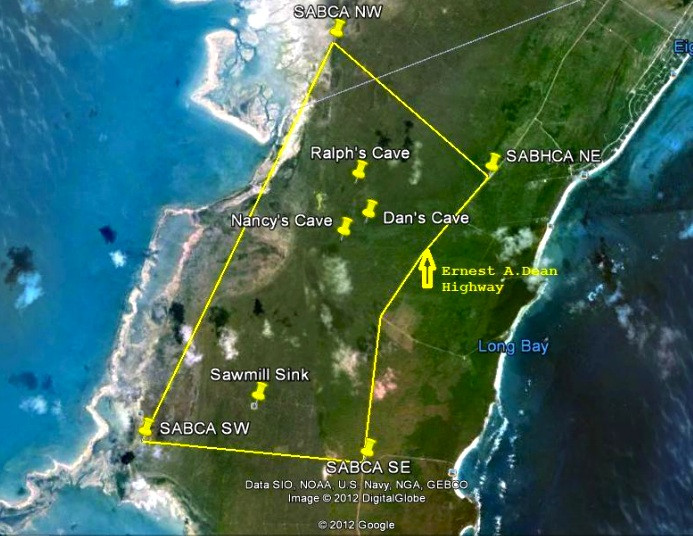
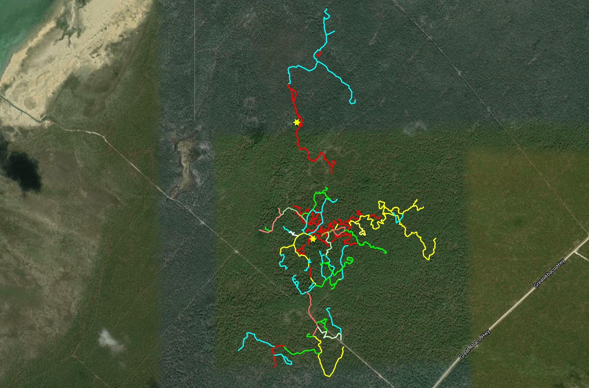
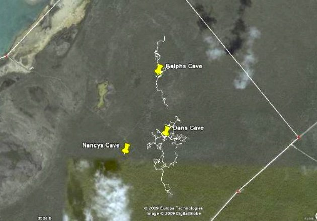

# Details

## Identification

- **Feature type:** Cave
- **Source:** Mindat

## Cave and exploration data

- **Cave rating:** Advanced
- **Vertical access:** No
- **Exploration potential:** Medium
- **Tourism potential:** Low
- **Goes to water:** Yes

# Additional Notes

- **Bahamas Caves:** http://www.bahamascaves.com/exploration/abacoralphscave.html

# Maps

- 

# References

- **cavdiving.pictures:** https://www.cavediving.pictures/copie-de-ralph-s-cave-glass-factory
- **ADM:** http://www.advanceddivermagazine.com/articles/crystal/crystal.html

## Images
- 
- 
- 
