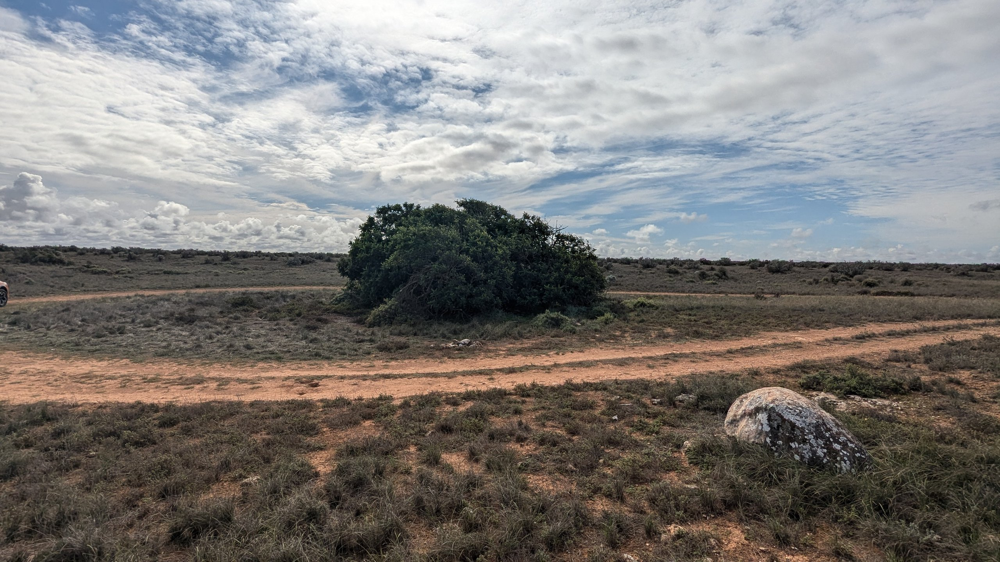
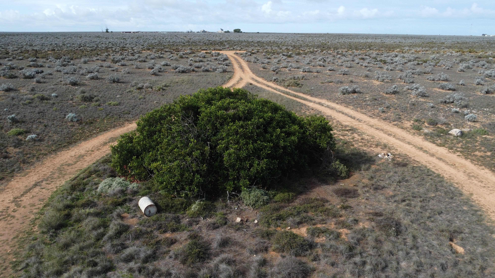
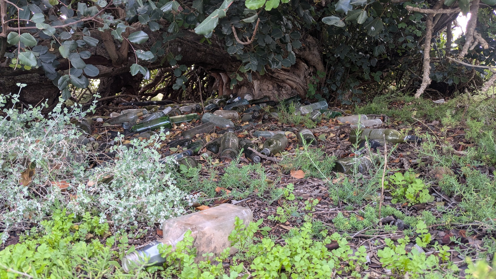

# About

Checked by MW 13-07-2024
No cave, just a tree with lots of rubbish and drums

# Details

## Identification

- **Feature type:** Destroyed

## Cave and exploration data

- **Vertical access:** No
- **Disabled access potential:** High
- **Goes to water:** No

## Amenities

- **hasShowers:** No
- **hasToilets:** No

# References

## Images
- 
- 
- 
