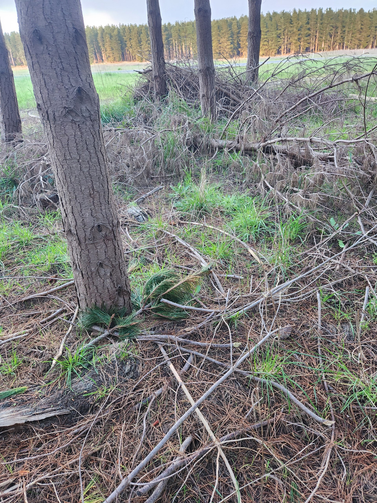
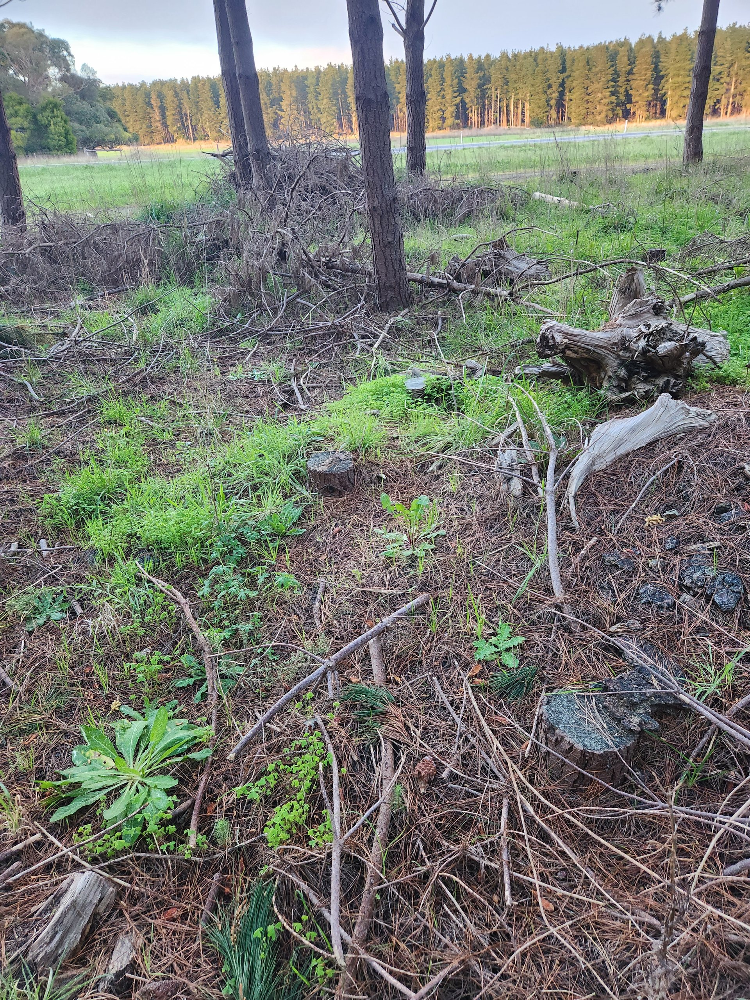

# About

2021-Aug: MW visited on foot. Several small depressions full of pine needles and clearings with broken limestone between mark and southern treeline. Likely digging in depressions will expose further limestone and potential water entry points.

Worth exploring this area and other potential limestone outcrops heading in 310-340deg (NW) direction

# Details

## Identification

- **Feature type:** RockyOutcrop

## Cave and exploration data

- **Vertical access:** No
- **Exploration potential:** Medium
- **Disabled access potential:** Low
- **Goes to water:** No

# References

## Images
- 
- 
