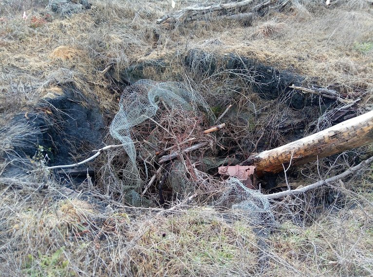

# About

2021-Aug: MW visited on foot & photographed. Small depression filled with rubbish and fencing material.

# Details

## Identification

- **Feature type:** Destroyed

## Cave and exploration data

- **Vertical access:** No
- **Goes to water:** No

# References

- **Forestry:** 2m wide by 2m deep

## Images
- 
