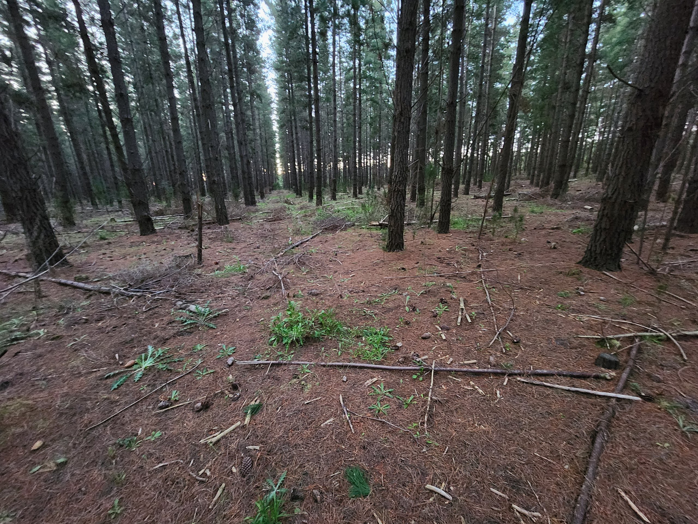
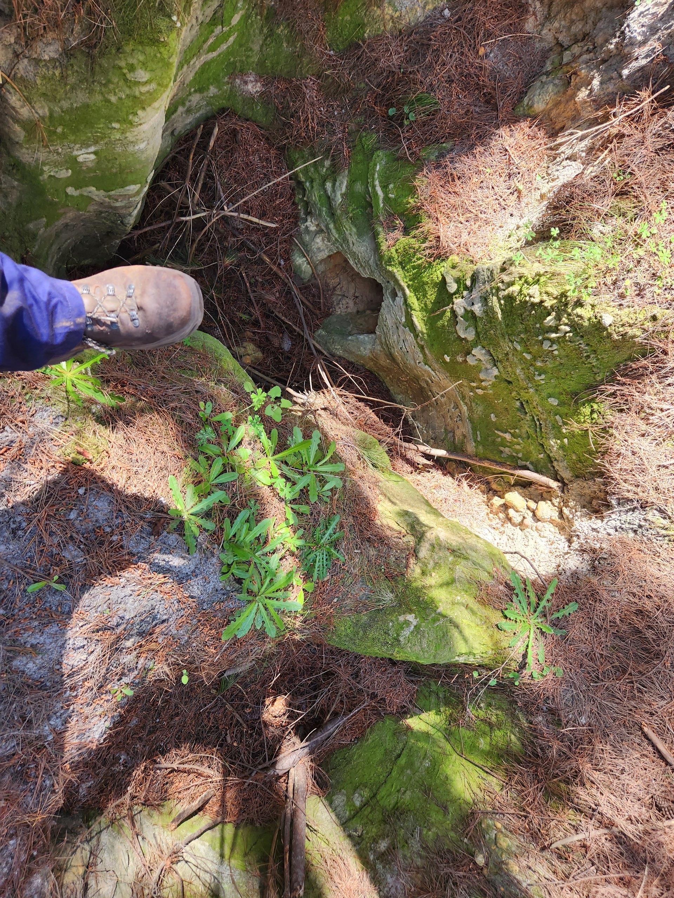
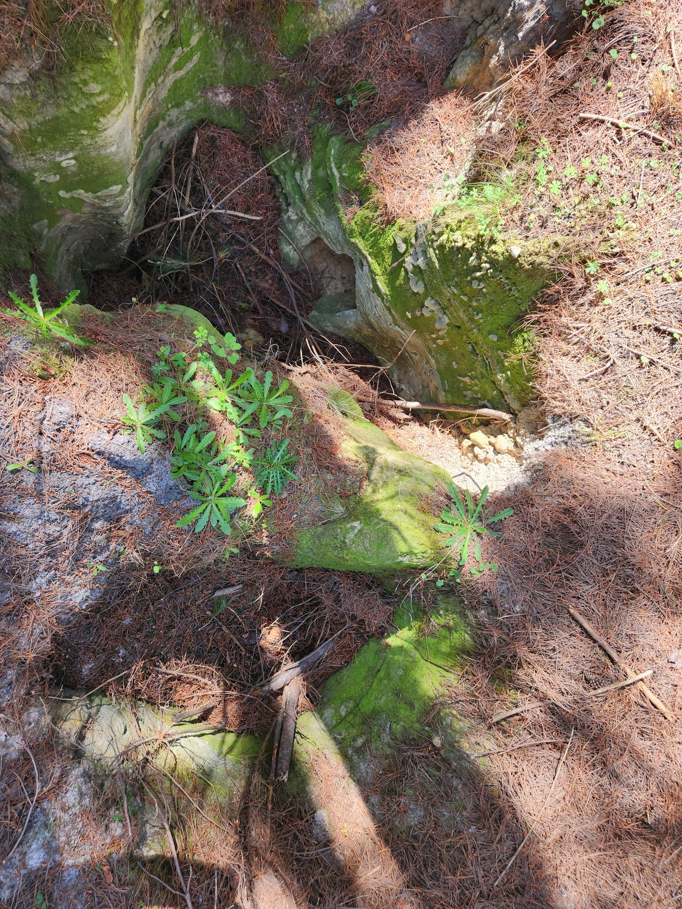
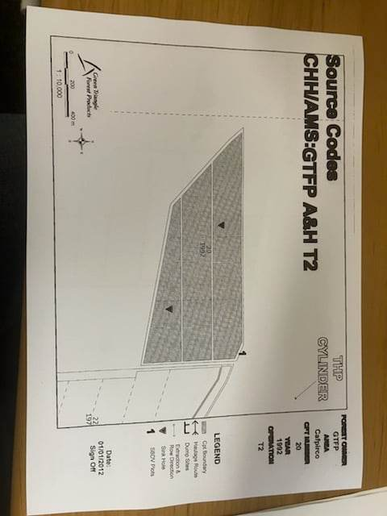

# About

From Col's List
BC 23/8/2023: no sign of any thing interesting. Explored the surrounding area but nothing

# Details

## Identification

- **Feature type:** NotFound

# References

## Images
- 
- 
- 
- 
