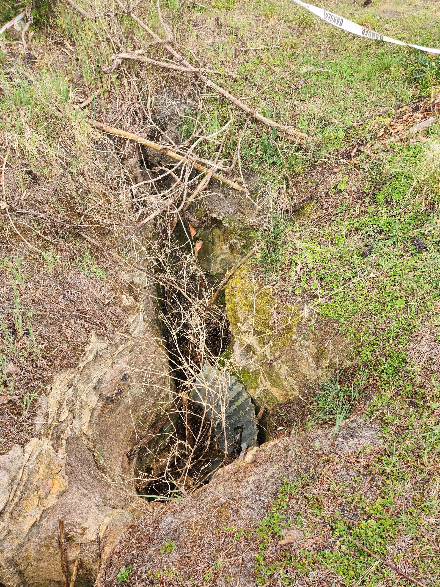
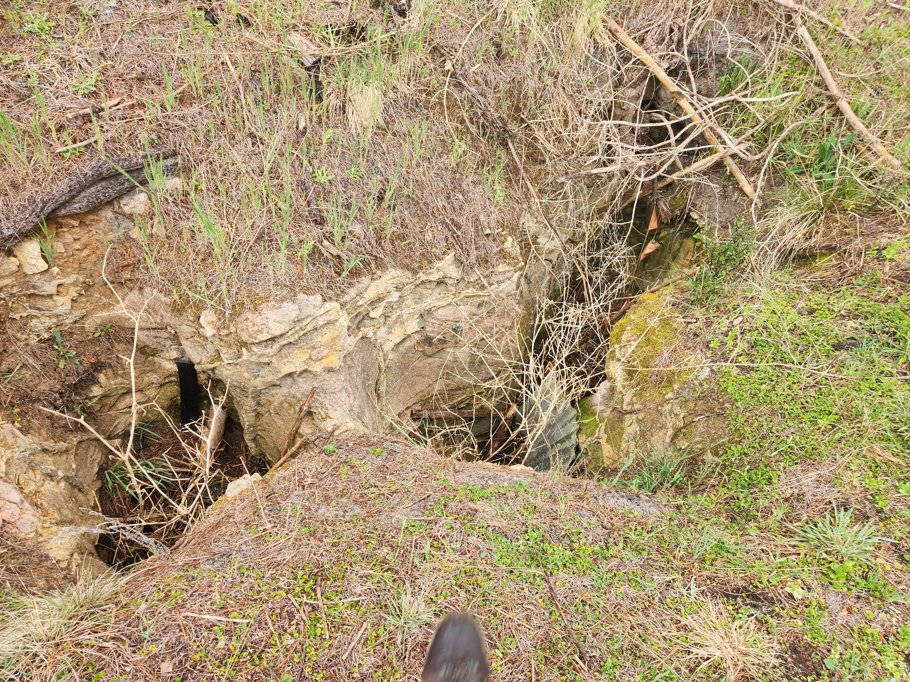
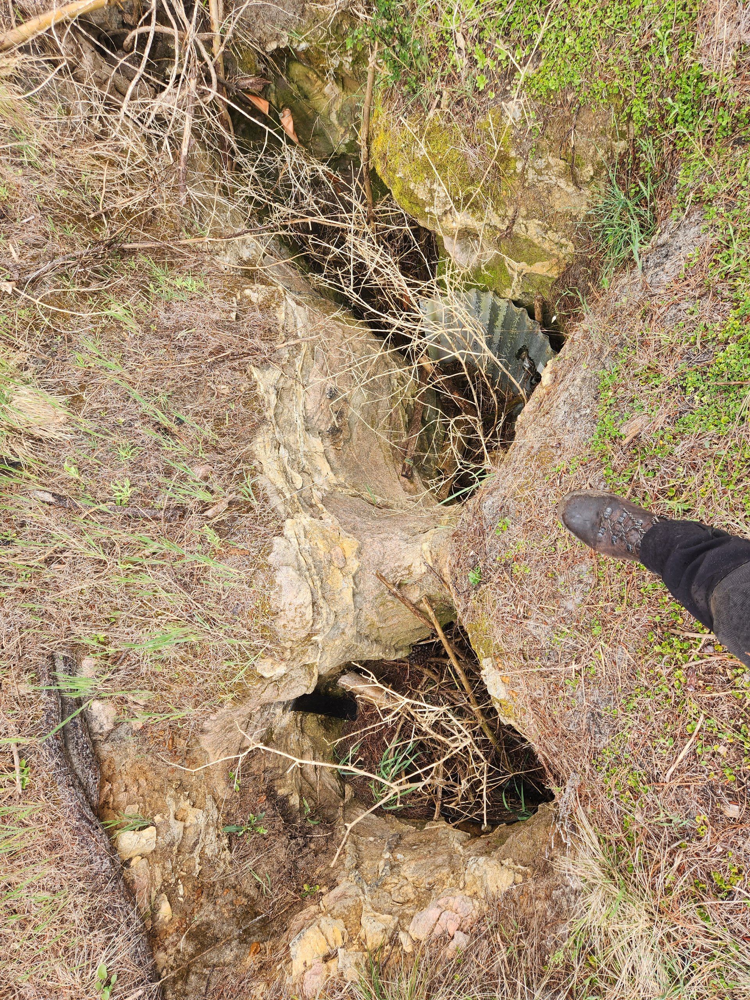
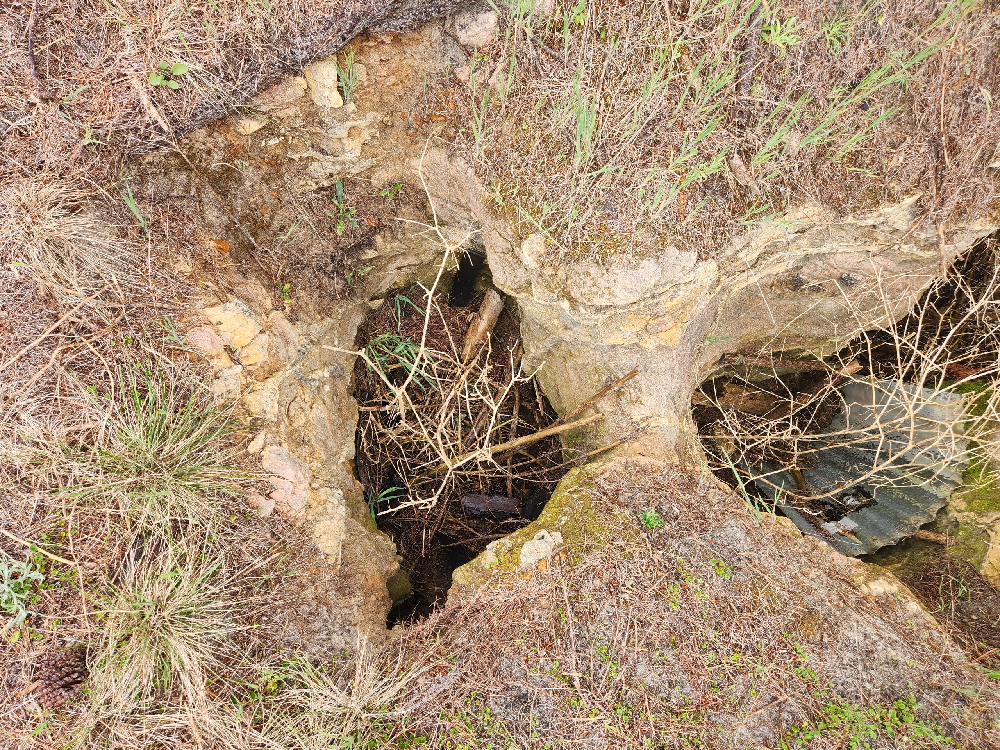
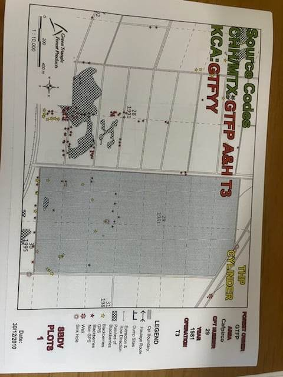

# About

From Col's List
BC 14/10/2023: Small sinkholl approx 1.5m deep. Full of forest litter,  needs clearing to explore further

# Details

## Identification

- **Feature type:** Sinkhole

## Cave and exploration data

- **Exploration potential:** Low

# References

## Images
- 
- 
- 
- 
- 
