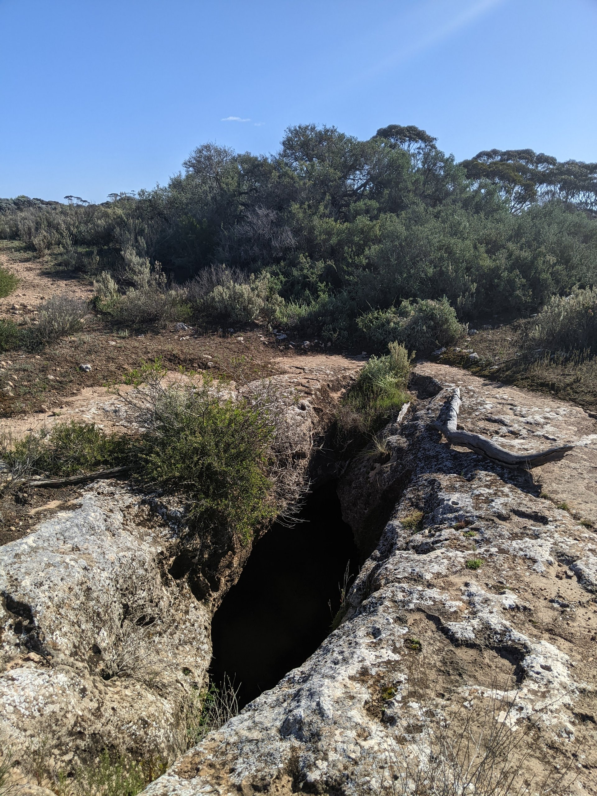
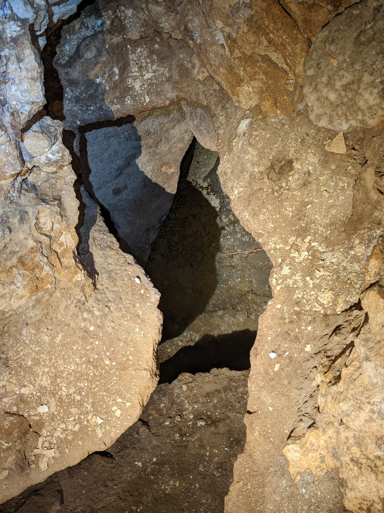
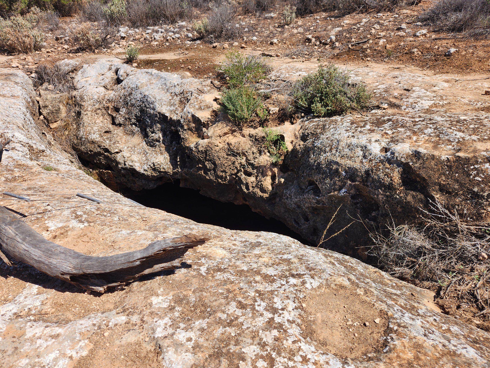
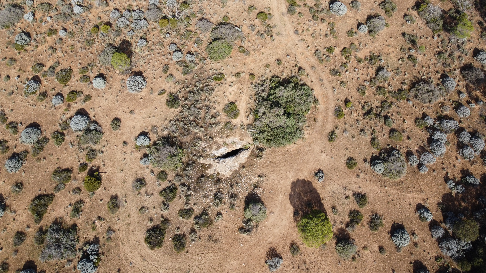
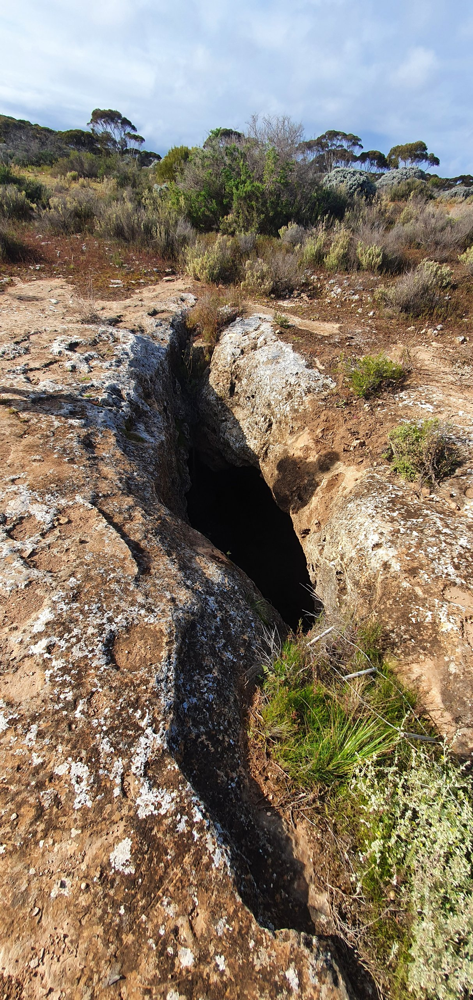

# About

Slot cave is located on the Roe Plains close to Burnabbie Cave. There is a well defined track leading from the main track to the cave itself.  The cave is a slot about 10m long and 1-1.5m at its widest. The drop is about 4m and you will need a ladder or ropes to enter. There are two dives here, the upstream and the downstream.

### Upstream

The upstream is an advance cave dive but quite open.

### Downstream

The downstream side is a tight squeeze through black silt to get to a relatively open clear section after 5-10m. There you can go left or right. Left will take you to progressively tighter and dirtier sections until it comes to an end. Turning right you face a tight restriction to push through ending in an air chamber. If you cross this you will come a 20-30m dry tunnel leading to another big tunnel.

# Details

## Identification

- **Feature type:** Cave

## Cave and exploration data

- **Cave rating:** Advanced
- **Vertical access:** Yes
- **Exploration potential:** VeryHigh
- **Goes to water:** Yes

## Diving data

- **Water type:** Salt
- **Tidal:** No

# Maps

- [site - 4d402a72-76c76c32](https://github.com/twosharprocks/Karst-Database/blob/d6f539534154fcd23f60d0a25899bf7ef553f1d8/Regions/Oceania/Australia/6N%20-%20Nullabor%20and%20Roe%20Plains/KML_Data/Slot%20Cave.kml)

# References

## Images
- 
- 
- 
- 
- 
