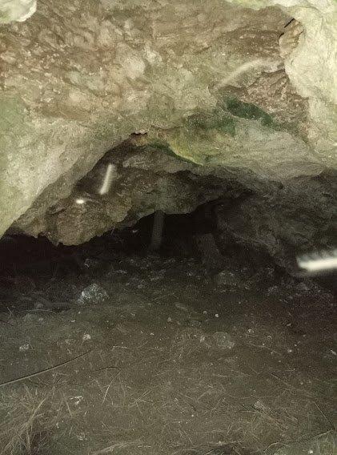
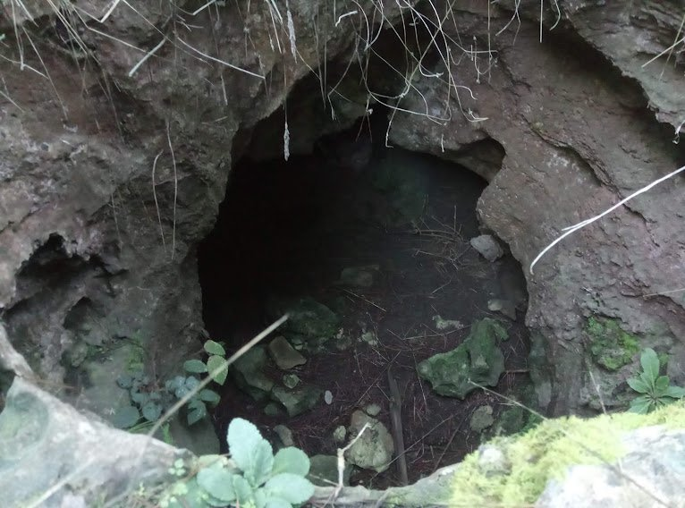
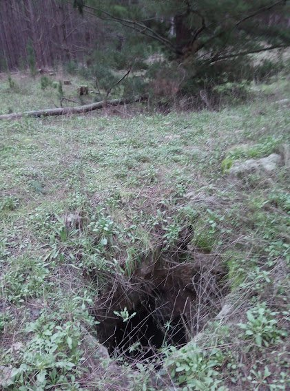
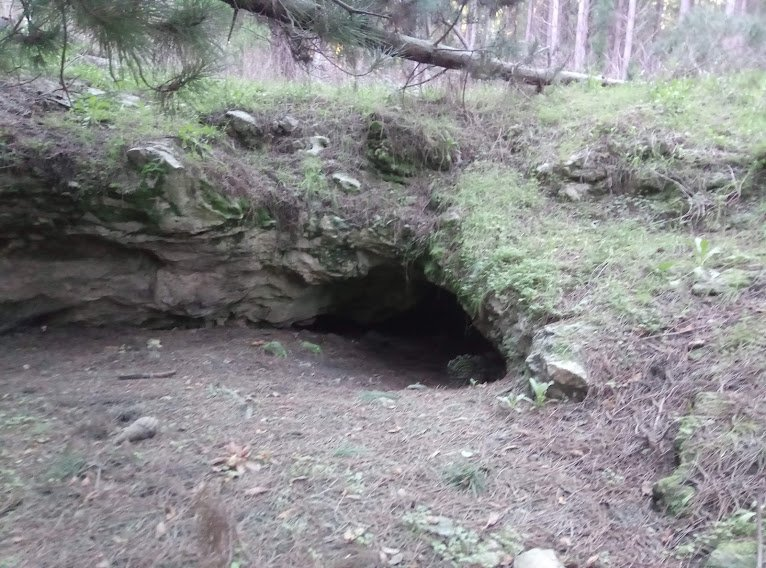

# About

2021-Aug: MW visited on foot & photographed. Sinkhole with large pine tree growing. Eastern side of sinkhole has a small cave that connects to a solution tube just west (between coordinates and vehicle track). Unlikely to be an extensive feature, but worth further investigation with coveralls and headlamp.

# Details

## Identification

- **Feature type:** Cave
- **Source:** Forestry

## Cave and exploration data

- **Vertical access:** No
- **Tourism potential:** Low
- **Disabled access potential:** Low
- **Goes to water:** No

## Amenities

- **hasShowers:** No
- **hasToilets:** No
- **hasPhone:** Yes

# References

- **Forestry:** Thin Roof: ?, Fence: ?. Dimensions: ?. Features: Sinkhole

## Images
- 
- 
- 
- 
