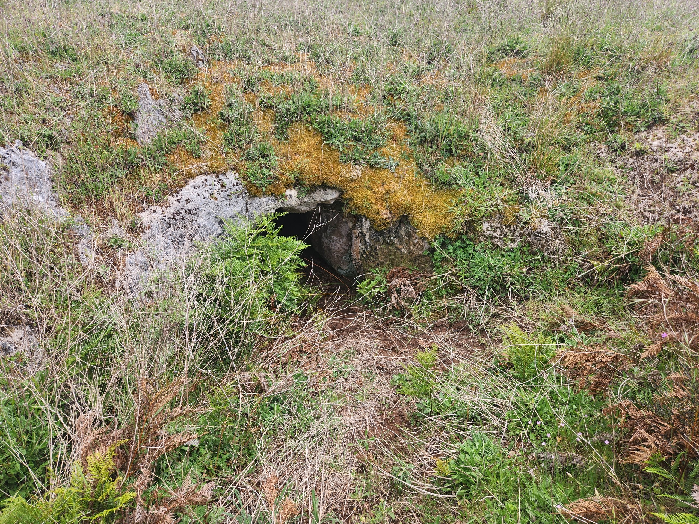
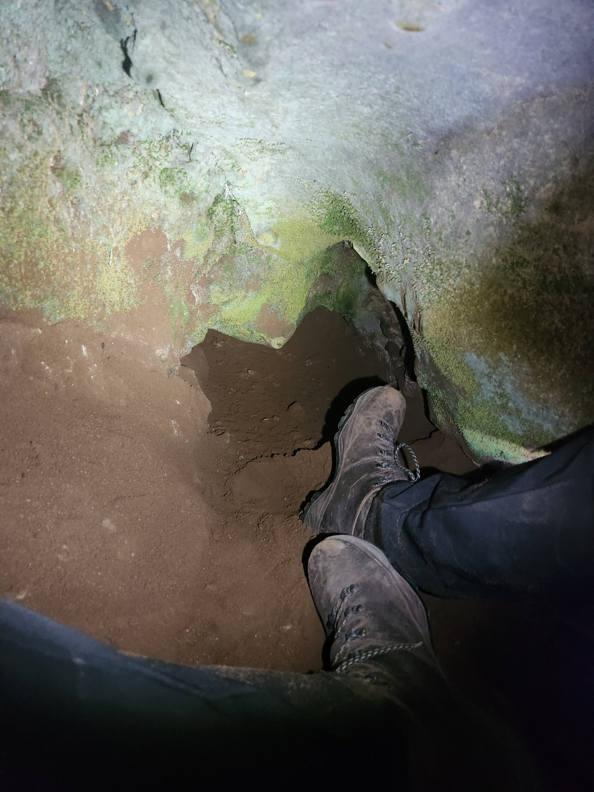

# About

BC 4/11/2023: Small entrance leading to a small tight cave that tails off after a few meters.

# Details

## Identification

- **Feature type:** Cave

## Cave and exploration data

- **Vertical access:** No
- **Exploration potential:** Low

# References

## Images
- 
- 
