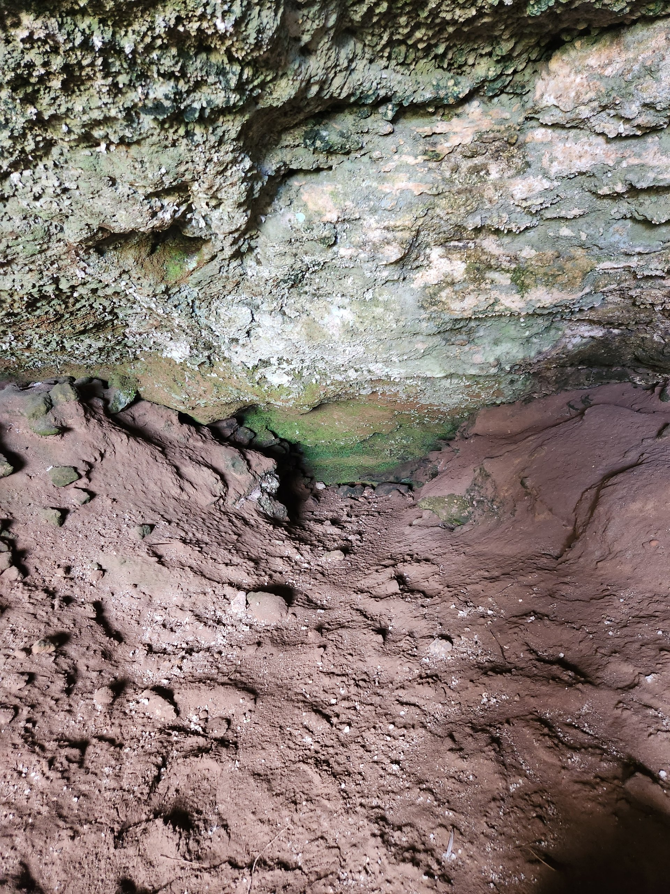
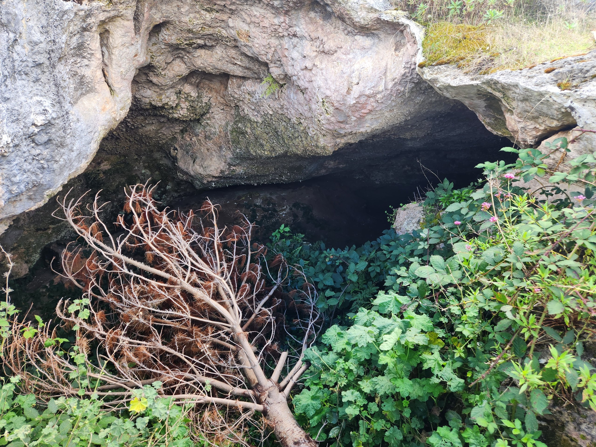
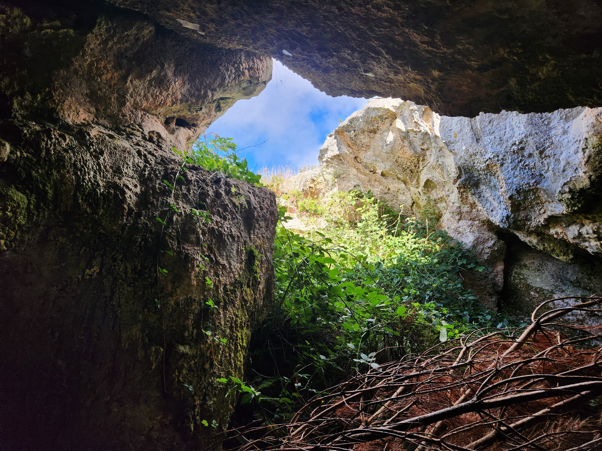
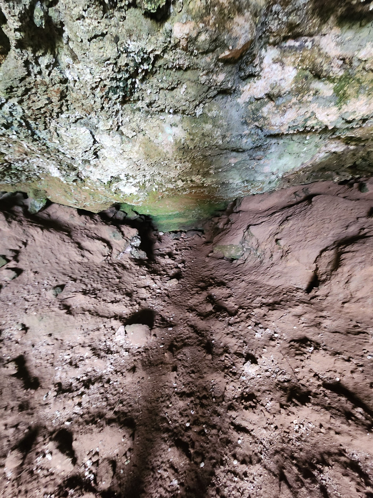
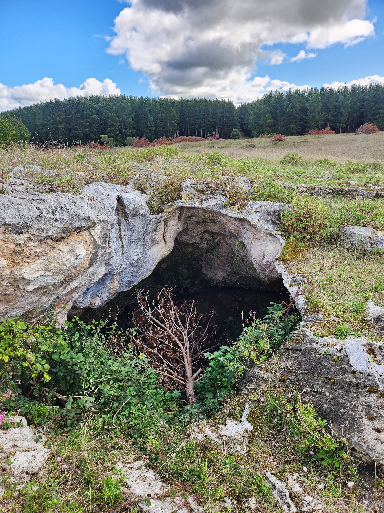

# Details

## Identification

- **Feature type:** Cave

## Cave and exploration data

- **Vertical access:** No
- **Exploration potential:** Low
- **Tourism potential:** Low
- **Goes to water:** No

# References

## Images
- 
- 
- 
- 
- 
