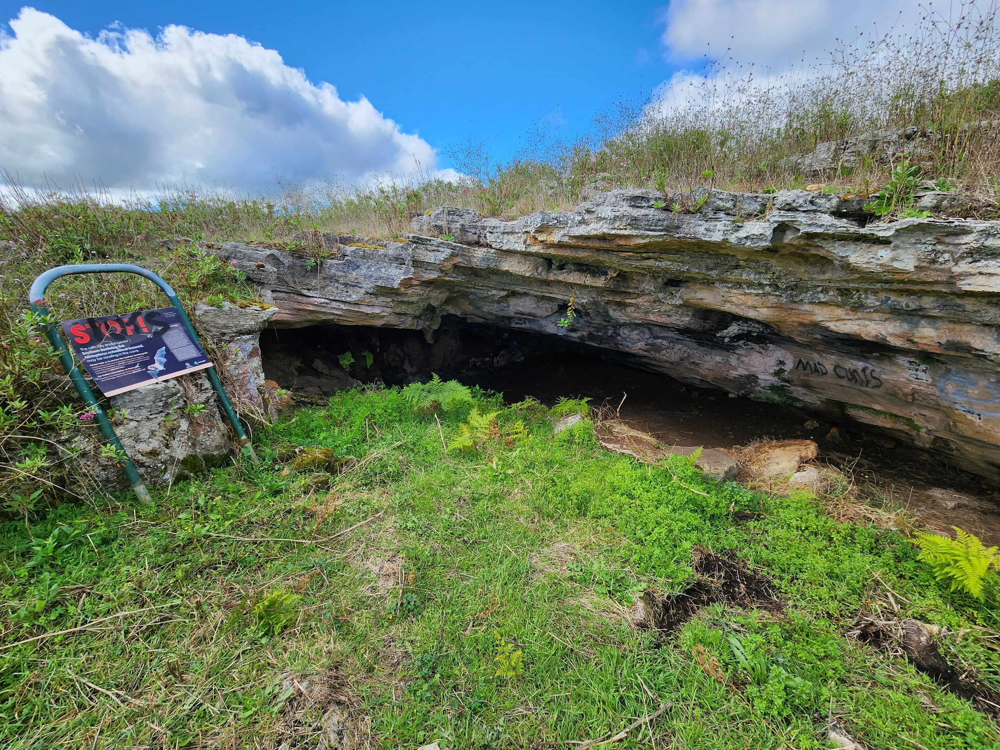
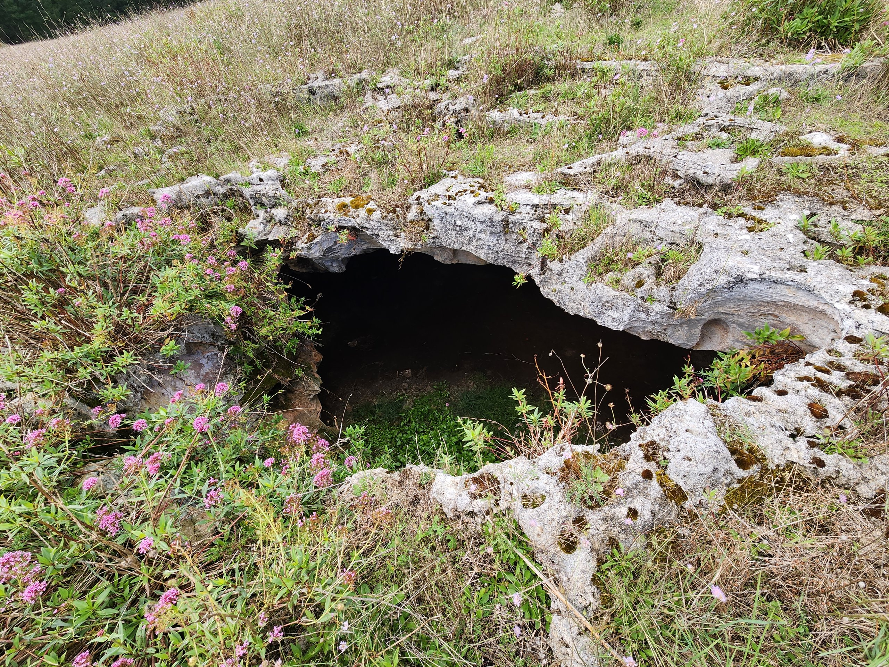
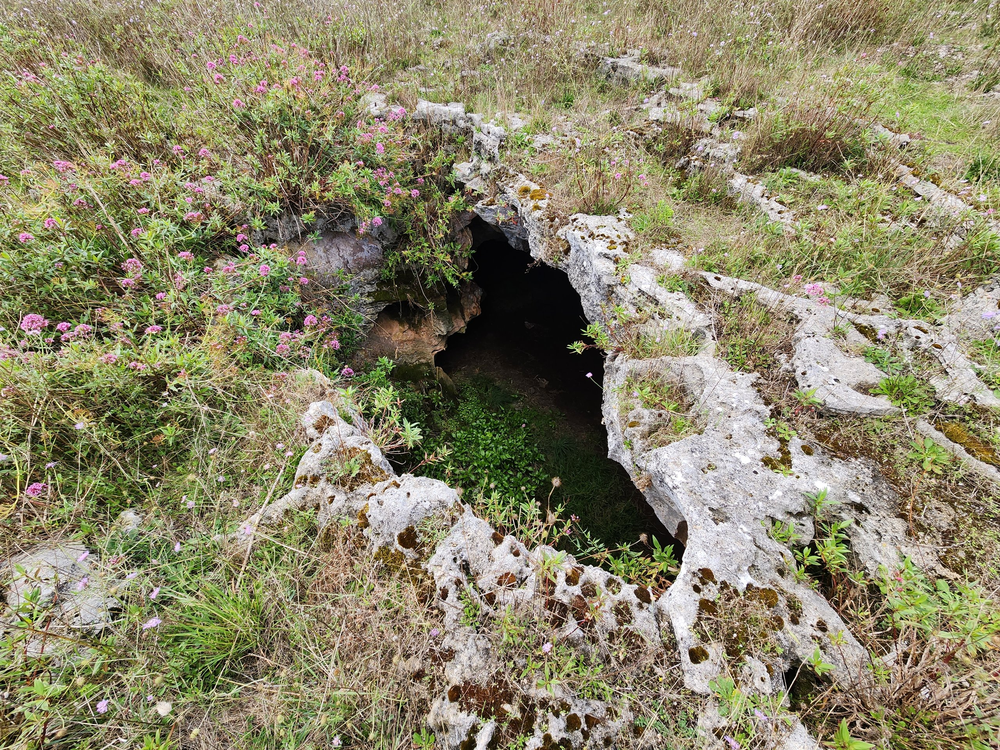

# About

Opens into 2 reasonable sized cave 3-5m in diameter. Lots of graffiti. No obvious places to explore.

# Details

## Identification

- **Feature type:** Cave
- **Reference:** L0119a
- **Source:** Forestry SA

## Cave and exploration data

- **Vertical access:** No
- **Exploration potential:** Low
- **Tourism potential:** Medium
- **Goes to water:** No

## Access and warnings

Forestry

# References

- **LSECR:** Page 236
- **Forestry SA:** L0119, Thin Roof: Y, Fence: R. Dimensions: ?. Features: bats/snails/moss  Fence around broad area

## Images
- 
- 
- 
