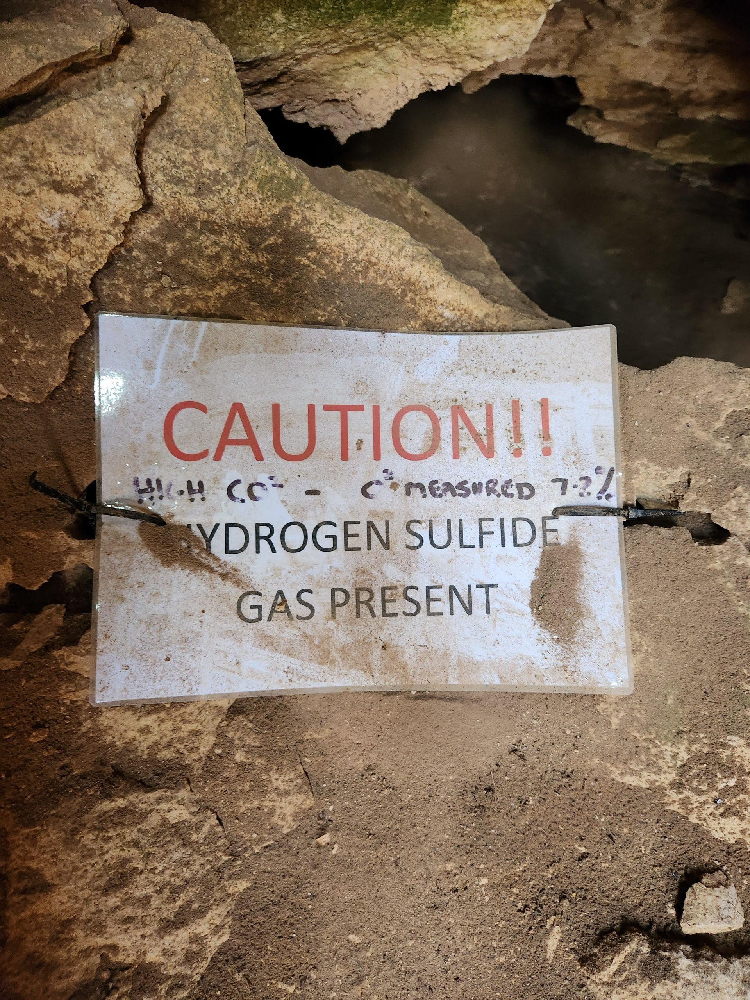
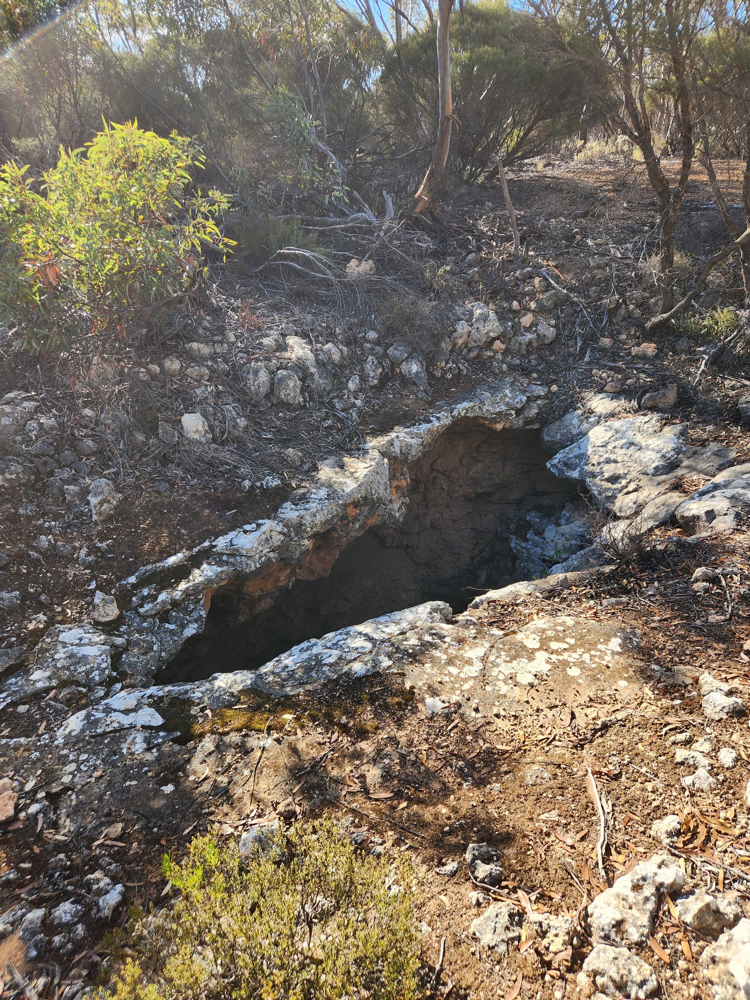
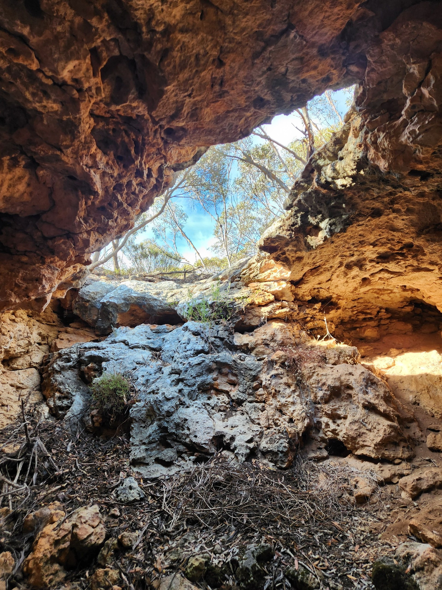
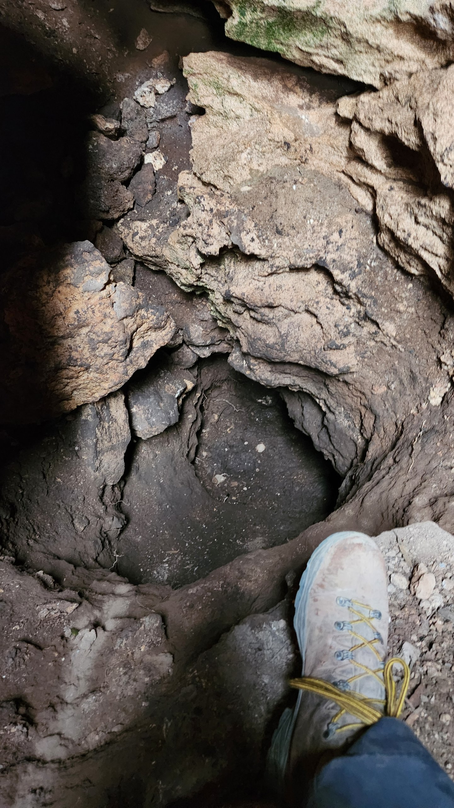
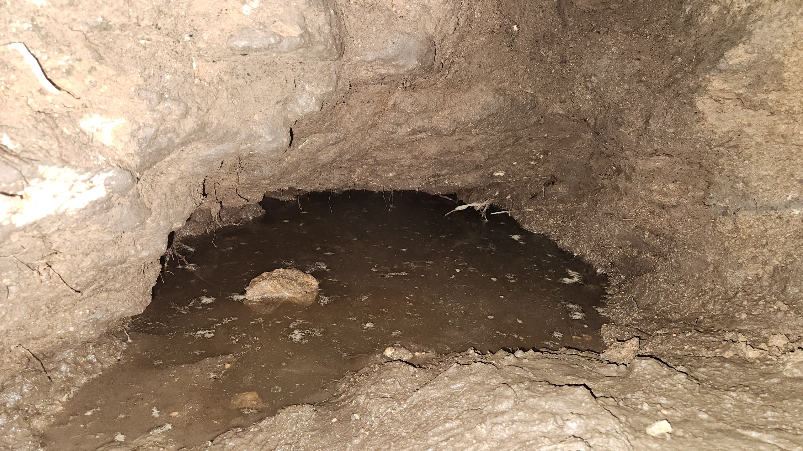
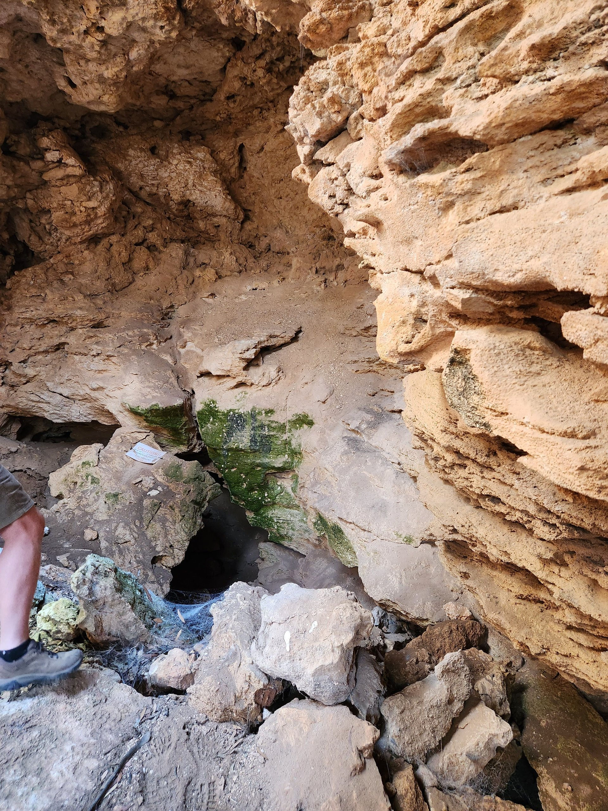
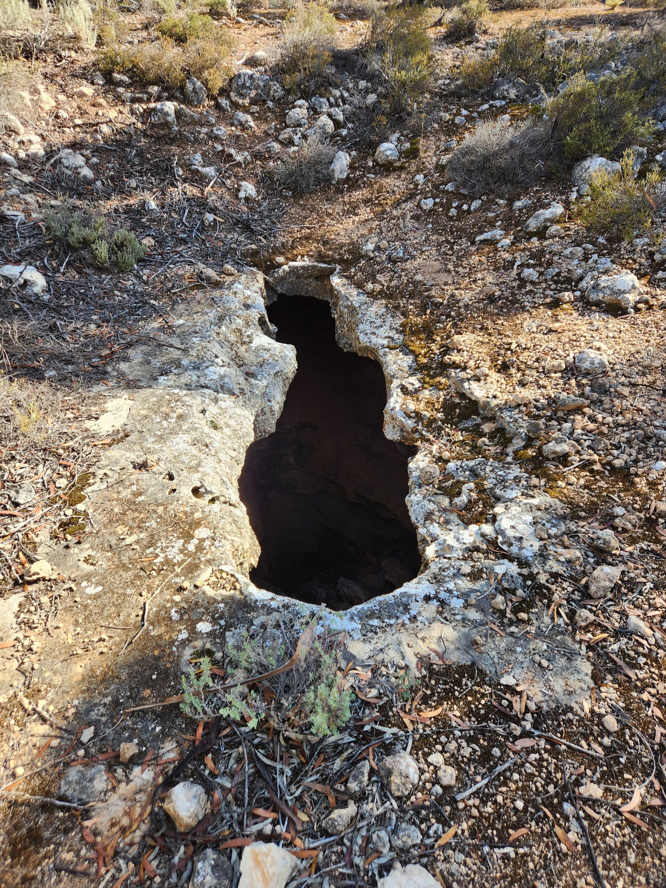
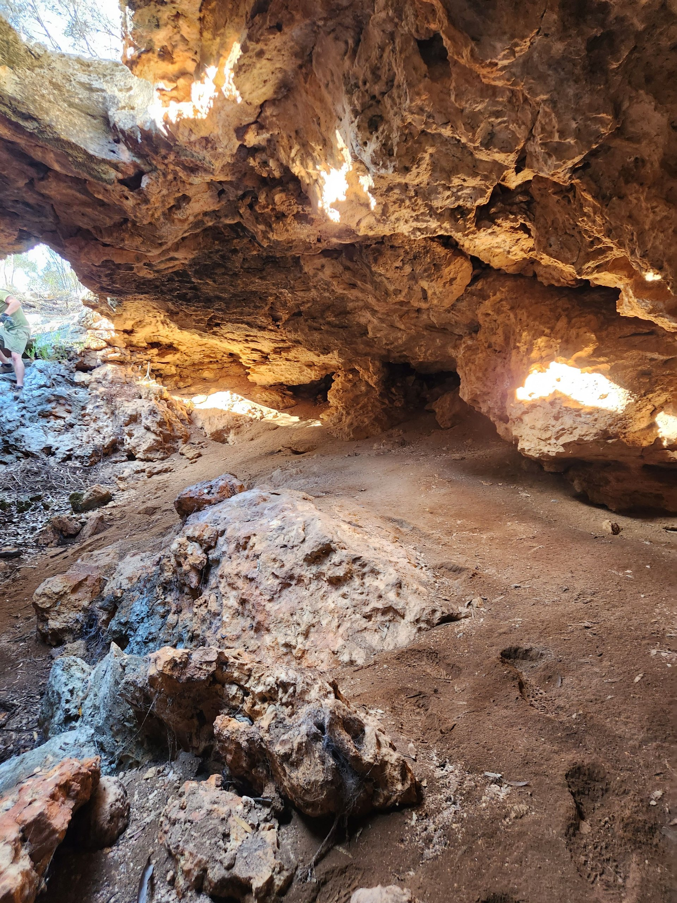

# Details

## Identification

- **Feature type:** Cave

## Cave and exploration data

- **Vertical access:** No
- **Exploration potential:** Low

# References

- **Fordyce:** Double [Slot Cave]()
Has CO2 at bottom and dark mossy walls above - good potential dig but needs air pump to get clean air in / CO2 out.

SF and party checked 2019-10. Similar to [Slot Cave]() but with 2 holes in ceiling. Probably 3-4m deep, so only ~2m above water table. Green moss still there over most likely looking dig point, but looks like much choke and not much actual cave. Not hugely inspiring.

## Images
- 
- 
- 
- 
- 
- 
- 
- 
