# About

15m solution tube with squeeze and drop at the bottom into large dry doline collapse. On further pentetration there is a highly decorated and decorated room which care is needed to not damage.

# Maps

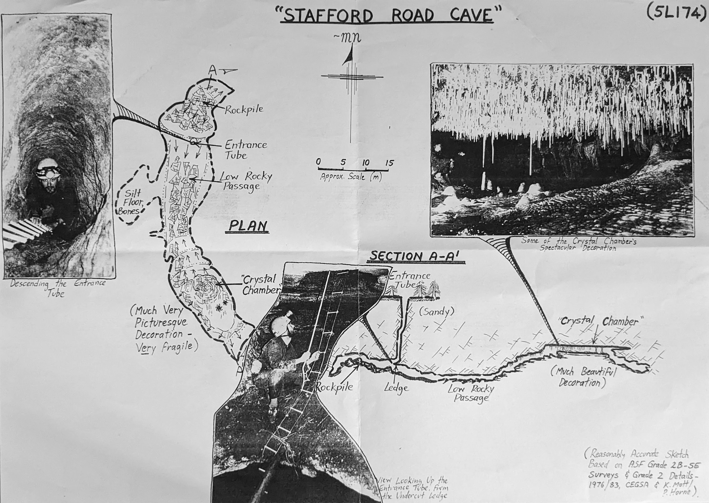

# References

## Images
- 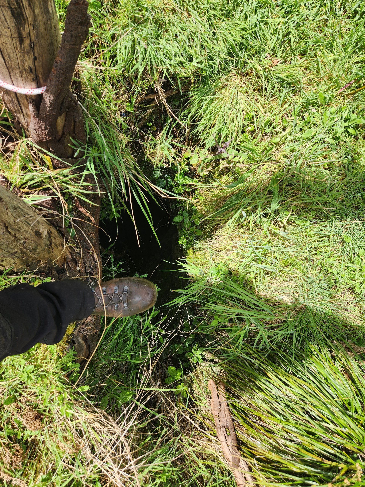
- 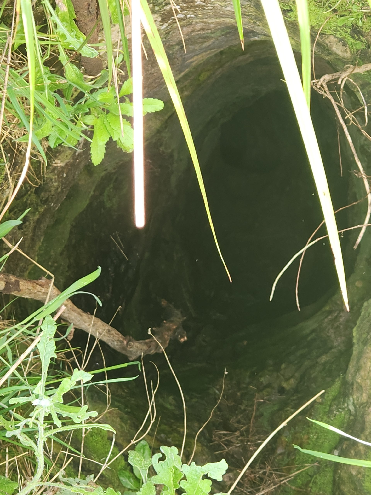
- 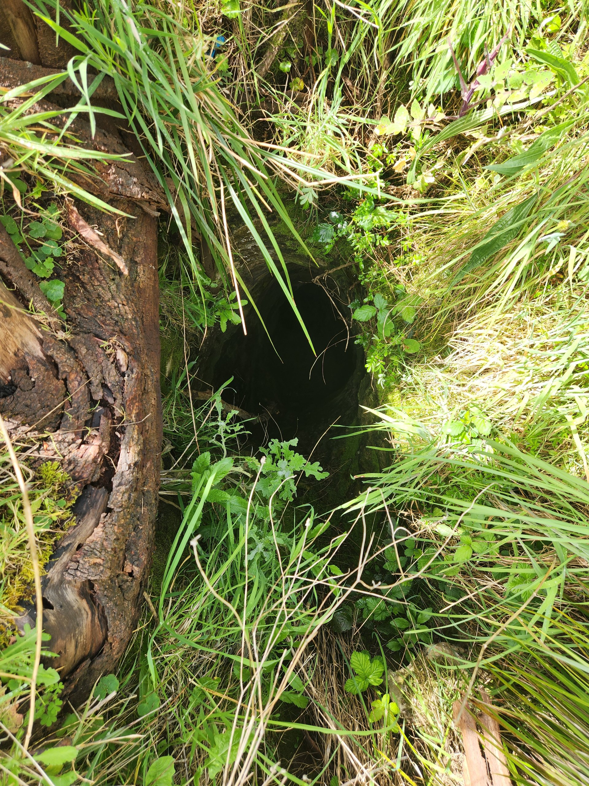
- 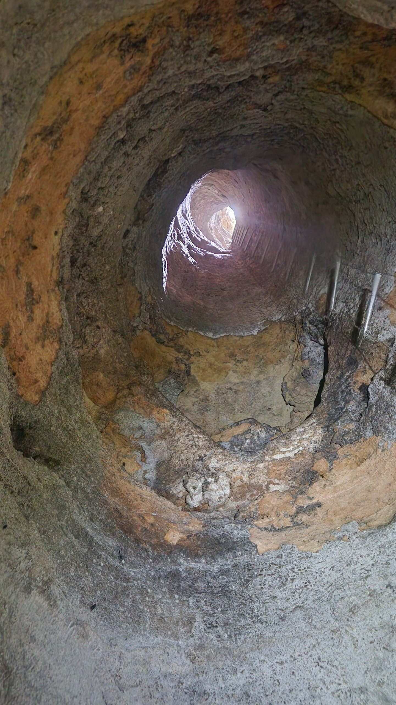
- 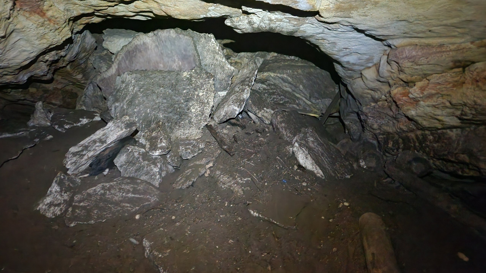
- 
- 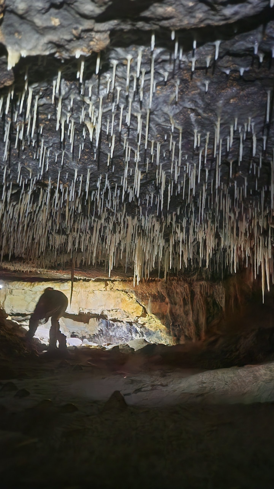
- 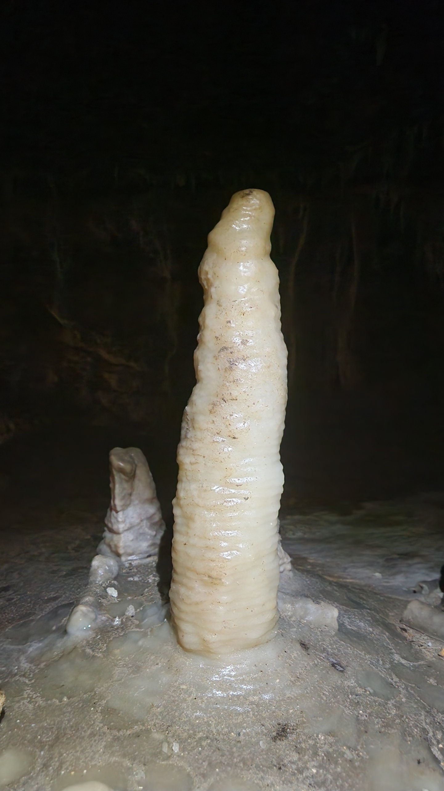
- 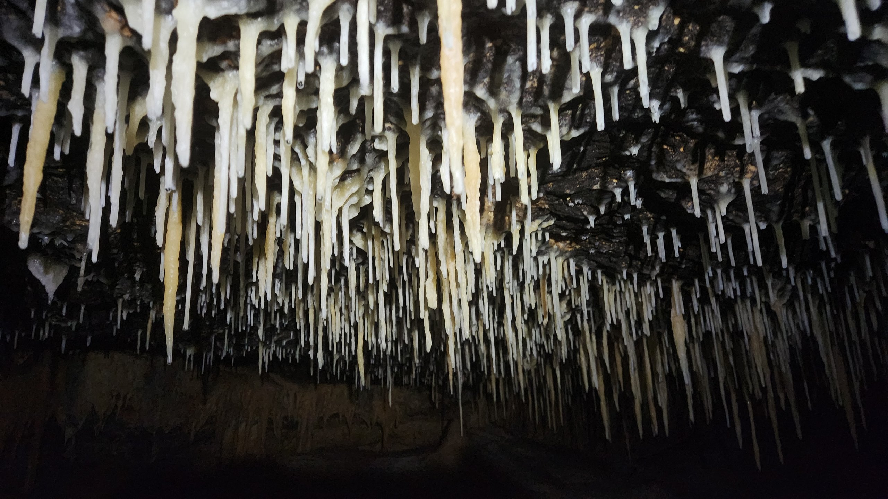
- 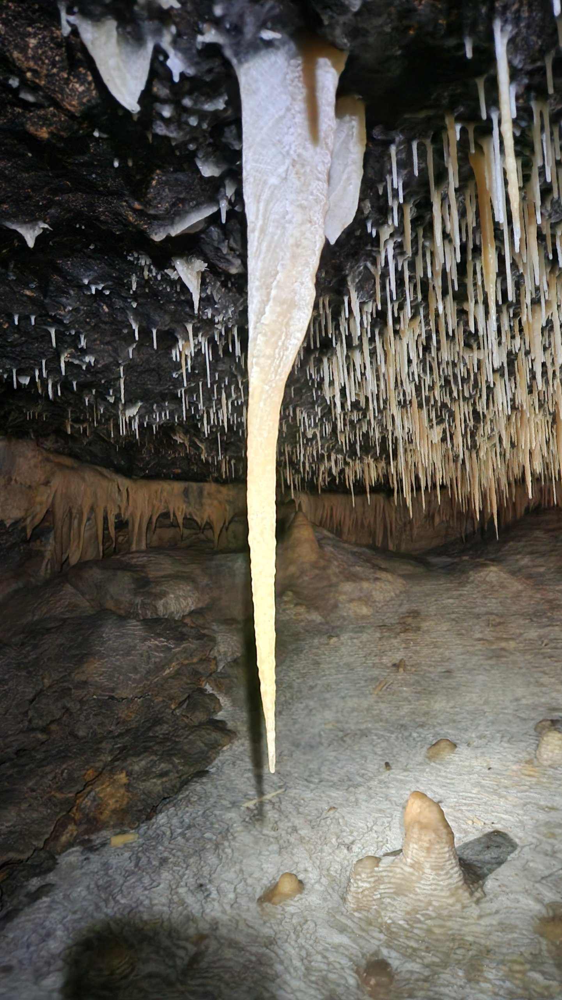
- 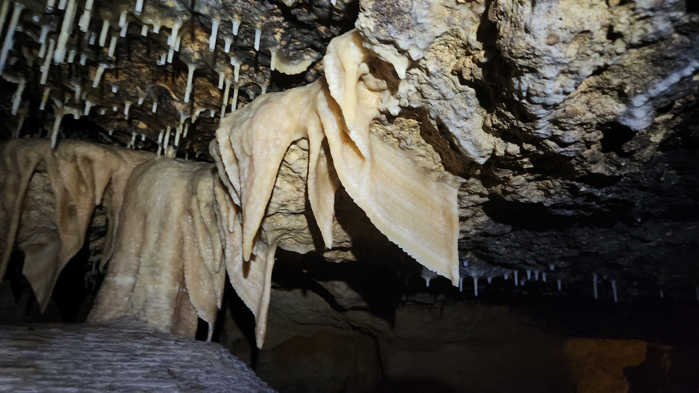
- 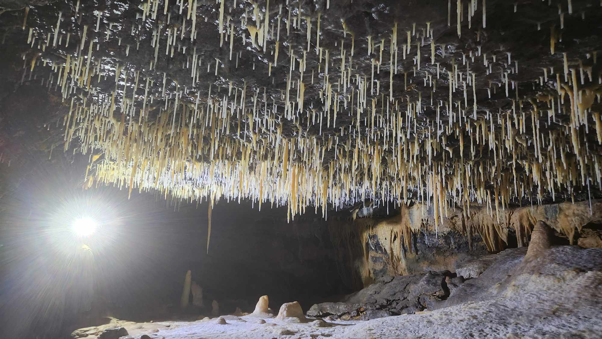
- 
- 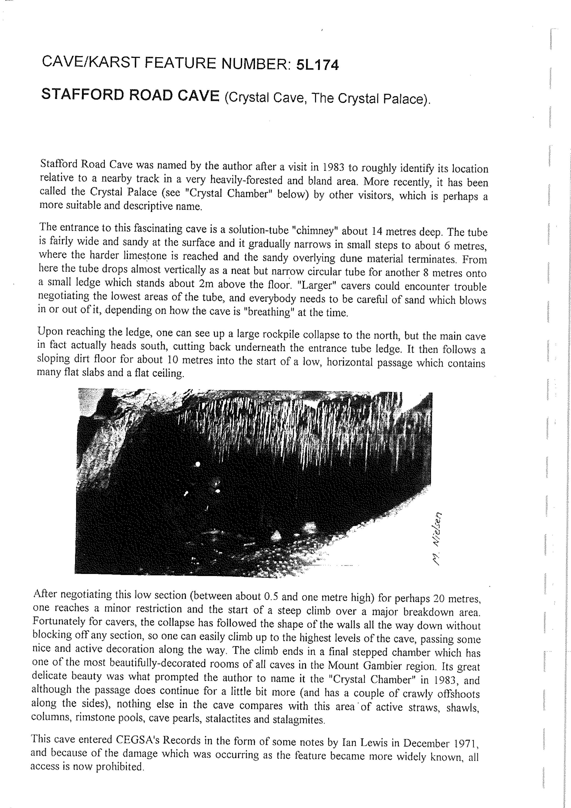
- 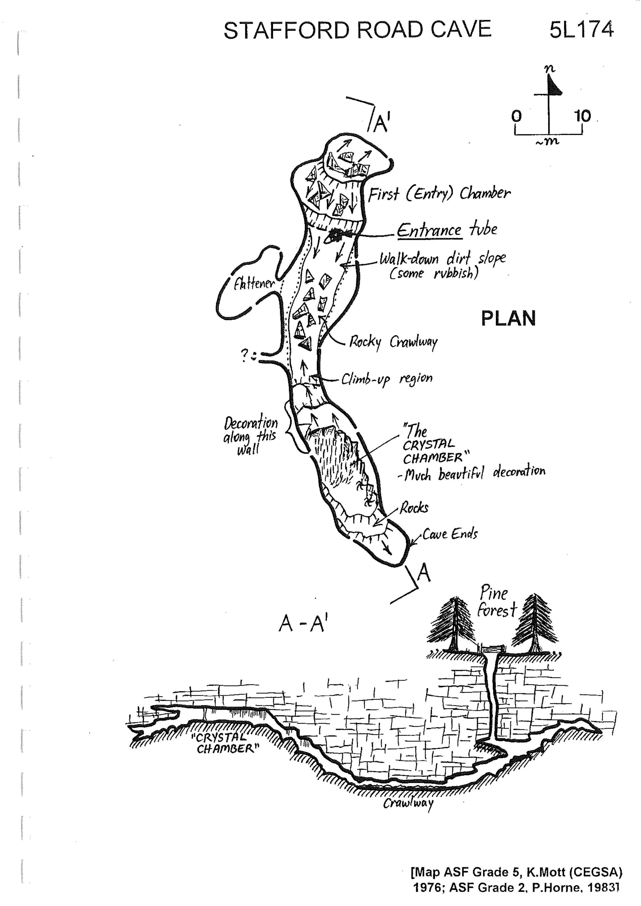

- **LSECR:** Page 338
Stafford Road Cave was named by the author after a visit in 1983 to roughly identify its location relative to a nearby track in a very heavily-forested and bland area. More recently, it has been called the Crystal Palace (see "Crystal Chamber" below) by other visitors, which is perhaps a more suitable and descriptive name.
The entrance to this fascinating cave is a solution-tube "chimney" about 14 metres deep. The tube is fairly wide and sandy at the surface and it gradually narrows in small steps to about 6 metres, where the harder limestone is reached and the sandy overlying dune material terminates. From here the tube drops almost vertically as a neat but narrow circular tube for another 8 metres onto a small ledge which stands about 2m above the floor. "Larger" cavers could encounter trouble negotiating the lowest areas of the tube, and everybody needs to be careful of sand which blows in or out of it, depending on how the cave is "breathing" at the time.
Upon reaching the ledge, one can see up a large rockpile collapse to the north, but the main cave in fact actually heads south, cutting back underneath the entrance tube ledge. It then follows a sloping dirt floor for about 10 metres into the start of a low, horizontal passage which contains many flat slabs and a flat ceiling.

After negotiating this low section (between about 0.5 and one metre high) for perhaps 20 metres, one reaches a minor restriction and the start of a steep climb over a major breakdown area. Fortunately for cavers, the collapse has followed the shape of the walls all the way down without blocking off any section, so one can easily climb up to the highest levels of the cave, passing some nice and active decoration along the way. The climb ends in a final stepped chamber which has one of the most beautifully-decorated rooms of all caves in the Mount Gambier region. Its great delicate beauty was what prompted the author to name it the "Crystal Chamber" in 1983, and although the passage does continue for a little bit more (and has a couple of crawly offshoots along the sides), nothing else in the cave compares with this area of active straws, shawls, columns, rimstone pools, cave pearls, stalactites and stalagmites.
This cave entered CEGSA's Records in the form of some notes by Ian Lewis in December 1971, and because of the damage which was occurring as the feature became more widely known, all access is now prohibited.

# Details

## Identification

- **Feature type:** Cave
- **Reference:** L0174
- **Source:** Forestry SA

## Cave and exploration data

- **Vertical access:** Yes
- **Exploration potential:** Medium
- **Tourism potential:** Low
- **Goes to water:** No

## Access and warnings

GTFP
