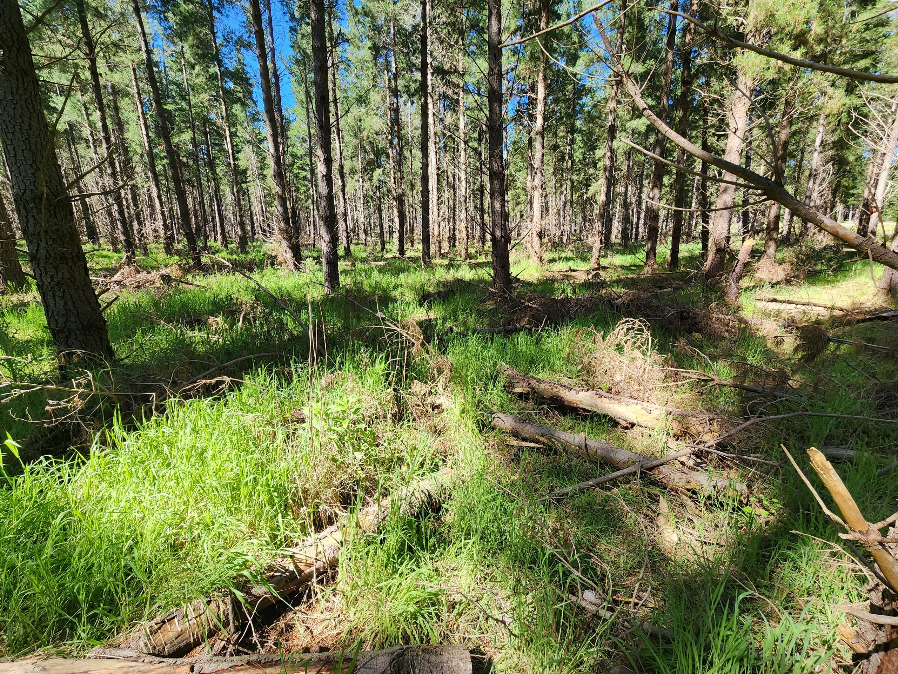

# About

BC 24/92023:  Some rocky features but no signs of anything interesting

# Details

## Identification

- **Feature type:** RockyOutcrop

## Cave and exploration data

- **Vertical access:** No

# References

## Images
- 
