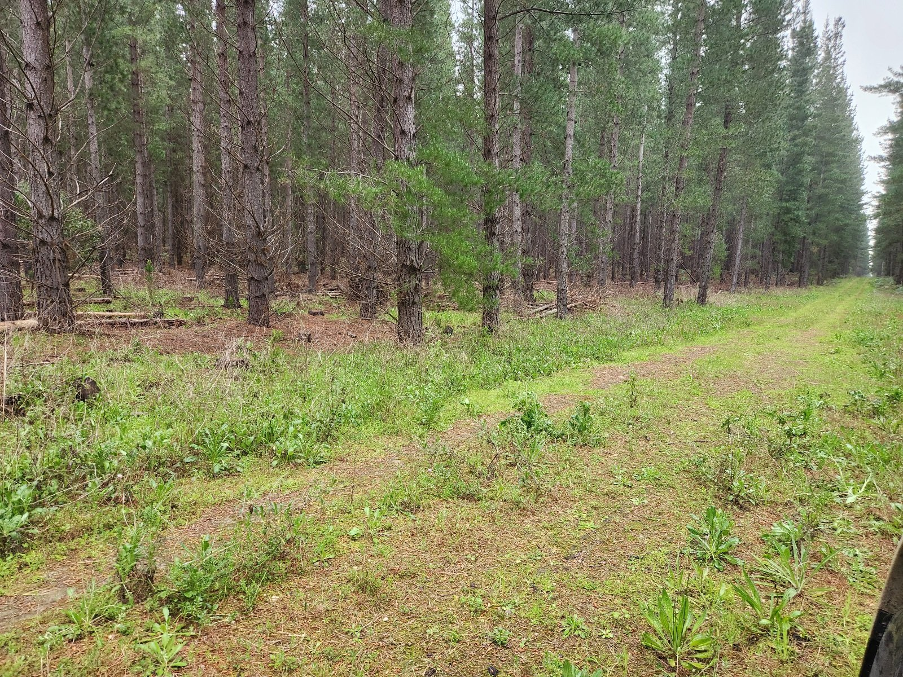

# About

BC 8/9/2023: Visited and no sign of any interesting features

# Details

## Identification

- **Feature type:** Depression

## Cave and exploration data

- **Vertical access:** No
- **Goes to water:** No

# References

## Images
- 
