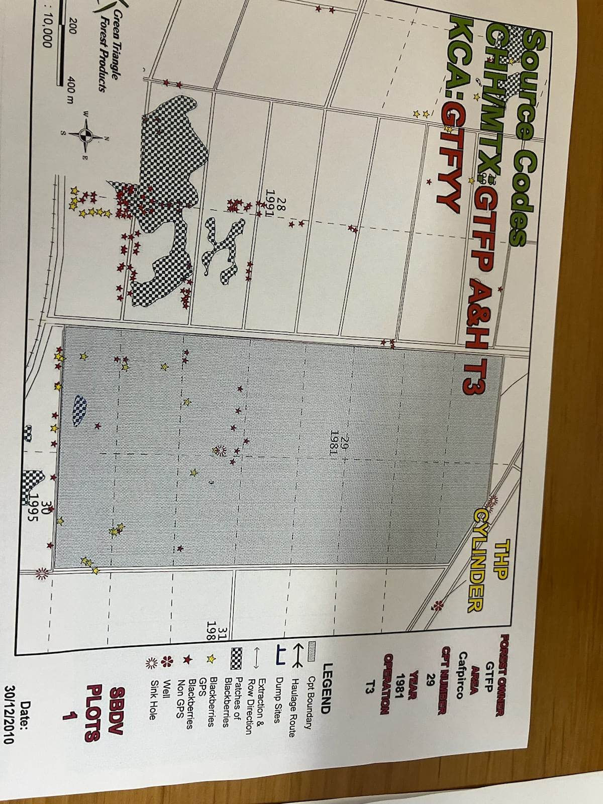
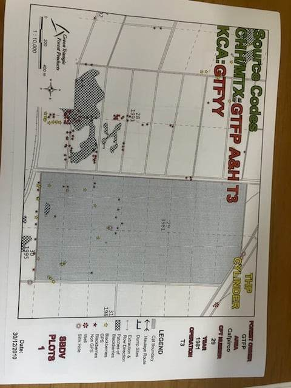

# About

From Col's list

# Details

## Identification

- **Feature type:** Destroyed

## Cave and exploration data

- **Vertical access:** No
- **Goes to water:** No

# References

## Images
- 

## Images
- 

