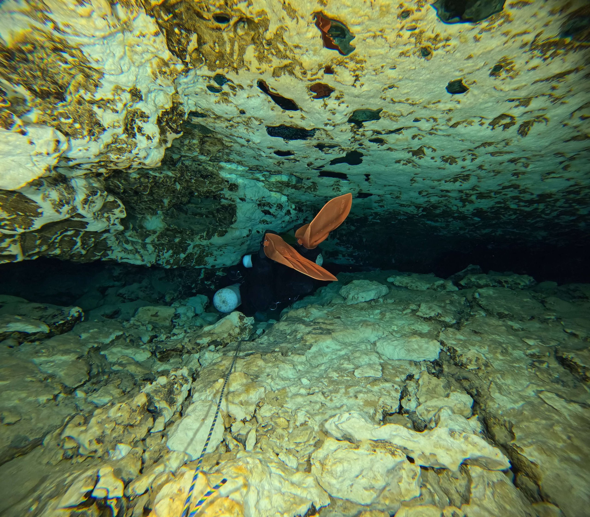
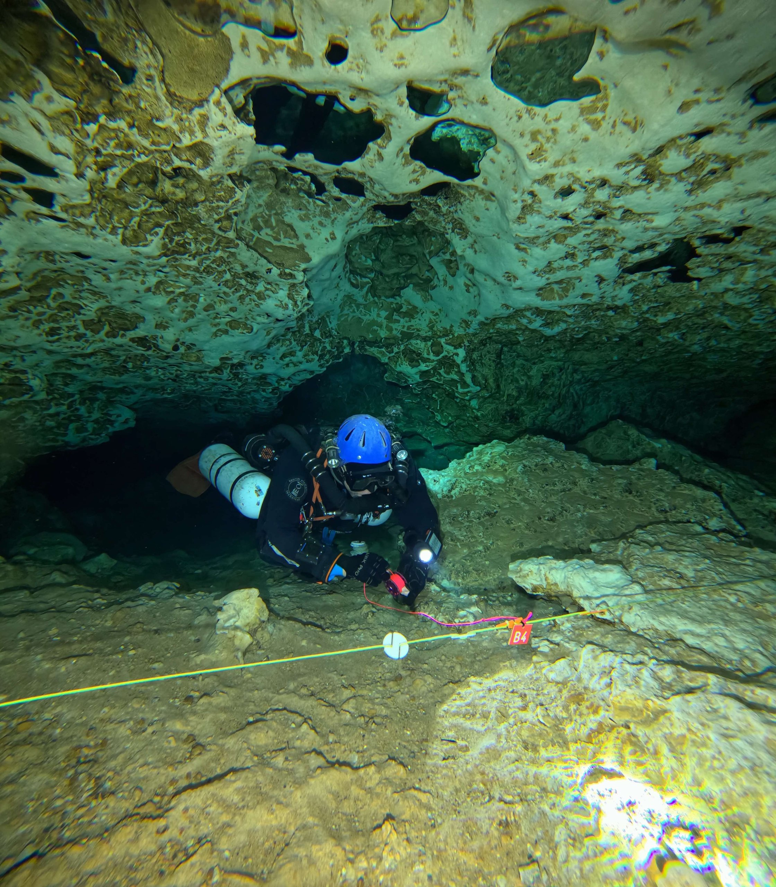
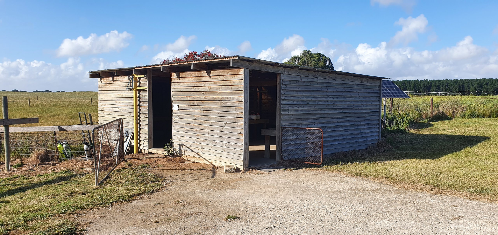
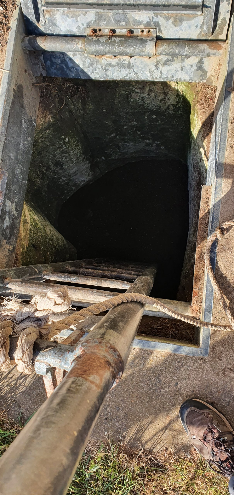
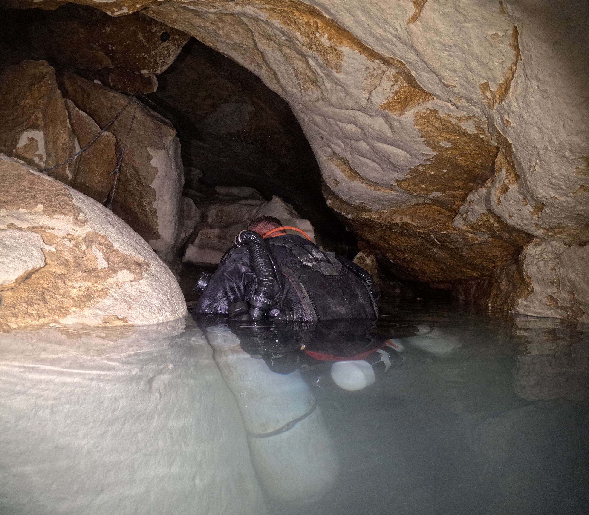
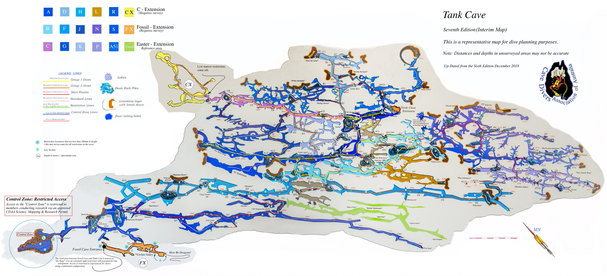

# About

Tank cave in Mount Gambier, South Australia is one of Australia’s most popular and largest mapped submerged cave. It has over 7km of passage of which most contain fixed lines.  It is located in farmland about 20km outside Mount Gambia and its entrance is on land owned by the Cave Divers Association of Australia. The cave is a complex system of interconnected tunnels that requires complex navigation and even after gaining the needed advance cave standard you need to follow a strict familiarization schedule consisting of 18 dives that progressively expand your experience of the system.  Care must be taken with planning and cookie discipline due the complexity of dives and particular care taken not to cut corners and potentially miss an obscured branch of line.  A large amount of the cave are accessible to back-mount divers but many sections required side-mount configuration to penetrate.  Water temperature is relatively constant 14 Celsius year round and a dry suit with suitable thermal protected is needed. Much of the cave is quite shallow around 10-12 metres with deeper sections as you get to the Fossil Cave side getting to 20+ metres.

On site bathroom and shower is available.

### Access

Access to the cave is managed through the CDAA [booking system](http://www.cavedivers.com.au). You need to be a CDAA Advanced Cave diver to dive this site and access must be in the presence of an Access Officer (AO).

### Entry

A metal lid covers the entrance which the AO will open. This leads to a ladder dropping 3-4 metres. To lower equipment a rope and pulley system are provided.  When you descend the ladder you reach a small cave with a path leading to the entrance pool where the main fixed line begins. Descending in the entrance pool and turning right you will be led in the first main passage.

# References

## Images
-  — Abi Harwood
-  — Abi Harwood
-  — Martin Slater
-  — Martin Slater
-  — Abi Harwood
- 
- 

- **LSECR:** Page 448
Rumoured since the late 1960s as a "cave diving site" of some type (although nobody seemed to be able to describe it in any detail), this amazingly extensive feature is today considered by many to be the "cream of the crop" as far as South Australian (even Australian?) cave diving sites goes.
The first real recognition of the cave's potential significance occurred on 9th August 1983, when the author and his cave diving companion, Mark Nielsen, negotiated the low, muddy cave to discover a fantastically clear and wide horizontal passage which headed north-west for 70 metres to the base of a rockpile, where other extensions were also obvious. After encountering "some difficulty" negotiating a rather nasty restriction near the exit, the author decided to stick to researching OTHER sites for a while, and Mark and another diver, John Hansen, went back on 20th May 1984 to subsequently explore (and roughly map) another 200-odd metres of 'virgin' passage, before believing that they had basically exhausted the main possibilities of new extensions being found.
The site had already shown that it was a singularly important one, so the author named it Tank Cave (after a large windmill tank which used to cover the boarded entrance until its destruction during the later gating in 1989) and allocated the CEGSA number 5L230 in conjunction with CEGSA caver, Kevin Mott. After stressing the potential importance of the site to fellow cave divers Phil Prust, Chris Brown and Paul Arbon, they decided to have a look and after a false start through low-visibility water, Phil and Chris were finally able to see the maze for themselves.
With their modern underwater lighting and back-up air-supply systems, Phil and Chris had a very good look around, discovering numerous leads, and with the support of a team of other exper- ienced cave divers, they quickly broke into many hundreds and finally, THOUSANDS - of metres of spectacular virgin passage. This made Tank Cave one of the largest water-filled caves in Australia, and perhaps even the longest cave in South Australia!
The known network at this writing consisted basically of a series of about half a dozen major horizontal passages which ran north-west to south-east, more or less parallel with each other in a rectangular-shaped area of confinement, and many cross-connecting passages and chambers... ALL of which is completely submerged! The entrance lies at the eastern corner of this pattern - it has now been significantly dug out and gated so all cave dives are necessarily complex and lengthy, requiring a lot of careful planning, special gear-handling knowledge and penetration skills. The known passages total more than FIVE KILOMETRES at this time, ranging from very small and silty crawlways to 15 metres or so in size. Depths can reach around 14m in places.
Because of a change in ownership, access to this spectacular site is currently restricted; there is obviously a lot of potential still waiting to be checked out in this remarkable cave!
- **www.cavediving.net.au:** 5th Edition
https://www.cavediving.net.au/images/articles/maps/5L-230.gif
- **https://www.cavediving.net.au/index.php/siteinfo/?site=44:** Named because a water tank used to rest right over the top of the entrance, Tank Cave is an extensive, maze like system with over 7km of diveable passage which makes it one of the longest underwater caves in Australia. A connection to Fossil Cave was made in June 2018.

## Images
- 
- 
- 
- 
- 
- [Tank Cave A5 - 528c33f2-7888927e](https://github.com/twosharprocks/Karst-Database/blob/d6f539534154fcd23f60d0a25899bf7ef553f1d8/Assets/19a243e75dda8bd9ba11b5519d7fdafd60f2c42b79cecbf2066611ce1ca758d1.pdf)
- [4a8bd27d-66e4-4050-8d37-8b42e8db487d](https://www.youtube.com/watch?v=EfFSlUX302Y)
- [3185dcc5-657b-48ba-b2d1-0fbcb6cb12f2](https://www.youtube.com/watch?v=lwa4wu3IR2g)
- [a17b7532-d81d-49a9-b296-f9b597a5c405](https://www.youtube.com/watch?v=lB7pkw38GsA)
- [Tank Cave A3 - 72bcceb4-7888927e](https://github.com/twosharprocks/Karst-Database/blob/d6f539534154fcd23f60d0a25899bf7ef553f1d8/Assets/aa66d653ea648e20876d24f7b47cba13e208af41c1822e33489c65b65ce552f8.pdf)

# Details

## Identification

- **Feature type:** Cave
- **Reference:** L0230
- **Source:** Forestry SA

## Cave and exploration data

- **Cave rating:** Advanced
- **Vertical access:** Yes
- **Exploration potential:** Medium
- **Tourism potential:** Low
- **Disabled access potential:** Low
- **Goes to water:** Yes
- **Surveyed length:** 8000 m

## Diving data

- **Maximum depth:** 20 m
- **Water type:** Fresh
- **Tidal:** No
- **Temperature:** 13–15 °C

# Maps

- 
- 
- [site - 474f9c11-7888927e](https://github.com/twosharprocks/Karst-Database/blob/d6f539534154fcd23f60d0a25899bf7ef553f1d8/Assets/686300af14bef33174b058f8aa0b494fc181335e3d0f977ea6afe72f8d3e8375.kml)
