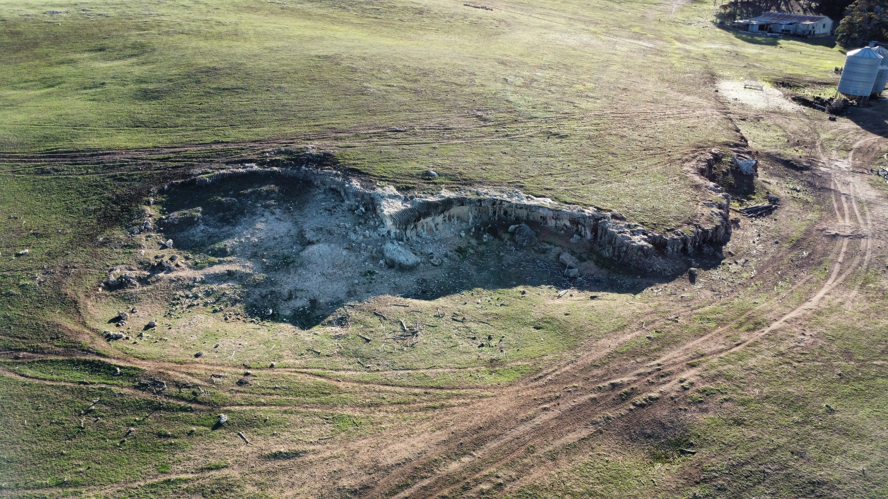
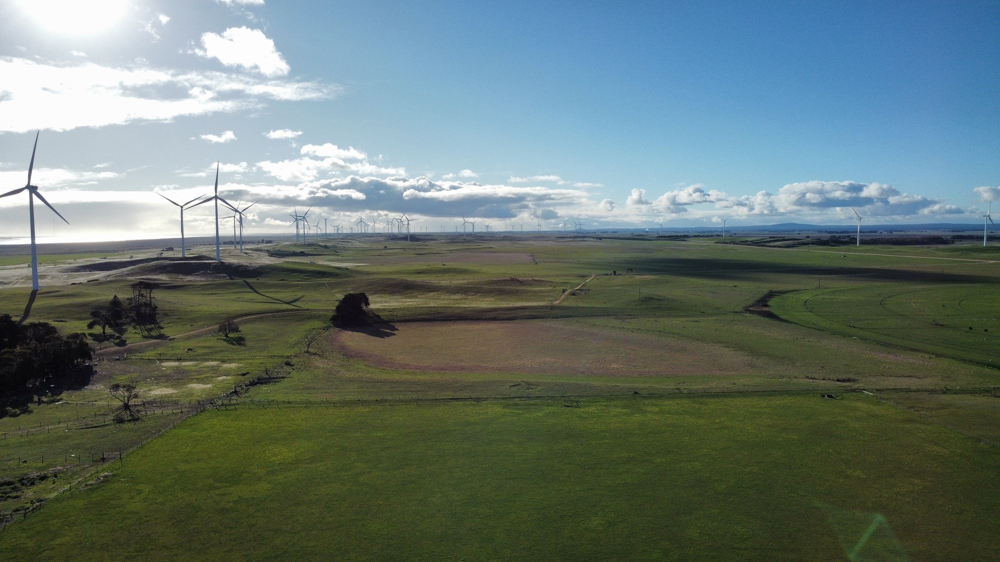
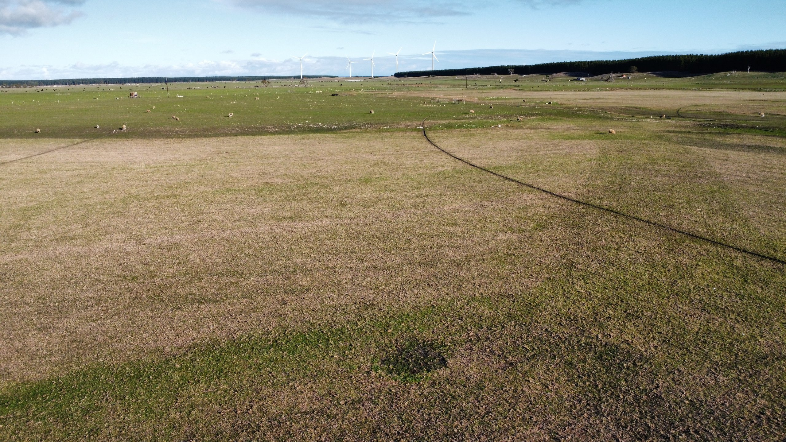
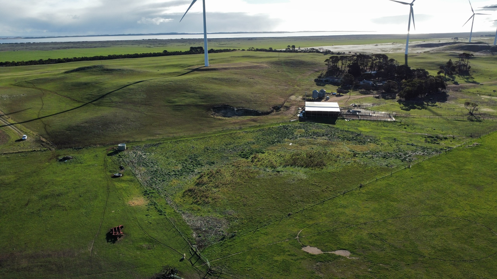

# About

Checked 2024-06 by MW
Site is a swampy area of paddock that ducks migrate through - potential mark is just a slightly darker patch of grass

# Details

## Identification

- **Feature type:** Depression
- **Source:** MapCarta

## Cave and exploration data

- **Vertical access:** No
- **Goes to water:** No

## Amenities

- **hasShowers:** No
- **hasToilets:** No

# References

- **MapCarta:** https://mapcarta.com/28768114

## Images
- 
- 
- 
- 
