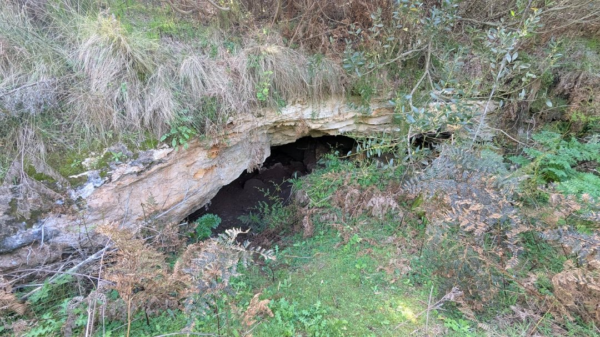
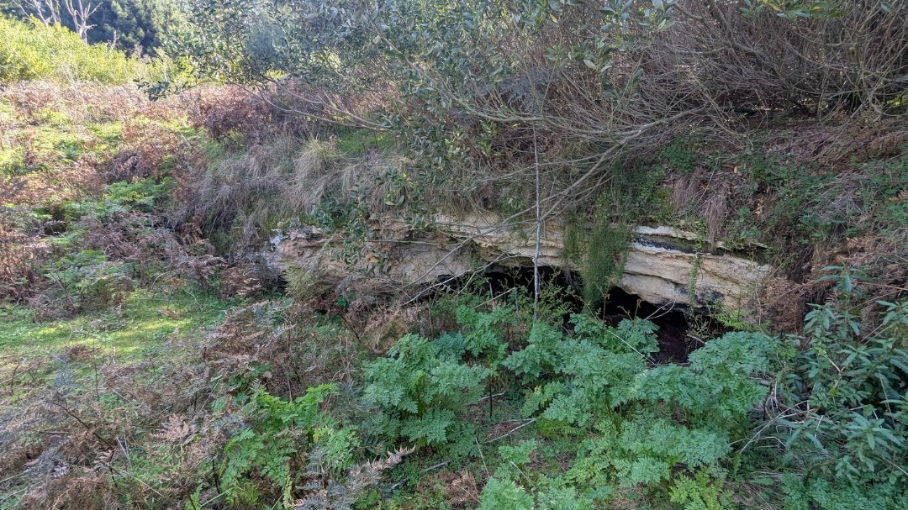
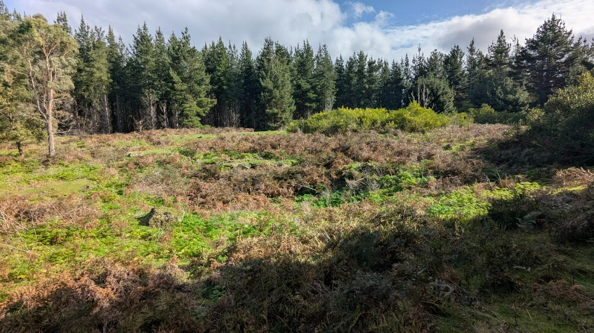
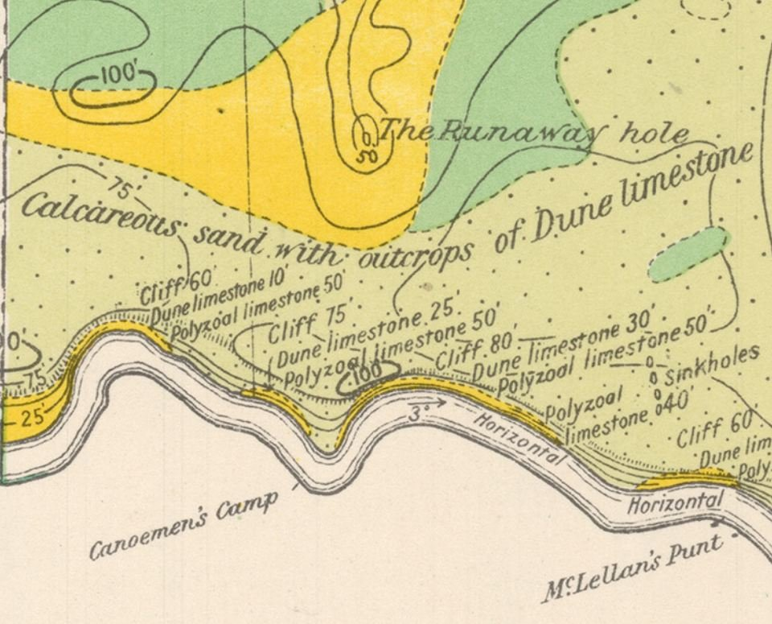

# Details

## Identification

- **Feature type:** Cave
- **Source:** Map - G11037_parishplan_wanwin

## Cave and exploration data

- **Vertical access:** No
- **Exploration potential:** High
- **Tourism potential:** Medium

## Amenities

- **hasShowers:** No
- **hasToilets:** No
- **hasPhone:** No
- **family:** Ok

# References

## Images
- 
- 
- 
- 
