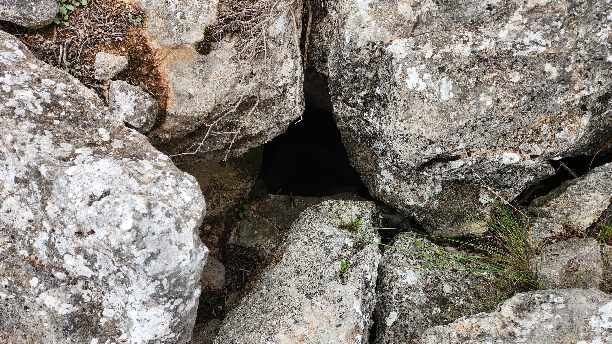
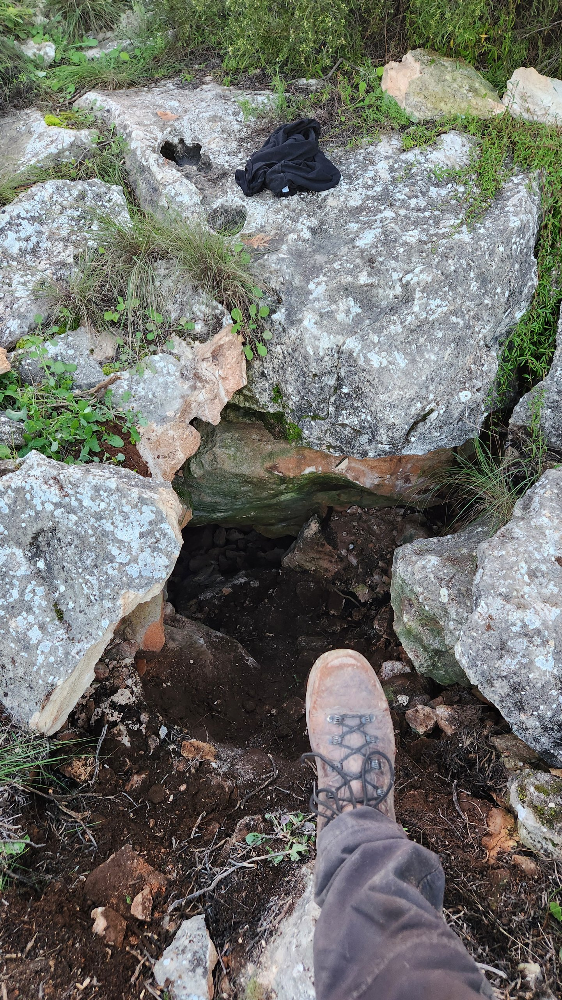
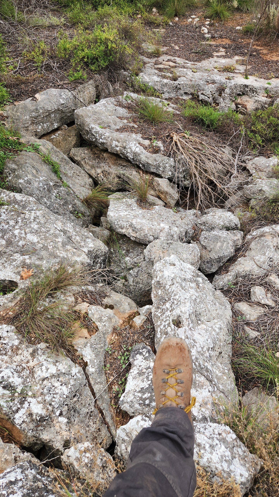
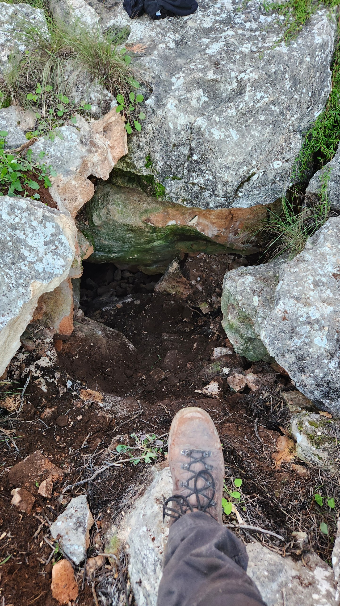

# About

7m rockpile with entrance to small opening

# Details

## Identification

- **Feature type:** Cave
- **Source:** N6476

## Cave and exploration data

- **Exploration potential:** Medium

# References

## Images
- 
- 
- 
- 
