# About

2021-Aug: MW visited on foot & photographed. Plastic "Danger" tape around substantial steel hatch - no obvious lock, but site definitely well sealed.

2023-Aug: MW, NB and BW unlocked, checked and photographed. Wire ladder is required for access to cave floor (3m drop). Extensive decoration and graffiti - pretty but no further exploration, do not recommend tourist access.

2023-July: MW and NB checked Forestry "magic" key on locked hatch. Key is compatible and turns in mechanism, but lock release has rusted. WD40 sprayed without success - recommend boltcutters. Significant breeze noted coming OUT of hatch - definitely breezeway from another entrance

2023-Aug: MW, NB and BW rechecked lock with more WD-40, managed to get hatch open. MW dropped down solution tube but needed wire rope ladder to reach caev floor (3-4m climbable solution tube followed by 2-3m drop). FIlmed South first to dead-end, filmed North. Significant formations as well as extensive graffiti throughout cave - beautiful cave but not big enough to justify tourism.

# Details

## Identification

- **Feature type:** Cave
- **Reference:** L0018
- **Source:** Forestry SA

## Cave and exploration data

- **Vertical access:** Yes
- **Tourism potential:** Low
- **Goes to water:** No

## Access and warnings

Forestry

# References

- **LSECR:** Page 58
The entrance to this large (200 metre long?) horizontal cave system is a gated 8 metre deep chimney-like hole about 0.75 metres across near the surface, and the main passage heads off both to the north-west and south-east from the base of this tube (which is considerably narrower). The cave reaches a maximum depth of 13 metres below ground level and is generally around 3 metres high, with a lot of decoration. There is also a lot of old graffiti and considerable damage to many features. This cave was the fifth in a series of five features which Norman B. Tindale (B.Sc.) named "A" through to "E" for identification purposes in May 1931, during a research visit to the Tantanoola Caves system at the nearby "Up and Down Rocks" (where he named the other four features, with "A" naturally being allotted to the main tourist cave). Tindales Cave "E" was found to contain a considerable amount of old (and recent) bone material, and it was apparently "lost" from about 1938 until sometime around the early 1960s, when CEGSA was provided with information from Messrs. Peter Gower and George Brown of Tantanoola via Mr. Fred W. Aslin in July 1965. A CEGSA trip report dated April 1966 by Norman Hocknell mentioned air temper- ature measurements in the cave of around 56 to 57.5 degrees F (wet and dry bulb) while the (dry bulb) external temperature was 55 degrees F. Some 14 wetas (Speleotettix tindalei) were also collected during this trip. A follow-up trip (report dated September 1967) referred to a noticeable increase in vandalism; perhaps the immediate precursing factor to the gating which followed soon afterwards.
- **Forestry SA:** L0018, Thin Roof: N, Fence: N. Dimensions: ?. Features: Significant decoration N.B.Tindale named caves A to E during research visit to Tant System Already gated : has been vandailse
- **ASF:** Entrance is pothole type; (Unknown entrances); development is entrance tube leads to long fissure passage with bedding plane flatteners; karst type is unknown; length is 180.0 m , surveyed; vertical extent is 11.00 m; reasonably explored, some unexplored leads; pitches 6.0.

## Images
- 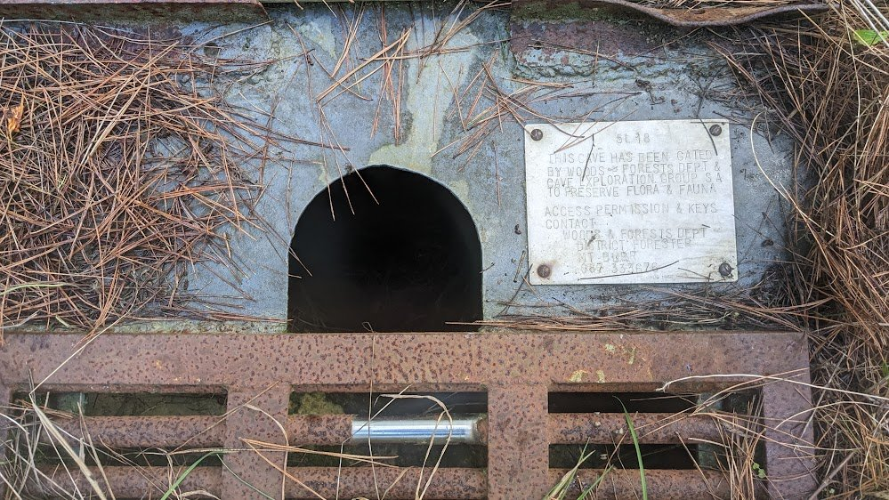
- 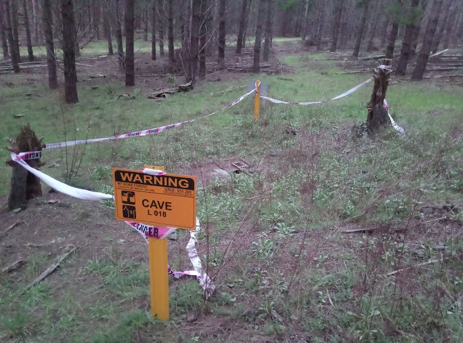
- 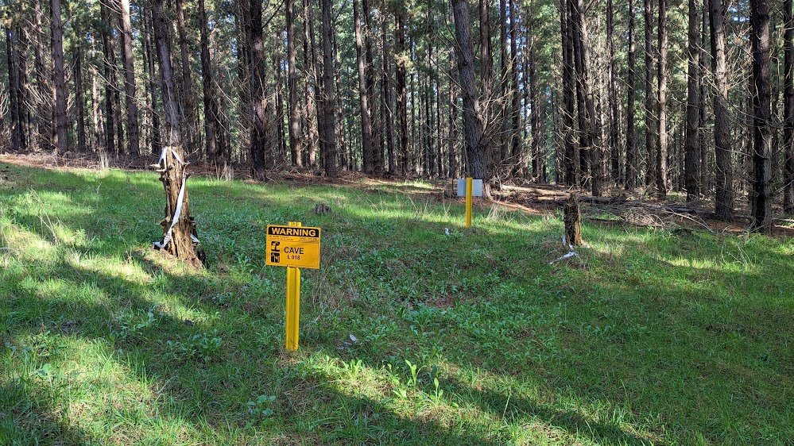
- 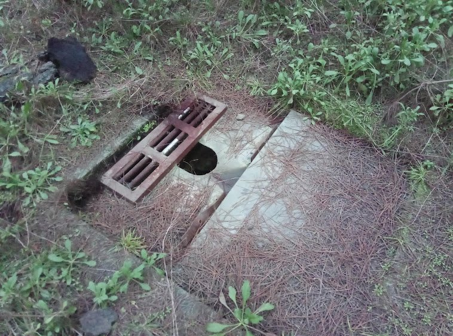
- 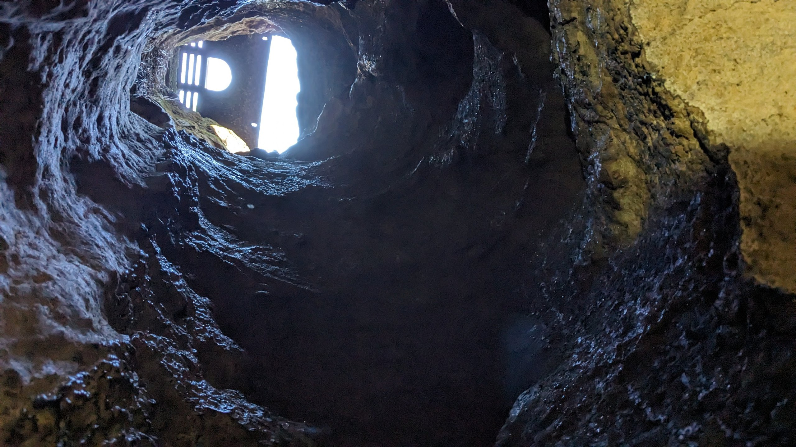
- 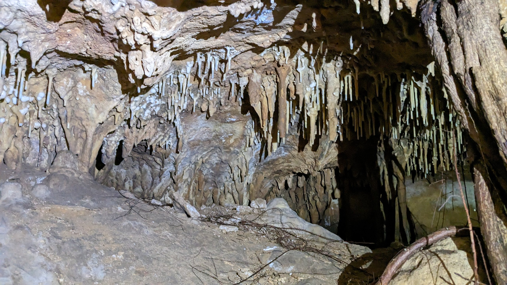
- 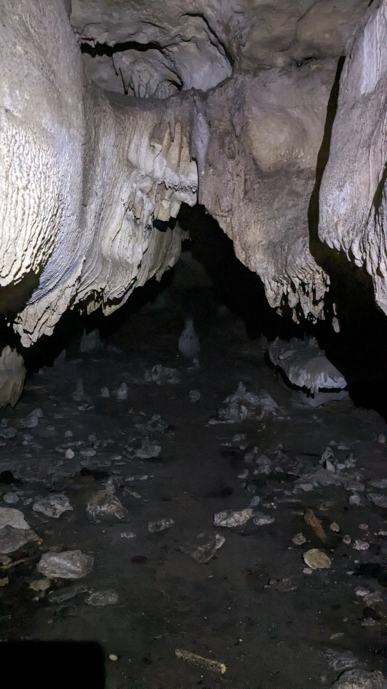
- 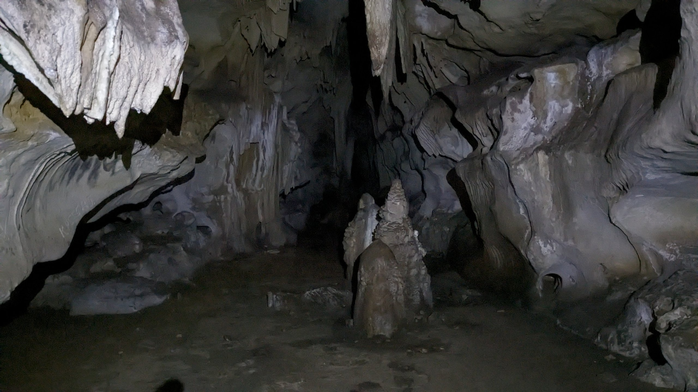
- 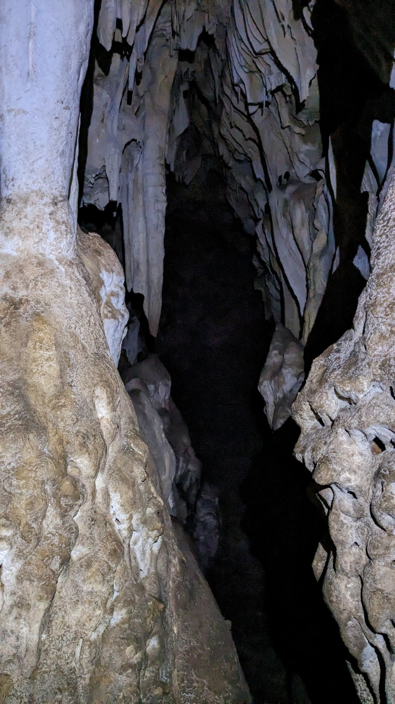
- 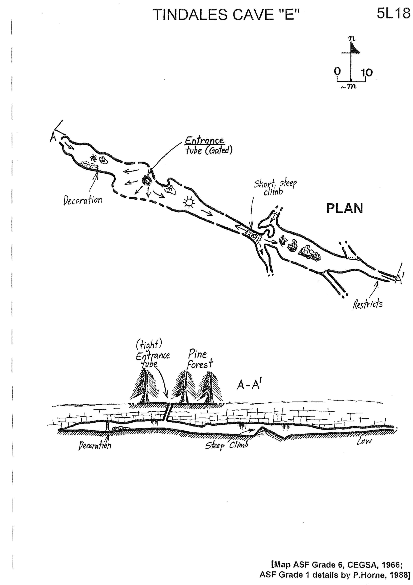
- 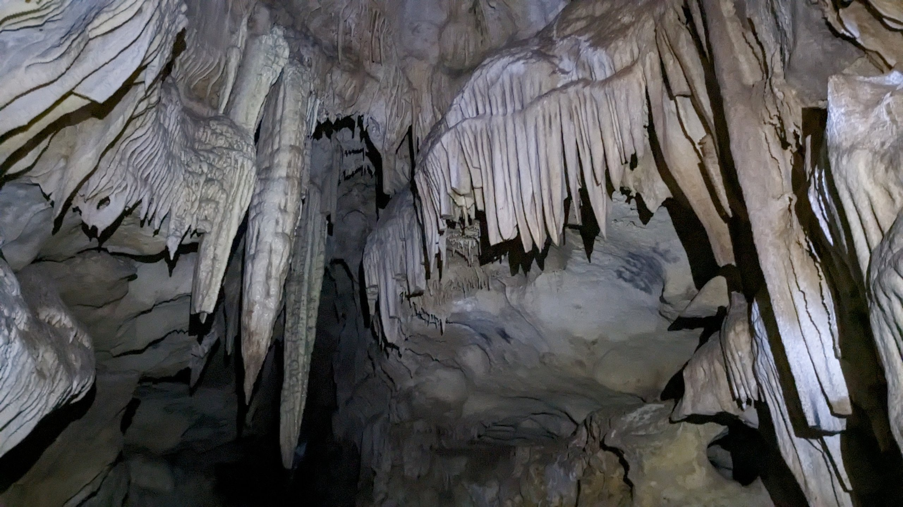
- 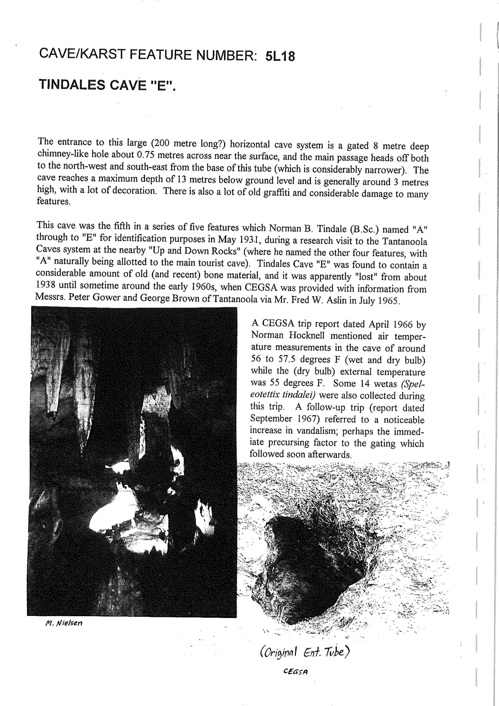
- 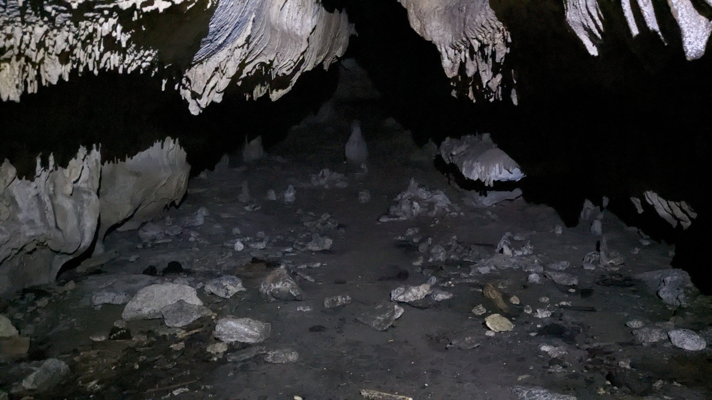
- 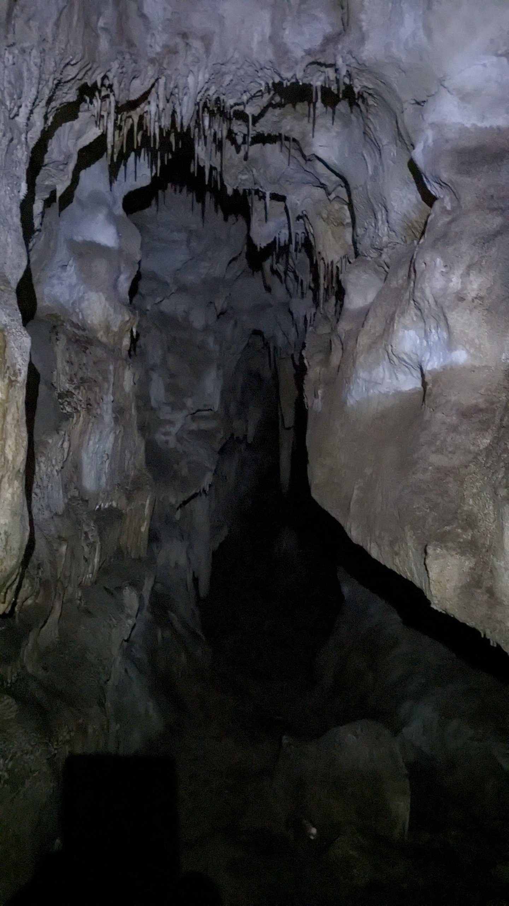
- 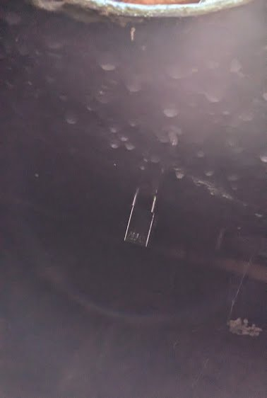
