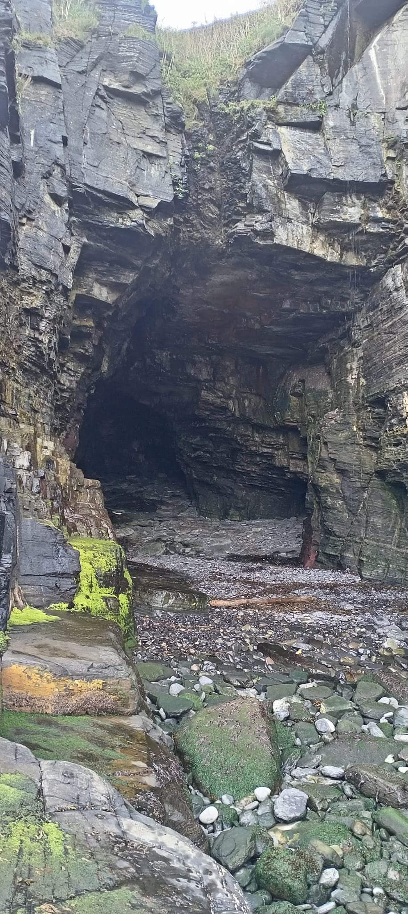
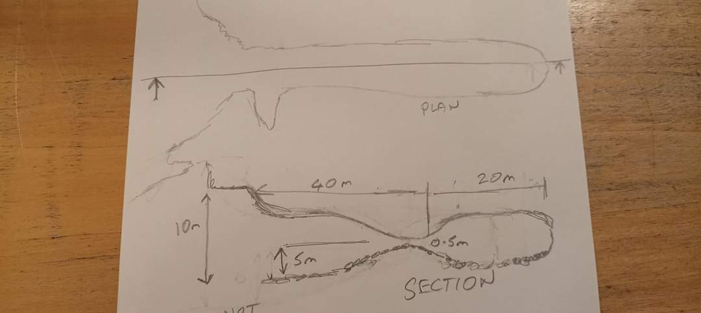
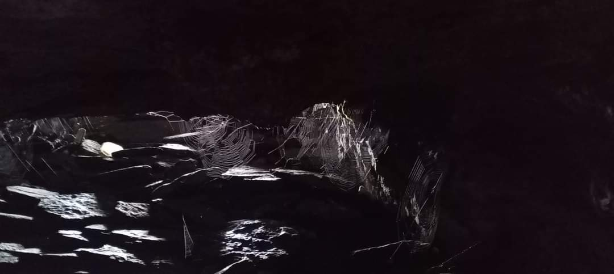
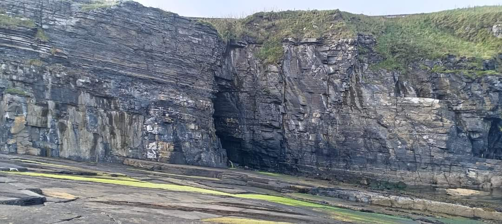
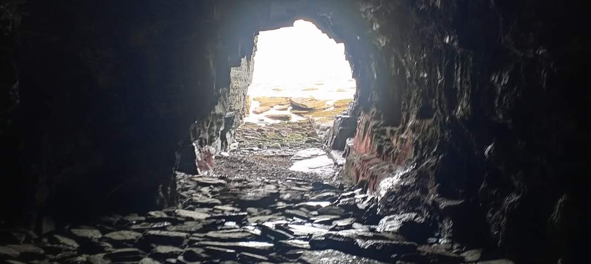

# About

Tinker's Cave on the South of Wick bay.
Big sea cave with a climb to a squeeze that gives access to an inner chamber that's dry and there's just a hint of light. Jetsam evident through most of the outer chamber suggesting storm waves penetrate most of the way in.
There seems to be confusion about cave dwellers. This is called Tinker's cave on maps and I literature, but photo of the last cave dwellers show a smaller cave on the North of the Bay and the description doesn't fit this cave.

# Details

## Identification

- **Feature type:** Cave

## Cave and exploration data

- **Cave rating:** Basic
- **Highest cave rating:** Cave
- **Vertical access:** No
- **Goes to water:** Yes

## Diving data

- **Water type:** Salt
- **Tidal:** Yes

# References

## Images
- 
- 
- 
- 
- 
