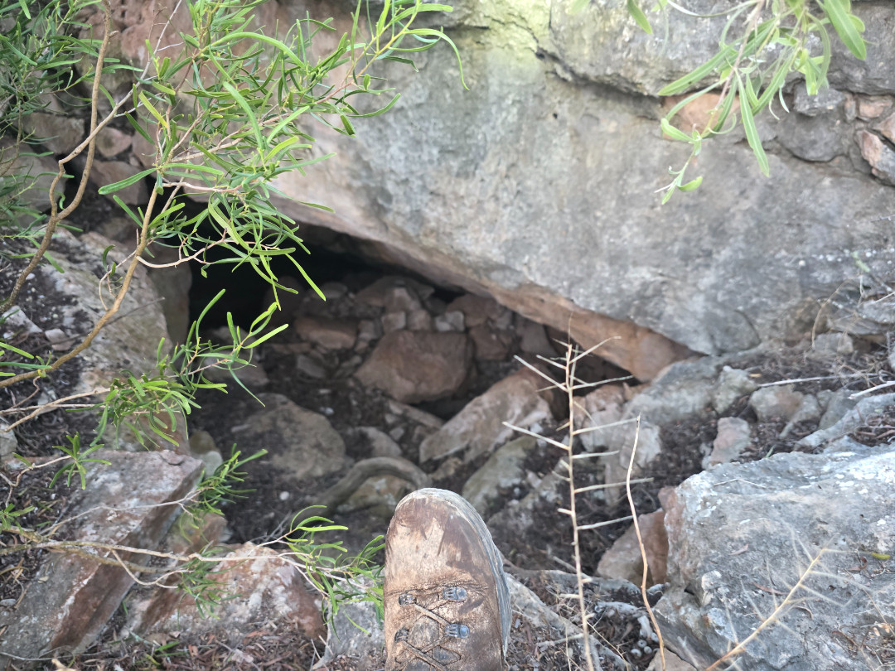
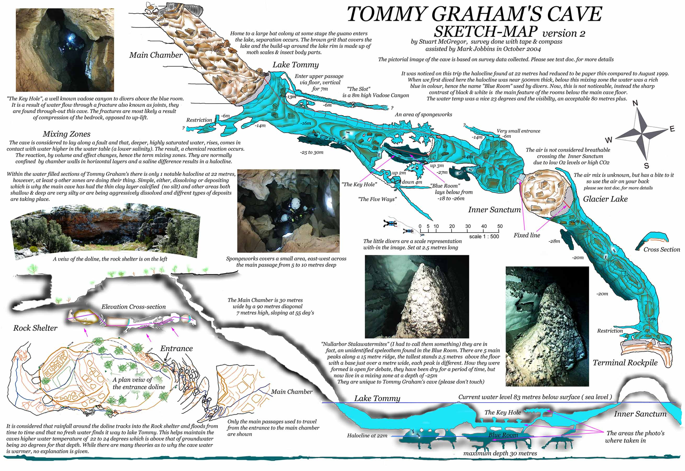
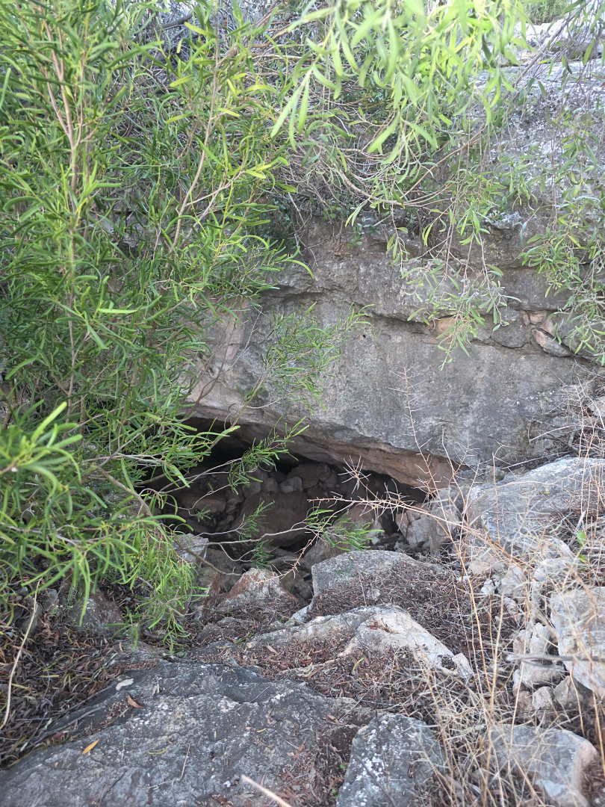

# About
The entrance to the cave is a large doline 50m in diameter. The obvious route into the doline leads to short cave below the Northwest cliff line.

The main cave has been described as a “wombat- sized hole” which is found in the Southeast end of the doline, about 3m down from the level of the plain. There is a visitor book on a rock shelf in the entrance. The way on is not obvious and goes through a rock squeeze at the end of the low entrance chamber.

The cave descends steeply over broken rock and silt, following the trogged path goes through several boulder chokes near the cave roof steps until it opens into a large chamber. The main chamber has a floor of broken boulders, silt and guano. There are frequently bats in this chamber.

Care needs to be taken in traversing the loose floor to the clear, blue, 30m wide crescent shaped lake at the end of the rock pile. There is an interesting helictite above the water’s edge. The water temperature is 22°C.

Beyond the lake a fixed line traverses a 170m long sump through phreatic maze to large dry chamber 60m long, this is known as the “inner sanctum”. This chamber has a high level of CO2. At the end of this chamber is another lake and a 130m sump to a further airspace at the edge of a huge rockpile, which blocks off 35m above the water level. The total cave length is around 600m.
## Access
The cave is close to the camping area and access track. No additional equipment is required to enter the cave. A typical trip to visit the main cave takes two hours.
## Cave Diving
Moving equipment through this cave is demanding, with the humidity and air temperature adding to the difficulty. More than 4 divers gearing up at the lakes edge would be a squeeze.

There is are fixed lines through the sumps and a marked jump line which leads to the a key hole passage, “the amazing phreatic bypass” and into the “blue room”. The “blue room” has some “stalagmite” formations at 27m depth. When it was surveyed in 1993 there was a pronounced halocline in this room, this has not been as evident on recent trips.

The lake on the entrance side of the “inner sanctum” is surprisingly small, it has been described as “bath tub sized”. Traversing the inner sanctum needs care because of the loose nature of the floor and the high CO2, with most people breathing on their air supplies to make the trip.

Although it is possible to exit the water into the terminal rock pile through a small lake at the end of the second sump, most people don’t. 
## Land use 
The cave is on Nuytsland Nature Reserve, and specific permission is required to visit the cave. 
# Maps

N56-CEG 20056
N56-CEG3001

Tommy Graham’s Sketch Map 2004

N56-CEG8105 (in prep)

- **https://www.youtube.com/watch?v=-8EcYqws7Nk:** Youtube video showing entrance and blue water

## Images
- 
- 
- 
- 

# References
[Tommy Grahams Cave - Google Maps](https://maps.app.goo.gl/r7QR7nYLo8mFTqRE9)

- [Source](https://www.cavediving.net.au/index.php/siteinfo/?site=10)
- [Source](https://www.tdisdi.com/tdi-diver-news/trip-report-tommy-grahams-cave/)
[Tommy Grahams Cave - cavedivers.com.au](https://www.cavedivers.com.au/index.cfm?action=details&module=BUSINESSDIRECTORY&pageMode=indiv&page_id=1404666) 
[Speleotherms - st1.asflib.net](https://st1.asflib.net/JNS/AUNat/ASF/ASF-ConfProc/ASF-26thConfMat-2007-CavesCratersCritters/ASF-26th-DVD/08-LakeSpeleothemsNullarbor.pdf)
[ASF-26th-DVD/08-LakeSpeleothemsNullarbor.pdf - st1.asflib.net](https://st1.asflib.net/JNS/AUNat/ASF/ASF-ConfProc/ASF-26thConfMat-2007-CavesCratersCritters/ASF-26th-DVD/08-LakeSpeleothemsNullarbor.pdf)
[new.ackma.org](https://new.ackma.org/wordpress/wp-content/uploads/2025/01/78/Tommy-Grahams-Cave-Visitor-Book-Peter-Buzzacott.pdf")