# Details

## Identification

- **Feature type:** Sinkhole
- **Reference:** L0006
- **Source:** Forestry SA

## Cave and exploration data

- **Vertical access:** No
- **Tourism potential:** High
- **Disabled access potential:** Medium
- **Goes to water:** No

# References

- **LSECR:** Page 34
Named after Mr. James Umpherston, a former politician who purchased the land in 1886 and subsequently beautified what was a barely-accessible eye-sore, this feature is a very large open sinkhole about 50 x 55 metres across and 20 metres deep. It is undercut all the way around, and it has been extensively modified to provide easy access for the public. The water-table is reached at the east-south-eastern end in a shallow crescent-shaped lake which has a deeper section, where a recently installed pump supplies water for a nearby artificial waterfall. In the earlier years of the 20th Century, almost all of the sinkhole's floor was covered by a lake which tourists could explore in a rowboat, but the lowering of the regional water-table over the decades has now left it basically dry. A CEGSA Trip Report by Bob Sexton in April 1963 mentioned that the property on which the sinkhole is situated was formerly known as "Umpherston's Cave Station", as well as the fact that a well hole had been put down on the south-eastern side, although it no longer reached the water. Other sources also referred to the property as "Beswicks Farm", and James Umpherston employed a gardener around 1870 to keep the cave and the surrounding area in a very tidy condition. James' efforts paid off as the recreational value of the site became evident; for example, it was reported that over a 10 day period in early April 1889, more than 1,000 people visited the feature, and the property became known as "The Caves Farm". Almost 100 years later, in November 1982, the author undertook a brief scuba-dive in the small pocket of relatively deep water which remains in the sinkhole today, in the south-eastern area directly below the waterfall. This dive revealed that the minor extension was little more than a very narrow vertical fissure-like area generally less than half a metre wide which ran around between the wall and the rubble floor for a few metres, and it had a maximum depth of only about 5 metres. Umpherstons Cave is a fabulous example of what other waterfilled sinkholes such as the huge Little Blue Lake really look like beneath the surface, and is well worth a visit... you may even see a possum or two!
- **ASF:** Entrance is cave type; (Unknown entrances); development is large undercut entrance with water-filled section; karst type is doline; length is Unknown m , surveyed; vertical extent is 22.00 m; reasonably explored, no leads noticed; wet environment.

## Images
- 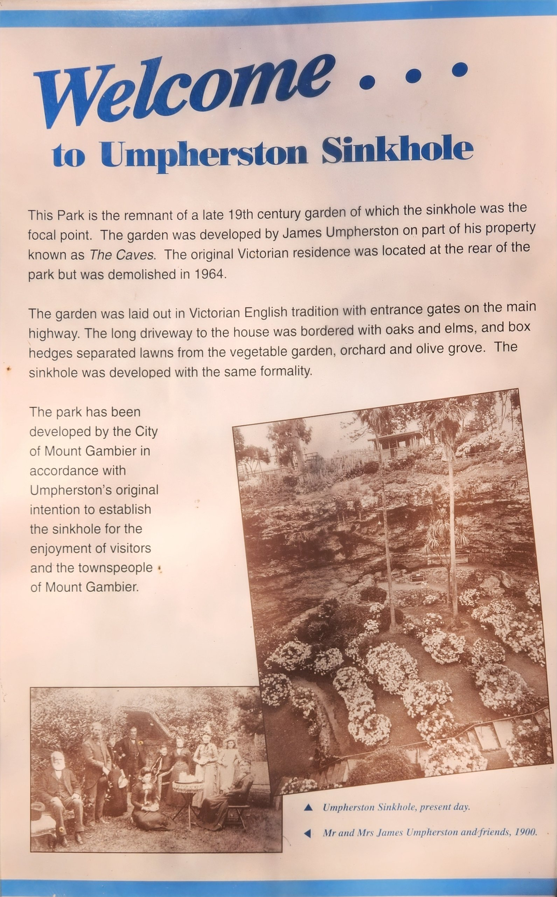
- 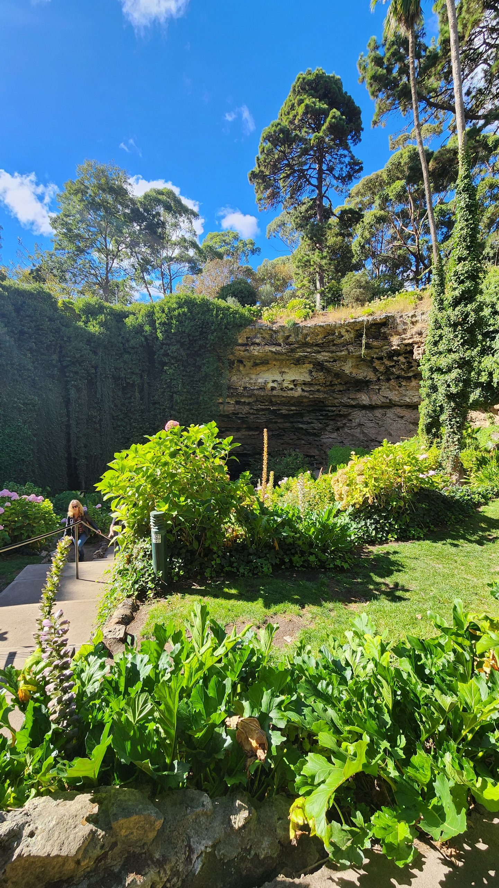
- 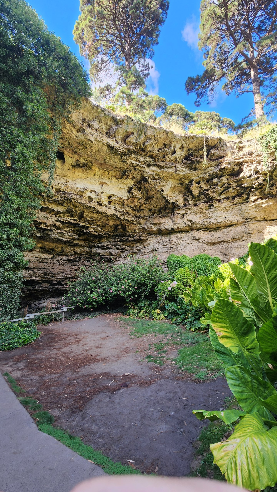
- 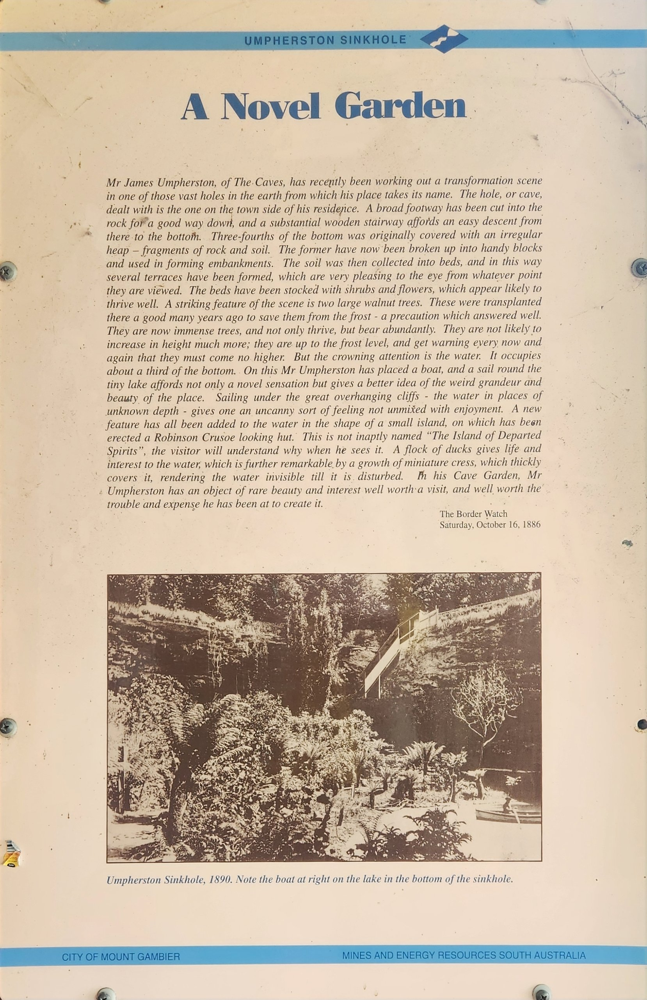
- 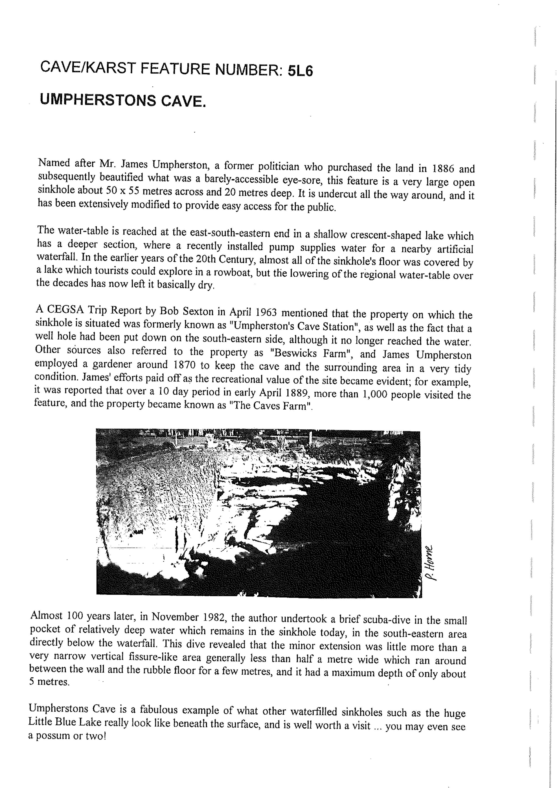
- 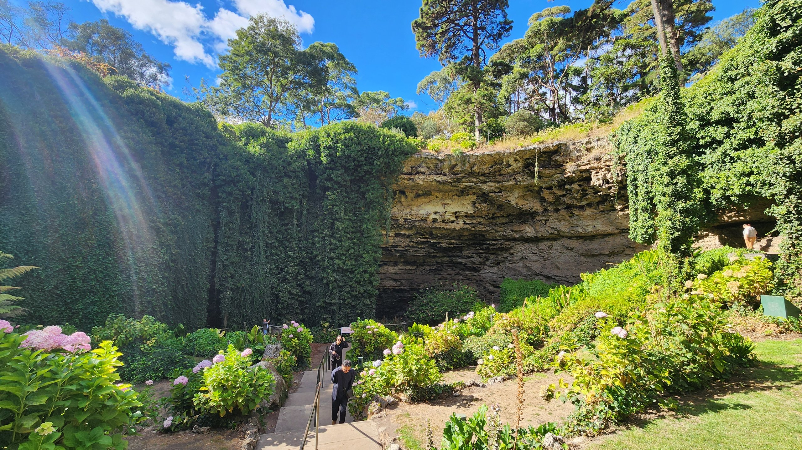
- 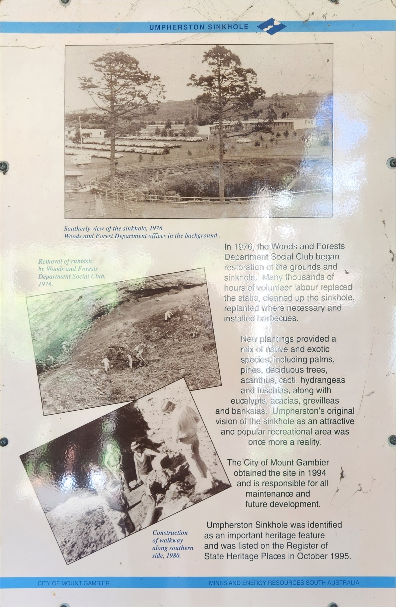
- 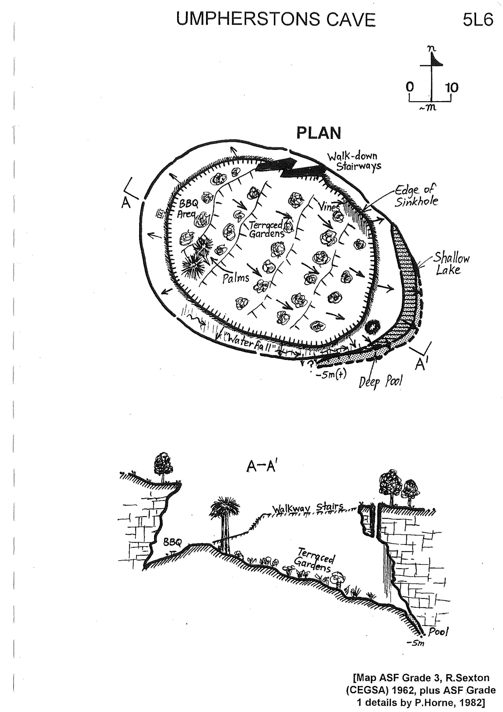
- 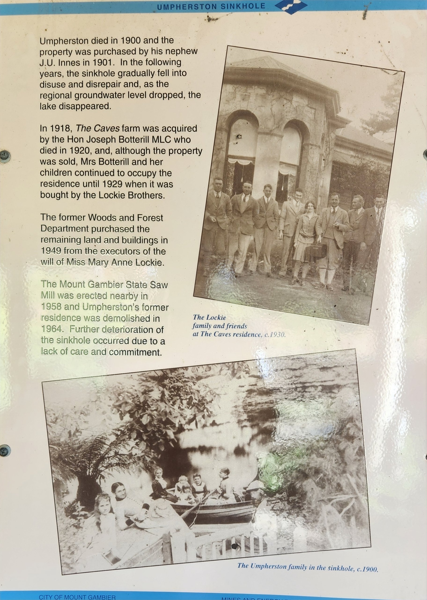
- 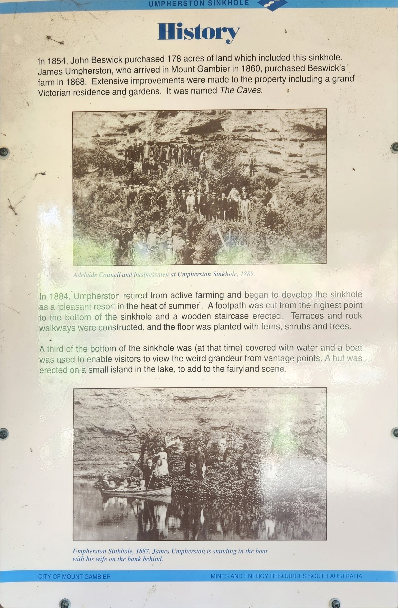
- 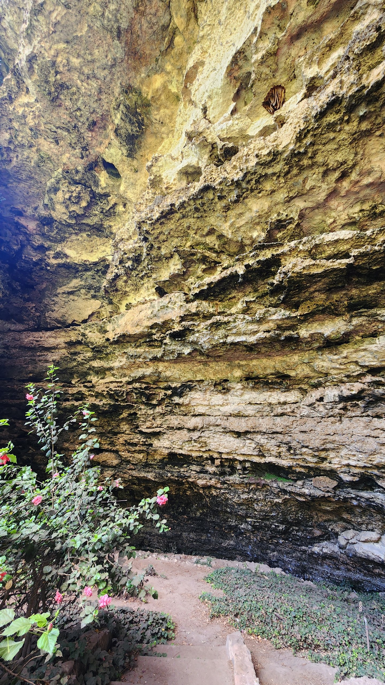
- 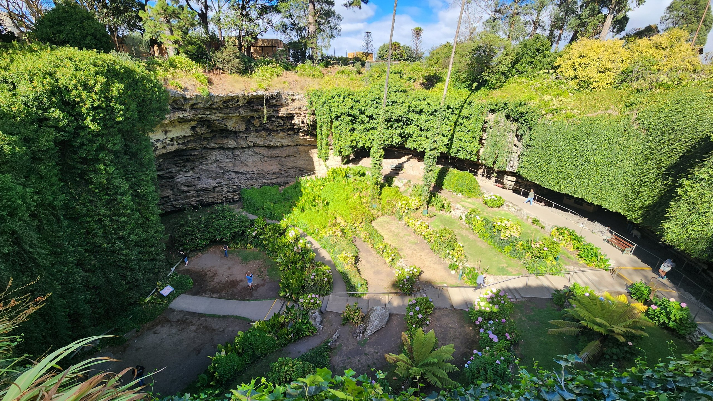
- 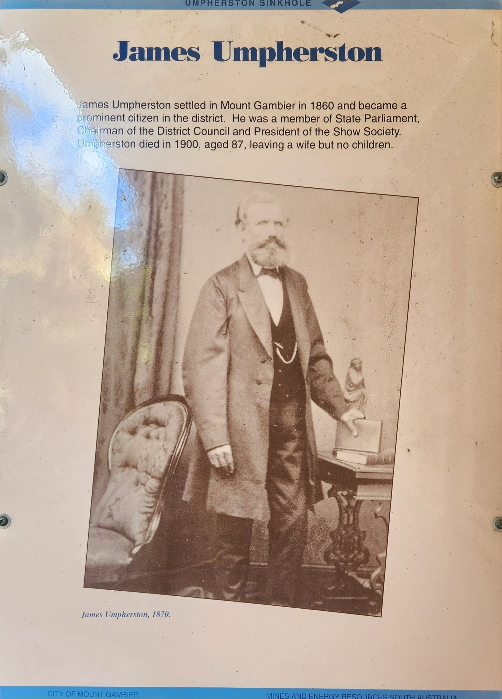
