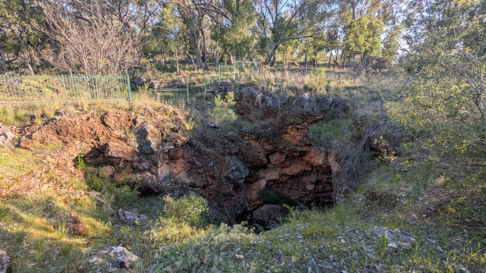
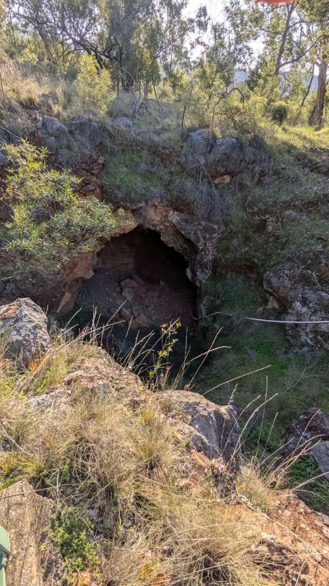

# Details

## Identification

- **Feature type:** Cave

## Cave and exploration data

- **Vertical access:** Yes
- **Tourism potential:** Medium

## Amenities

- **hasShowers:** No
- **hasToilets:** No
- **hasPhone:** Yes
- **family:** Bad
- **parking:** Ok

# References

## Images
- 
- 
